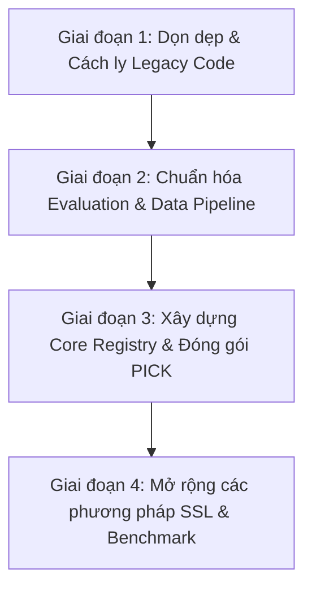

# TÀI LIỆU QUY HOẠCH VÀ THIẾT KẾ TÁI CẤU TRÚC TOÀN DIỆN MÃ NGUỒN
## ĐỊNH HƯỚNG MỞ RỘNG FRAMEWORK SEMI-SUPERVISED MEDICAL IMAGE SEGMENTATION (BHSD)

---

## 1. TỔNG QUAN VÀ MỤC TIÊU DỰ ÁN

### 1.1. Bối cảnh
Mã nguồn hiện tại được kế thừa từ bài báo nghiên cứu **PICK** (*Pseudo-label Informed CutMix / Context Masking Knowledge for Semi-supervised Medical Image Segmentation*) và đã được tinh chỉnh bước đầu để chạy trên tập dữ liệu **BHSD (Brain Hemorrhage Segmentation Dataset)** gồm ảnh chụp cắt lớp vi tính sọ não 3D (3D CT Scans).

### 1.2. Mục tiêu tái cấu trúc
1. **Thích ứng hoàn toàn với BHSD**:
   - Thống nhất cả 2 bài toán **Binary** (*Hemorrhage vs Background*) và **Multi-class 6 classes** (*Background, EDH, IPH, IVH, SAH, SDH*) trong cùng một codebase duy nhất.
2. **Khả năng mở rộng vượt trội (Extensibility)**:
   - Dễ dàng tích hợp thêm nhiều phương pháp Semi-Supervised Learning (SSL) khác: **Supervised Baseline**, **Mean Teacher (MT)**, **Uncertainty-Aware Mean Teacher (UA-MT)**, **Cross Pseudo Supervision (CPS)**, **Bidirectional Copy-Paste (BCP)**, **FixMatch-3D**, v.v.
   - Dễ dàng hoán đổi và benchmark các kiến trúc mạng (Backbones): **VNet**, **UNet3D**, **UNETR**, **SwinUNETR**, **MedNeXt**.
3. **Tính chuyên nghiệp & Chuẩn mực kỹ thuật (Clean Architecture)**:
   - Triệt tiêu hoàn toàn mã nguồn trùng lặp (DRY - Don't Repeat Yourself).
   - Tách bạch rõ ràng: `Data` ⟷ `Models` ⟷ `Methods (Algorithms)` ⟷ `Evaluation` ⟷ `Configs`.
   - Quản lý cấu hình tập trung qua file YAML (thay vì hơn 30 dòng argparse lặp lại).
   - Đồng nhất Engine suy luận trượt (Sliding-window 3D Inference) và hệ thống đo lường metrics (Single Source of Truth).
   - Loại bỏ toàn bộ mã rác, legacy code và lỗi import thừa.

---

## 2. ĐÁNH GIÁ VÀ PHÂN LOẠI CHI TIẾT TỪNG FILE HIỆN TẠI

### 2.1. Bảng kiểm kê mã nguồn (Code Audit Matrix)

| Đường dẫn file | Dòng | Trạng thái hiện tại | Đánh giá | Phương án xử lý |
| :--- | :---: | :--- | :--- | :--- |
| `BHSD_multiclass_PICK_train.py` | 743 | Huấn luyện PICK 6-class cho BHSD. Gồm pre-train, self-train, wandb, sliding-window validation. | **CẦN THIẾT NHƯNG MONOLITHIC** | Tách thuật toán PICK vào `methods/pick.py`. Dùng chung evaluation và dataloader. |
| `BHSD_binary_PICK_train.py` | 471 | Huấn luyện PICK nhị phân. | **DƯ THỪA / TRÙNG LẶP** | Gộp chung vào cùng pipeline với multiclass, điều khiển qua tham số `task: binary` / `task: multiclass`. |
| `LA_PICK_train.py`<br>`LT_PICK_train.py`<br>`PA_PICK_train.py` | ~500/file | Huấn luyện PICK trên Left Atrium, Lung Tumor, Pancreas từ repo gốc. Hardcode path `/data/...`, import lỗi (`turtle`). | **LEGACY / DEAD CODE** | Di chuyển vào thư mục `legacy/` để tham khảo khi cần hoặc xóa bỏ để làm sạch root. |
| `evaluate_5folds_benchmark.py` | 263 | Đánh giá OOF 5-fold cross validation, tính Dice từng lớp và so sánh với nnU-Net. | **RẤT CẦN THIẾT** | Giữ lại, chuẩn hóa để sử dụng chung inference engine và metrics module thống nhất. |
| `test_util.py` | 196 | Hàm tính metric (MedPy) và chạy sliding window test. | **TRÙNG LẶP** | Gộp và chuẩn hóa với `utils/test_3d_patch.py` thành `evaluation/sliding_window.py` và `evaluation/metrics.py`. |
| `pick_code.zip` | - | File zip backup cũ trong repo. | **FILE RÁC** | Xóa bỏ hoặc đưa vào `.gitignore`. |
| `dataloaders/dataset_bhsd.py` | 199 | DataLoader nạp file `.h5`, sinh mask MIM 3D, augmentations (Rot, Flip, Crop). | **CỰC KỲ QUAN TRỌNG** | Chuyển thành `data/dataset_bhsd.py`, bổ sung augmentations 3D chuyên sâu, tối ưu I/O. |
| `dataloaders/convert_option1_to_h5.py` | 184 | Tiền xử lý dữ liệu nnUNet (`.b2nd`, `.pkl`) sang `.h5` và chia 5-fold split. | **RẤT CẦN THIẾT** | Đưa vào thư mục `tools/convert_option1_to_h5.py`. |
| `dataloaders/dataset.py` | 393 | Chứa `TwoStreamBatchSampler` và các class dataset cũ của ACDC/LA. | **LAI TẠP** | Tách `TwoStreamBatchSampler` ra `data/samplers.py`, bỏ các class dataset cũ. |
| `dataloaders/dataset_lu.py`<br>`dataloaders/dataset_pa.py` | ~393/file | Bản copy của `dataset.py` cho Lung và Pancreas. | **100% DƯ THỪA** | Di chuyển vào `legacy/` hoặc xóa bỏ. |
| `dataloaders/acdc_data_processing.py`<br>`dataloaders/la_heart_processing.py`<br>`dataloaders/lung_tumor_processing.py`<br>`dataloaders/lung_split.py`<br>`dataloaders/io_.py` | - | Tiền xử lý các tập dữ liệu ACDC, LA, Lung. Đọc NIfTI/MHD cũ. | **KHÔNG CẦN THIẾT CHO BHSD** | Di chuyển vào `legacy/data_prep/`. |
| `networks/net_factory.py` | 21 | Hàm tạo model bằng câu lệnh `if-else` thô sơ, hardcode `.cuda()`. Chỉ hỗ trợ UNet và VNet. | **CẦN THAY THẾ TOÀN DIỆN** | Xây dựng Model Registry (`core/registry.py`) cho phép đăng ký mô hình linh hoạt. |
| `networks/VNet.py` | 365 | VNet 3D và `VNet_my` (1 Encoder + 3 Decoders: Main, MIM, Aux). Có code comment và override trùng tên. | **CẦN THIẾT NHƯNG BỊ RÀNG BUỘC** | Dọn dẹp code comment, tách kiến trúc thành Backbone VNet chuẩn và Multi-head Decoders cho PICK. |
| `networks/unet.py`<br>`networks/Unet3D.py`<br>`networks/unetr.py` | ~300/file | Kiến trúc mạng UNet, 3D UNet, Transformer UNETR. Hiện đang "nằm chết", chưa kết nối vào huấn luyện. | **RẤT GIÁ TRỊ ĐỂ MỞ RỘNG** | Chuẩn hóa interface để dùng làm Backbone cho mọi phương pháp SSL trong tương lai. |
| `networks/git_VNet.py` | 274 | Bản copy gốc của VNet. | **100% DƯ THỪA** | Xóa bỏ (trùng lặp với `VNet.py`). |
| `utils/losses.py` | 401 | Chứa `mask_DiceLoss`, SoftDice, CE kết hợp. | **CẦN THIẾT** | Chuẩn hóa các loss classes (DiceLoss, DiceCELoss, FocalLoss), dọn sạch warnings. |
| `utils/ramps.py` | 60 | Hàm sigmoid ramp-up tăng dần trọng số loss bán giám sát theo iteration/epoch. | **CẦN THIẾT** | Giữ nguyên trong `utils/ramps.py` (công cụ chuẩn cho SSL). |
| `utils/BCP_utils.py` | 151 | Cung cấp hàm sinh `context_mask`, `random_mask`, `mix_loss`. Có import lỗi (`turtle`). | **CẦN THIẾT CHO CUTMIX** | Làm sạch import, chuyển thành `data/masking.py` và `methods/ssl_utils.py`. |
| `utils/test_3d_patch.py` | 276 | Sliding window test 3D, hardcode path LA dataset. | **TRÙNG LẶP** | Hợp nhất vào module evaluation chuẩn. |
| `utils/metrics.py` | 50 | Đo Dice, HD95. | **CẦN THIẾT** | Mở rộng tính per-class Dice, mean Dice, HD95 cho cả binary và 6 classes. |
| `utils/feature_memory.py`<br>`utils/contrastive_losses.py`<br>`utils/val_2d.py` | - | Memory bank và loss tương phản từ project SemiSeg-Contrastive, validation 2D. | **GIỮ ĐỂ DÙNG SAU** | Chuyển vào `methods/contrastive/` để sẵn sàng cho phương pháp Contrastive SSL sau này. |
| `scripts/submit_multiclass_5folds.sh`<br>`scripts/submit_binary_5folds.sh` | - | Slurm array scripts chạy trên máy chủ GPU. | **RẤT TỐT** | Cập nhật lại đường dẫn lệnh gọi theo kiến trúc mới. |
| `scripts/kaggle_bhsd_pick_wandb_notebook.ipynb` | - | Notebook chạy thử nghiệm và theo dõi trên Kaggle/Colab. | **RẤT TỐT** | Giữ lại và cập nhật theo `train.py` mới. |

---

## 3. THIẾT KẾ KIẾN TRÚC MỤC TIÊU (PROPOSED ARCHITECTURE)

Khung làm việc được tái cấu trúc theo mô hình **MedSSL-Framework (Modular & Extensible Semi-Supervised Medical Segmentation)**:

```text
PICK/  (Framework MedSSL-BHSD)
│
├── configs/                                 # QUẢN TRỊ CẤU HÌNH TẬP TRUNG (YAML)
│   ├── base.yaml                            # Cấu hình phần cứng, seed, data path, 5-fold, wandb
│   ├── models/                              # Cấu hình chi tiết từng model
│   │   ├── vnet.yaml
│   │   ├── unet3d.yaml
│   │   └── unetr.yaml
│   └── methods/                             # Cấu hình thuật toán Semi-Supervised
│       ├── supervised.yaml                  # Baseline chỉ dùng nhãn (Lower bound)
│       ├── pick.yaml                        # Thuật toán PICK (CutMix + MIM + Aux)
│       ├── mean_teacher.yaml                # Thuật toán Mean Teacher (EMA Consistency)
│       ├── cps.yaml                         # Thuật toán Cross Pseudo Supervision
│       └── bcp.yaml                         # Thuật toán Bidirectional Copy-Paste
│
├── core/                                    # NỀN TẢNG ĐIỀU PHỐI (REGISTRY & CONFIG)
│   ├── __init__.py
│   ├── registry.py                          # Registry: @MODELS.register, @METHODS.register
│   └── config_parser.py                     # Parser đọc YAML + ghi đè qua CLI linh hoạt
│
├── data/                                    # DATA PIPELINE CHUYÊN BIỆT CHO BHSD
│   ├── __init__.py
│   ├── dataset_bhsd.py                      # BHSD Dataset (Xử lý chung cả Binary & 6-class)
│   ├── samplers.py                          # TwoStreamBatchSampler, BalancedBatchSampler
│   ├── transforms3d.py                      # Augmentation 3D: RotFlip, Crop, IntensityScale, Gaussian
│   └── masking.py                           # MIM Token Masking, Context Masking (CutMix)
│
├── models/                                  # BACKBONES VÀ MULTI-HEAD HEADS
│   ├── __init__.py
│   ├── backbones/                           # Encoder-Decoder trích xuất đặc trưng thuần túy
│   │   ├── vnet.py
│   │   ├── unet3d.py
│   │   └── unetr.py
│   ├── heads/                               # Các đầu ra chuyên dụng
│   │   ├── seg_head.py                      # Segmentation Head (chính)
│   │   ├── mim_head.py                      # Reconstruction Head (cho MIM trong PICK)
│   │   └── proj_head.py                     # Contrastive Projection Head
│   └── pick_model.py                        # Composite Model ghép Backbone + 3 Heads cho PICK
│
├── methods/                                 # CÁC THUẬT TOÁN HỌC BÁN GIÁM SÁT (SSL ENGINES)
│   ├── __init__.py
│   ├── base_method.py                       # Base Trainer: vòng lặp train, val, checkpoint, wandb
│   ├── supervised.py                        # Phương pháp Supervised Baseline
│   ├── pick.py                              # Phương pháp PICK (Pre-train & Self-train logic)
│   ├── mean_teacher.py                      # Phương pháp Mean Teacher
│   ├── cps.py                               # Phương pháp Cross Pseudo Supervision
│   └── bcp.py                               # Phương pháp BCP
│
├── evaluation/                              # BỘ SUY LUẬN & ĐÁNH GIÁ (SINGLE SOURCE OF TRUTH)
│   ├── __init__.py
│   ├── sliding_window.py                    # 3D Sliding-window inference tối ưu VRAM (hỗ trợ AMP FP16)
│   ├── metrics.py                           # Tính per-class Dice, Mean Dice, HD95, IoU, Sensitivity
│   └── benchmark.py                         # Tổng hợp kết quả 5-fold cross validation, OOF metrics
│
├── utils/                                   # CÁC HÀM TIỆN ÍCH DÙNG CHUNG
│   ├── __init__.py
│   ├── losses.py                            # Dice, Cross-Entropy, Focal, Tversky Loss
│   ├── ramps.py                             # Sigmoid rampup schedule
│   └── logger.py                            # Quản lý Rich console log, W&B, TensorBoard
│
├── tools/                                   # SCRIPTS TIỀN XỬ LÝ & TIỆN ÍCH
│   ├── convert_option1_to_h5.py             # Script chuyển đổi nnUNet sang H5
│   └── upload_dataset_to_kaggle.sh
│
├── train.py                                 # ĐIỂM CHẠY HUẤN LUYỆN DUY NHẤT
├── evaluate.py                              # ĐIỂM CHẠY KIỂM ĐỊNH BENCHMARK DUY NHẤT
└── legacy/                                  # LƯU TRỮ TOÀN BỘ CODE CŨ (LA, PA, LT, ACDC)
```

---

## 4. THIẾT KẾ CHI TIẾT CÁC MODULE CHỦ CHỐT

### 4.1. Hệ thống Registry (`core/registry.py`)
Mẫu thiết kế Registry giúp loại bỏ các chuỗi `if-else` thủ công. Bất kỳ khi nào viết thêm Model hay Method mới, chỉ cần dùng decorator:

```python
# Ví dụ về Registry Pattern
from core.registry import MODELS, METHODS

@MODELS.register("vnet")
class VNet(nn.Module):
    ...

@METHODS.register("pick")
class PICKMethod(BaseMethod):
    ...

@METHODS.register("mean_teacher")
class MeanTeacherMethod(BaseMethod):
    ...
```

Khởi tạo động trong `train.py`:
```python
model = MODELS.build(cfg.model.name, **cfg.model.args)
method = METHODS.build(cfg.method.name, model=model, cfg=cfg)
```

---

### 4.2. Base Method (`methods/base_method.py`)
Lớp trừu tượng định nghĩa khung làm việc chuẩn của một thuật toán SSL:

```python
class BaseMethod(abc.ABC):
    def __init__(self, model, cfg):
        self.model = model
        self.cfg = cfg
        self.setup_dataloaders()
        self.setup_optimizers()
        self.setup_logging()       # WandB + TensorBoard
        self.setup_checkpointing() # Auto-resume, save best/latest

    @abc.abstractmethod
    def train_step(self, labeled_batch, unlabeled_batch, iter_num):
        """Mỗi phương pháp SSL chỉ cần cài đặt logic tính loss ở đây"""
        pass

    def validate(self):
        """Dùng chung engine sliding-window inference cho tất cả các phương pháp"""
        return run_sliding_window_validation(self.model, self.val_loader, self.cfg)

    def train(self):
        """Vòng lặp huấn luyện chuẩn: gọi train_step, log metrics, lưu checkpoint định kỳ"""
        ...
```

---

### 4.3. Unified Sliding-Window Inference (`evaluation/sliding_window.py`)
Giải quyết triệt để vấn đề logic inference 3D bị copy ở 4 file khác nhau:
- Nhận diện kích thước ảnh bất kỳ, tự động padding đối xứng nếu kích thước nhỏ hơn `patch_size (32, 160, 160)`.
- Sliding-window với stride cấu hình (`stride_z=8`, `stride_xy=32`).
- Phân bổ bộ nhớ đệm xác suất (Probability Map) hiệu quả, hỗ trợ Automatic Mixed Precision (`torch.cuda.amp.autocast`) giúp tăng tốc độ validation gấp 2 lần và giảm VRAM.
- Trả về cả ma trận dự đoán (Prediction) và chỉ số Dice chi tiết cho từng lớp (*Background, EDH, IPH, IVH, SAH, SDH*).

---

### 4.4. Unified BHSD Data Pipeline (`data/dataset_bhsd.py`)
Một Dataset duy nhất xử lý cả 2 bài toán:
- Tham số `task='multiclass'` ➔ Giữ nguyên nhãn 0..5.
- Tham số `task='binary'` ➔ Tự động binarize `(label > 0).astype(np.uint8)` on-the-fly.
- Hỗ trợ load theo 5-fold cross validation (`fold=0..4`) trực tiếp từ cấu trúc file splits của BHSD.
- Sinh token mask cho Masked Image Modeling (MIM) và CutMix masking.

---

### 4.5. Quản lý cấu hình bằng YAML (`configs/`)
Ví dụ cấu hình thí nghiệm PICK (`configs/methods/pick.yaml`):

```yaml
experiment:
  name: "BHSD_multiclass_PICK_5folds"
  task: "multiclass"        # hoặc "binary"
  num_classes: 6            # 2 đối với binary
  fold: 0
  seed: 1337

data:
  root_path: "/home/u001015/notebook/preprocessed_bhsd_pick/"
  patch_size: [32, 160, 160]
  batch_size: 4
  labeled_bs: 2
  labelnum: 15
  max_samples: 2200

model:
  name: "vnet"
  in_channels: 1
  normalization: "batchnorm"

method:
  name: "pick"
  pre_max_iteration: 4000
  self_max_iteration: 12000
  base_lr: 0.01
  consistency: 1.0
  lambda_mim: 0.2
  mask_ratio: 0.6667

logging:
  use_wandb: true
  wandb_project: "PICK_BHSD"
  val_interval: 500
```

Chạy thí nghiệm cực kỳ đơn giản và sạch sẽ:
```bash
python train.py --config configs/methods/pick.yaml --fold 0
# Hoặc ghi đè tham số trực tiếp qua dòng lệnh:
python train.py --config configs/methods/pick.yaml --fold 1 --model.name unet3d
```

---

## 5. HƯỚNG DẪN MỞ RỘNG (HOW-TO EXTEND)

### 5.1. Thêm một phương pháp Semi-Supervised mới (Ví dụ: Mean Teacher)
Chỉ cần thực hiện đúng **2 bước đơn giản**:
1. Tạo file `methods/mean_teacher.py`:
   ```python
   from core.registry import METHODS
   from methods.base_method import BaseMethod

   @METHODS.register("mean_teacher")
   class MeanTeacherMethod(BaseMethod):
       def __init__(self, model, cfg):
           super().__init__(model, cfg)
           self.ema_model = self.create_ema_model()

       def train_step(self, labeled_batch, unlabeled_batch, iter_num):
           # 1. Forward model sinh viên (student)
           # 2. Forward model giáo viên (teacher EMA)
           # 3. Tính loss supervised + consistency loss giữa student & teacher
           # 4. Cập nhật trọng số student và cập nhật EMA teacher
           return total_loss, loss_dict
   ```
2. Tạo file cấu hình `configs/methods/mean_teacher.yaml`.
3. Chạy lệnh: `python train.py --config configs/methods/mean_teacher.yaml`.
*(Toàn bộ DataLoader, Validation, WandB, Checkpoint, OOF Benchmark đều tự động hoạt động!)*

---

### 5.2. Thêm một kiến trúc mạng mới (Ví dụ: UNet3D hoặc UNETR)
1. Thêm định nghĩa mạng trong `models/backbones/unet3d.py` và đăng ký `@MODELS.register("unet3d")`.
2. Trong file cấu hình đổi: `model.name: "unet3d"`.

---

## 6. LỘ TRÌNH THỰC HIỆN TỪNG BƯỚC (ROADMAP)



### Giai đoạn 1: Dọn dẹp & Cách ly an toàn (Zero Risk)
- [x] Tạo thư mục `legacy/` và di chuyển các file không thuộc BHSD: `LA_PICK_train.py`, `LT_PICK_train.py`, `PA_PICK_train.py`, `dataloaders/dataset_lu.py`, `dataloaders/dataset_pa.py`, `git_VNet.py`, các file processing của ACDC/Lung/LA.
- [x] Cách ly file `pick_code.zip` (đã đưa vào `.gitignore`).
- [x] Dọn dẹp các import lỗi (`from turtle import pd`, `from locale import normalize`).

### Giai đoạn 2: Chuẩn hóa Evaluation & Data Pipeline
- [x] Xây dựng `evaluation/sliding_window.py` (chuẩn hóa inference 3D sliding window với AMP FP16).
- [x] Xây dựng `evaluation/metrics.py` (tính per-class Dice, mean Dice, HD95).
- [x] Cập nhật `evaluate_5folds_benchmark.py` để sử dụng module mới, kiểm chứng kết quả chạy thử nghiệm.
- [x] Tách `dataloaders/dataset_bhsd.py` thành `data/dataset_bhsd.py`, `data/samplers.py`, `data/transforms3d.py`, và `data/masking.py`.

### Giai đoạn 3: Xây dựng Core Framework & Đóng gói PICK
- [x] Xây dựng `core/registry.py` và `core/config_parser.py` (hỗ trợ đọc YAML và alias thông minh cho CLI).
- [x] Xây dựng `methods/base_method.py` quản lý huấn luyện, logging (W&B, TensorBoard), checkpointing và resume.
- [x] Chuyển mã huấn luyện PICK từ `BHSD_multiclass_PICK_train.py` sang `methods/pick.py`.
- [x] Tạo `train.py` dùng chung và các file cấu hình mẫu trong `configs/`.
- [x] Tạo các wrapper adapter đảm bảo tính tương thích ngược 100% với các lệnh gọi cũ.

### Giai đoạn 4: Mở rộng các phương pháp SSL mới & Hoàn thiện Benchmark
- [x] Thêm phương pháp `methods/supervised.py` (Baseline có giám sát đối chứng).
- [x] Thêm phương pháp `methods/mean_teacher.py` (Mean Teacher cho 3D CT).
- [x] Thêm phương pháp `methods/cps.py` (Cross Pseudo Supervision).
- [x] Thêm phương pháp `methods/bcp.py` (Bidirectional Copy-Paste).
- [x] Nối mạng `VNet`, `UNet3D` và `UNETR` vào Model Registry (`core/registry.py`).
- [x] Tạo `evaluate.py` làm điểm chạy benchmark thống nhất 5 folds và đánh giá từng ca đơn lẻ.
