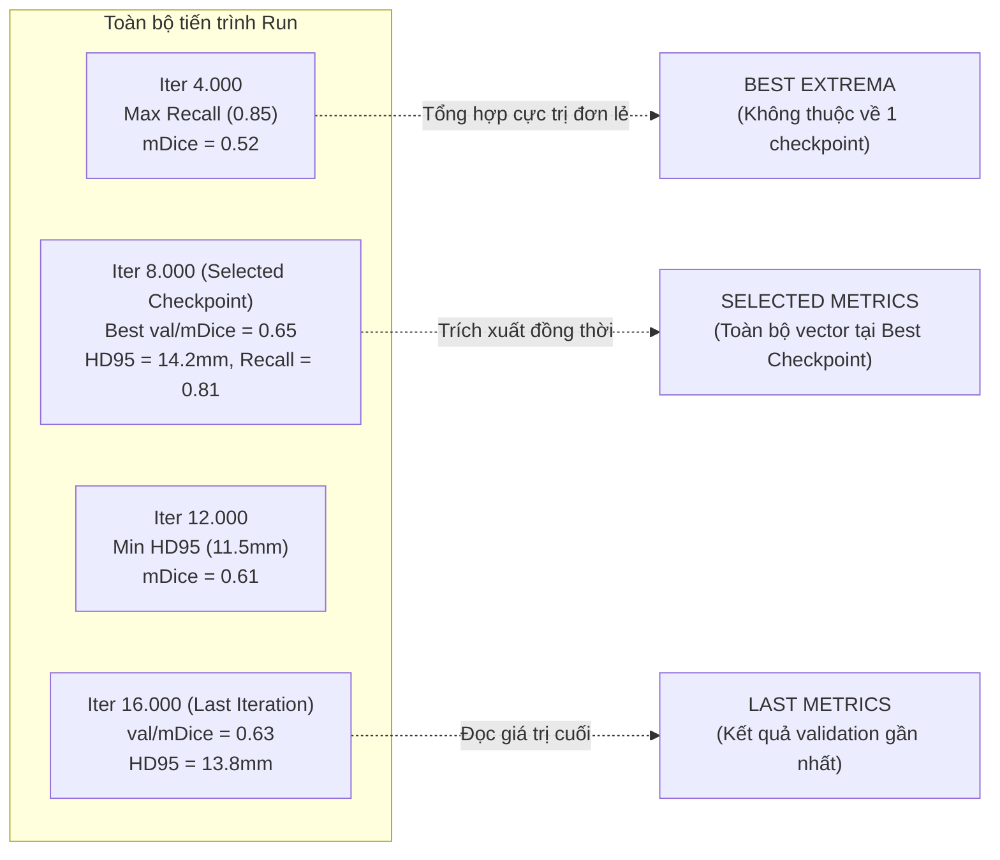
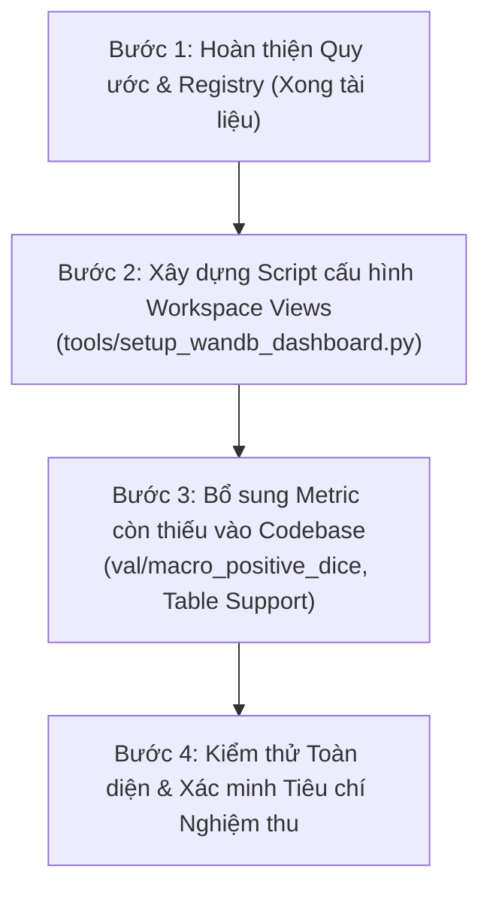

# Quy chuẩn Metric Logging và Kiến trúc Dashboard Weights & Biases (W&B)

Tài liệu này xác lập quy chuẩn thu thập metric, phân định ý nghĩa thống kê và kiến trúc bảng điều khiển (Workspace Dashboard) trên W&B Cloud cho dự án **MedSSL-BHSD**. 

Tài liệu được xây dựng nhằm giải quyết tình trạng quá tải biểu đồ, đồng thời bảo đảm tính toàn vẹn dữ liệu, khả năng truy hồi lịch sử và tương thích hoàn toàn giữa các tác vụ phân đoạn y tế (cả Binary và Multiclass).

---

## 1. Hiện trạng Metric Logging và Giới hạn Kỹ thuật

### 1.1. Bản chất cơ chế hiển thị trên W&B App
- **Cơ chế Panel:** Trên W&B App, mỗi khóa (scalar key) mới được gửi qua `wandb.log()` mặc định sẽ tự động sinh một đồ thị dạng đường (Line plot) trên Default Workspace nếu workspace đó chưa được cố định cấu hình panel.
- **Cơ chế Grouping:** W&B hỗ trợ cấu hình nhóm theo tiền tố (First segment trước dấu `/` hoặc toàn bộ các tầng prefix). Việc đặt tên phân cấp giúp tổ chức Section, nhưng **không tự động làm giảm số lượng panel hay tự động gom các đường vào cùng một đồ thị**.
- **Ý nghĩa của `hidden=True`:** Khi đăng ký qua `wandb.define_metric(key, hidden=True)`, W&B sẽ không tự động tạo biểu đồ cho key đó trong các workspace sinh tự động của các run mới. Thuộc tính này **không xóa hay dọn các panel đã tồn tại** trong các Workspace View đã được lưu từ trước.

### 1.2. Thống kê tải lượng Metric trong Codebase Hiện hành
Trong các vòng lặp huấn luyện và đánh giá ([methods/base_method.py](../methods/base_method.py)), số lượng metric và media được phát sinh theo từng điều kiện:

#### A. Training Phase (mỗi `log_interval` bước):
Được gửi tại [methods/base_method.py](../methods/base_method.py#L766-L774):
- Mất mát: `train/total`, `train/supervised` (hoặc `train/supervised_main`), `train/deep_supervision`, `train/consistency`.
- Tối ưu hóa: `train/weight` (ramp-up weight), `train/lr`.
- Trục điều khiển: `global_step` (trục bước huấn luyện thống nhất), `phase`, `train/iter`.

#### B. Validation Phase (mỗi `val_interval` bước):
Được gửi tại [methods/base_method.py](../methods/base_method.py#L624-L649):
1. **Summary tổng quát:** `val/mDice`, `val/best_mDice`, `{phase}/val_mDice` (lưu ý: `{phase}/val_mDice` thuộc namespace của phase huấn luyện tương ứng).
2. **Per-class basic Dice:** `val/dice_{class}` cho từng lớp foreground.
3. **Per-class chi tiết từ [`aggregate_segmentation_stats`](../evaluation/metrics.py#L177):**
   Với mỗi lớp foreground, hệ thống tính toán:
   - `val/{class}_dice_case_mean` *(trùng lặp giá trị số với `val/dice_{class}`)*.
   - `val/{class}_dice_positive_mean` *(Dice chỉ tính trên các ca có tổn thương)*.
   - Các chỉ số bề mặt có điều kiện: `val/{class}_hd95_mm_mean`, `val/{class}_asd_mm_mean`, `val/{class}_surface_valid_pairs`.
   - Các thống kê phân bố ca: `val/{class}_positive_cases`, `val/{class}_negative_cases`.
   - Các chỉ số báo động giả trên ca âm tính: `val/{class}_negative_fp_case_rate`, `val/{class}_negative_fp_ml_mean`, `val/{class}_negative_fp_voxels_mean`.
   - Các chỉ số mức voxel: `val/{class}_precision_micro`, `val/{class}_recall_micro`, `val/{class}_tp_voxels`, `val/{class}_fp_voxels`, `val/{class}_fn_voxels`.
4. **Visual Sample Artifact:** `val/predictions` (ảnh composite 4 panel, chỉ log khi đến lịch trực quan hóa).

> [!NOTE]
> Con số ~84 mục dữ liệu là **tải lượng tối đa theo lý thuyết** cho bài toán 5 lớp xuất huyết. Trong thực tế, các giá trị không hợp lệ (`None`) bị thư viện bỏ qua, các chỉ số bề mặt phụ thuộc vào việc có cặp hợp lệ hay không, và media trực quan chỉ xuất hiện theo chu kỳ cấu hình.

---

## 2. Chiến lược Quản lý Workspace và Phân chia Views

Thay vì vội vàng sửa đổi hàng loạt tên metric trong mã nguồn (gây nguy cơ mất liên kết với các run lịch sử), **giải pháp trọng tâm là xây dựng và cố định các Workspace Views có cấu hình rõ ràng**, tắt chế độ tự động sinh panel tự do.

Toàn bộ ~80 metrics trong cơ sở dữ liệu W&B tiếp tục được duy trì để phục vụ phân tích chuyên sâu, nhưng được phân bổ vào **3 Workspace Views** chuyên biệt:

```
W&B Project Dashboard
├── 1. View: "Overview" (Mặc định - 7 đến 9 Panels trọng yếu)
│   ├── Panel 1: Validation mDice (Đường mDice hiện tại + best_mDice trên cùng đồ thị)
│   ├── Panel 2: Macro Positive Dice (Đánh giá trên ca thực sự có bệnh)
│   ├── Panel 3: Per-class Dice (Tất cả các lớp trên 1 biểu đồ Multi-line)
│   ├── Panel 4: Per-class Positive Dice (Tất cả các lớp trên 1 biểu đồ Multi-line)
│   ├── Panel 5: Training Losses (Total, Supervised, Deep Supervision, Consistency)
│   ├── Panel 6: Learning Rate (Tách riêng do thang đo log/nhỏ)
│   └── Panel 7: Consistency Ramp-up Weight (Tách riêng do thang đo 0..max_weight)
│
├── 2. View: "Evaluation" (Đánh giá Hình học & Lâm sàng - Mở khi nghiệm thu checkpoint)
│   ├── Multi-line HD95 per class (95th percentile Hausdorff Distance - mm)
│   ├── Multi-line ASD per class (Average Surface Distance - mm)
│   ├── Negative False Positive Case Rate & FP Volume (ml) per class
│   ├── Micro Precision & Recall per class
│   ├── Artifact Panel: Visual Predictions Gallery (CT | GT | Pred | Error map)
│   └── Table: Per-class Evaluation Summary (Bảng tổng hợp kèm Support Counts)
│
└── 3. View: "Diagnostics" (Tra cứu Nội bộ & Gỡ lỗi)
    ├── Voxel Volumes: TP, FP, FN voxels per class
    ├── Cohort Counts: positive_cases, negative_cases, surface_valid_pairs
    ├── Memory & System Metrics: GPU memory footprint, step duration
    └── Bảng chi tiết Diagnostic Snapshot theo từng Validation Step
```

### 2.1. Quy tắc hiển thị trong từng View
1. **Tách biệt thang đo (Scale separation):** Tuyệt đối không vẽ chung `train/lr` ($10^{-4}$) hoặc `train/weight` ($0..10$) vào cùng biểu đồ với `train/total` loss ($0.1..2.0$) vì sẽ làm bẹp các đường biểu diễn nhỏ.
2. **Nhất quán bảng màu theo lớp (Consistent Color Mapping):** Màu của từng lớp (Epidural, Intraparenchymal, Intraventricular, Subarachnoid, Subdural) phải đồng nhất trên tất cả các đồ thị Per-class Dice, Positive Dice, HD95 và ASD.
3. **Tránh quá tải khi so sánh nhiều Run (Multi-run Comparison):** Trên các đồ thị Per-class đa đường, việc so sánh cùng lúc 5 lớp $\times$ nhiều run sẽ tạo ra hàng chục đường chồng chéo. Khi so sánh nhiều run, Workspace cần cấu hình bộ lọc (run filter/regex) hoặc chuyển sang đồ thị so sánh theo từng lớp đơn lẻ.

---

## 3. Bản chất Thống kê: Phân định Last, Best và Selected Metrics

Để tránh nhầm lẫn khi tổng hợp kết quả (đặc biệt trong các công cụ như [`tools/compare_runs.py`](../tools/compare_runs.py)), dự án quy định rạch ròi 3 khái niệm:



1. **`last` (Metric cuối cùng):**
   - Giá trị đạt được tại bước validation cuối cùng của run hoặc phase.
   - Thể hiện trạng thái kết thúc huấn luyện (phát hiện hiện tượng overfitting hoặc suy thoái muộn).
2. **`best` (Cực trị đơn lẻ - Metric Extrema):**
   - Cực trị cao nhất (max Dice) hoặc thấp nhất (min Loss, min HD95) của từng metric độc lập trong toàn bộ run.
   - **Cảnh báo khoa học:** Không bao giờ được kết hợp max Dice tại bước 8.000, min HD95 tại bước 12.000 và max Recall tại bước 4.000 để báo cáo như "năng lực của mô hình". Đó là các trạng thái ở các thời điểm hoàn toàn khác nhau.
3. **`selected` (Toàn bộ metric tại Checkpoint được lựa chọn):**
   - Bộ vector đầy đủ tất cả các chỉ số (mDice, positive Dice, HD95, ASD, Precision, Recall, FP rate) **được trích xuất tại đúng checkpoint tốt nhất** (dựa trên chính sách chọn checkpoint, hiện tại là `val/mDice` cao nhất).
   - Đây là bộ giá trị duy nhất có giá trị công bố học thuật và đánh giá lâm sàng.

### 3.1. Làm rõ hành vi W&B `run.summary` và `define_metric`
- Hiện tại, [`utils/wandb_manager.py`](../utils/wandb_manager.py#L80) đã đăng ký:
  ```python
  self.run.define_metric('val/mDice', step_metric='global_step', summary='max')
  ```
- Do cấu hình `summary='max'`, thuộc tính `run.summary['val/mDice']` trên W&B API sẽ lưu **giá trị cực đại (best)** của `val/mDice`, chứ **không phải giá trị ở bước cuối cùng (last)**.
- Các script đọc dữ liệu như [`tools/compare_runs.py`](../tools/compare_runs.py) cần phân biệt rõ khi in thông tin:
  - Trường in nhãn "Final mDice" thực chất đang nhận giá trị aggregate `summary='max'`. Cần đọc từ `history` nếu muốn lấy giá trị `last` thực sự.
- **Phạm vi của `best_mDice`:** Trong [`methods/base_method.py`](../methods/base_method.py#L696), khi bắt đầu một phase huấn luyện mới (ví dụ từ `pre_train` sang `self_train`), biến `self.best_dice` được khởi tạo lại về `0.0`. Do đó `best_mDice` được ghi nhận theo **từng phase**, không tự động kế thừa kỷ lục từ phase trước.

---

## 4. Chính sách Xử lý Dữ liệu Thiếu và Mẫu số Đánh giá

### 4.1. Nguyên tắc đối với giá trị không xác định (`None`)
- **Không bao giờ gán `0.0` cho giá trị thiếu:** 
  - Nếu một lớp không có ca dương tính nào trong tập validation, positive Dice là không xác định (`None`). Gán bằng `0` sẽ kéo tụt trung bình sai lệch nghiêm trọng.
  - Nếu mô hình dự đoán rỗng trên ca có tổn thương hoặc nhãn GT rỗng, khoảng cách bề mặt không tính được (`None`). Gán bằng một số phạt nhân tạo sẽ làm sai lệch phân bố hình học.
  - Các giá trị `None` phải được giữ nguyên dạng `None` trong JSON/W&B payload.

### 4.2. Mẫu số động của Macro Positive Dice
- Chỉ số `macro_positive_dice` (tính trong [`evaluation/metrics.py#L216`](../evaluation/metrics.py#L216)) được tính bằng trung bình cộng positive Dice của các lớp thỏa mãn điều kiện có ca dương tính (`positive_cases > 0`).
- Mẫu số đánh giá **không cố định luôn bằng số lớp foreground** mà phụ thuộc vào `eligible_positive_classes`.
- Bảng báo cáo trên W&B bắt buộc phải hiển thị kèm danh sách `eligible_positive_classes` và `positive_support` để bảo đảm tính minh bạch về kích thước mẫu.

### 4.3. Cảnh báo "Nghịch lý Khoảng cách Bề mặt" (HD95 / ASD Paradox)
- Chỉ số khoảng cách bề mặt `hd95_mm_mean` và `asd_mm_mean` chỉ được tổng hợp trên tập hợp các ca hợp lệ (`surface_valid_pairs`).
- Khi mô hình dự đoán kém đi và liên tục dự đoán rỗng trên các ca khó, các ca này bị loại khỏi tập tính khoảng cách bề mặt. Điều này có thể dẫn tới hiện tượng **HD95 trung bình giảm xuống (trông có vẻ tốt hơn) nhưng thực tế số cặp hợp lệ `surface_valid_pairs` cũng bị sụt giảm nghiêm trọng**.
- **Chính sách:** Không kết luận mô hình cải thiện ranh giới nếu `surface_valid_pairs` bị giảm sút. Mọi biểu đồ HD95/ASD phải được đối chiếu cùng số lượng cặp hợp lệ.

---

## 5. Metric Registry (Bảng Tra cứu Chỉ số Toàn diện)

Hệ thống hỗ trợ linh hoạt cả cấu hình **Binary** (1 lớp tổn thương) lẫn **Multiclass** (nhiều lớp tổn thương), danh sách tên lớp được nạp động từ cấu hình dataset metadata thay vì cố định 5 lớp.

| Metric Key | Nhóm / View | Đơn vị | Chiều tối ưu | Điều kiện tính hợp lệ | Summary Policy | Ý nghĩa Phân tích |
| :--- | :--- | :---: | :---: | :--- | :---: | :--- |
| `val/mDice` | Overview | 0..1 | Max $\uparrow$ | Toàn bộ ca val | `max` | Macro Mean Dice theo quy ước legacy |
| `val/macro_positive_dice` | Overview | 0..1 | Max $\uparrow$ | Ít nhất 1 lớp có $GT > 0$ | `max` | Macro Dice chỉ trên các ca thực sự có bệnh |
| `val/best_mDice` | Overview | 0..1 | Max $\uparrow$ | Theo phase hiện tại | `last` | Kỷ lục mDice của phase đang chạy |
| `val/dice_{class}` | Overview | 0..1 | Max $\uparrow$ | Toàn bộ ca val | `max` | Dice trung bình của từng lớp tổn thương |
| `val/{class}_dice_positive_mean` | Overview | 0..1 | Max $\uparrow$ | Lớp có $GT > 0$ | `max` | Positive Dice của từng lớp |
| `train/total` | Overview | scalar | Min $\downarrow$ | Mỗi training step | `min` | Tổng loss tối ưu |
| `train/supervised` | Overview | scalar | Min $\downarrow$ | Mỗi training step | `min` | Segmentation loss có giám sát |
| `train/consistency` | Overview | scalar | Min $\downarrow$ | Khi bật SSL | `min` | Semi-supervised consistency loss |
| `train/lr` | Overview | scalar | - | Mỗi training step | `last` | Learning rate tại thời điểm huấn luyện |
| `train/weight` | Overview | scalar | - | Khi bật ramp-up | `last` | Trọng số consistency loss |
| `val/{class}_hd95_mm_mean` | Evaluation | mm | Min $\downarrow$ | Cả Pred & GT không rỗng | `min` | 95th Hausdorff Distance |
| `val/{class}_asd_mm_mean` | Evaluation | mm | Min $\downarrow$ | Cả Pred & GT không rỗng | `min` | Average Surface Distance |
| `val/{class}_negative_fp_case_rate` | Evaluation | 0..1 | Min $\downarrow$ | Có ca $GT = 0$ | `min` | Tỷ lệ ca âm tính bị dự đoán nhầm |
| `val/{class}_negative_fp_ml_mean` | Evaluation | ml | Min $\downarrow$ | Có ca $GT = 0$ | `min` | Thể tích báo nhầm trung bình trên ca âm tính |
| `val/{class}_precision_micro` | Evaluation | 0..1 | Max $\uparrow$ | $TP + FP > 0$ | `max` | Voxel precision của lớp |
| `val/{class}_recall_micro` | Evaluation | 0..1 | Max $\uparrow$ | $TP + FN > 0$ | `max` | Voxel recall của lớp |
| `val/predictions` | Evaluation | media | - | Theo `val_visual_interval`| - | Ảnh composite trực quan (CT, GT, Pred, Error) |
| `val/evaluation_table` | Evaluation | table | - | Mỗi kỳ validation | `last` | Bảng tổng kết đa lớp kèm support counts |
| `val/{class}_tp_voxels` | Diagnostics | count | - | Không lọc | `last` | Tổng số voxel True Positive |
| `val/{class}_fp_voxels` | Diagnostics | count | - | Không lọc | `last` | Tổng số voxel False Positive |
| `val/{class}_fn_voxels` | Diagnostics | count | - | Không lọc | `last` | Tổng số voxel False Negative |
| `val/{class}_positive_cases` | Diagnostics | count | - | Không lọc | `last` | Số ca dương tính thực tế trong tập val |
| `val/{class}_negative_cases` | Diagnostics | count | - | Không lọc | `last` | Số ca âm tính thực tế trong tập val |
| `val/{class}_surface_valid_pairs` | Diagnostics | count | - | Cả Pred & GT không rỗng | `last` | Số cặp tính được khoảng cách bề mặt |

---

## 6. Chính sách Tương thích Ngược (Backward Compatibility)

Để bảo đảm tất cả các công cụ phân tích hiện hữu không bị gián đoạn, dự án thiết lập quy tắc tương thích nghiêm ngặt:

1. **Giữ nguyên toàn bộ Backend Logging:**
   - Tiếp tục ghi nhận các khóa: `val/mDice`, `val/best_mDice`, `val/dice_{class}` và `val/{class}_dice_case_mean`.
   - Các công cụ như [`tools/compare_runs.py`](../tools/compare_runs.py), [`tools/fetch_latest_run.py`](../tools/fetch_latest_run.py), [`tools/fetch_wandb.py`](../tools/fetch_wandb.py), [`tools/analyze_run_9tvq8qld.py`](../tools/analyze_run_9tvq8qld.py) tiếp tục hoạt động bình thường trên cả run cũ lẫn run mới.
2. **Không xóa dữ liệu trùng ở tầng log:**
   - Việc trùng lặp giữa `val/dice_{class}` và `val/{class}_dice_case_mean` được giải quyết ở tầng hiển thị: **chỉ đưa 1 đại diện vào Workspace View**, không tạo panel cho key còn lại.
   - Nếu thực hiện chuẩn hóa schema trong tương lai, phải tuân thủ quy trình 3 bước:
     * Bước 1: Thiết lập cơ chế alias/bảng ánh xạ trong reader.
     * Bước 2: Cập nhật reader hỗ trợ đọc song song cả 2 định dạng (fallback).
     * Bước 3: Thông báo lịch trình deprecation rõ ràng trước khi dừng ghi alias cũ.

---

## 7. Quy tắc Quản lý Dashboard và Tự động hóa qua Code

Nhằm duy trì dashboard ổn định lâu dài và dễ dàng tái tạo khi thay đổi môi trường hoặc tài khoản, dự án xây dựng script cấu hình bảng điều khiển: [`tools/setup_wandb_dashboard.py`](../tools/setup_wandb_dashboard.py).

### 7.1. Nguyên tắc thiết kế của Dashboard Automation Tool
- **Template lưu trong mã nguồn:** Cấu trúc định nghĩa layout (danh sách panel, màu sắc, vị trí) được lưu trữ dạng mã nguồn Python/JSON trong thư mục `tools/` của repository, chịu sự quản lý phiên bản của Git.
- **Hỗ trợ `--dry-run`:** Cho phép in cấu trúc layout kiểm tra cục bộ trước khi gửi lệnh gọi API tới W&B Cloud.
- **Tham số linh hoạt:** Nhận diện `--entity`, `--project`, `--view-name`.
- **Cập nhật lũy tiến (Idempotent):** Script truy vấn theo View ID / View Name. Nếu View đã tồn tại, script thực hiện cập nhật (update); nếu chưa, script tạo mới (create). Chạy script nhiều lần **tuyệt đối không tạo ra các panel nhân đôi hay duplicate view**.
- **Phân biệt rạch ròi giữa "Create Saved View" và "Set as Default":**
  - Script tạo ra các Saved Views (`Overview`, `Evaluation`, `Diagnostics`).
  - Việc đặt một View làm Default cho toàn Project phụ thuộc vào quyền hạn tài khoản (Admin/Owner của W&B Project). Script sẽ cố gắng kích hoạt nếu đủ quyền, hoặc in hướng dẫn một cú click trên UI nếu bị giới hạn quyền API.

---

## 8. Kế hoạch Triển khai theo Thứ tự Ưu tiên

Thay vì sửa đổi ồ ạt làm tăng chi phí bảo trì và rủi ro gián đoạn, thứ tự thực thi được chuẩn hóa như sau:



### Bước 1: Chuẩn hóa Quy ước và Định nghĩa (Đã hoàn thành)
- Hoàn thiện tài liệu quy chuẩn tại tài liệu này.

### Bước 2: Xây dựng Script Workspace trên các Key Hiện hành
- Cài đặt và cố định phiên bản thư viện `wandb-workspaces` (hoặc sử dụng W&B Public API hiện hành).
- Xây dựng [`tools/setup_wandb_dashboard.py`](../tools/setup_wandb_dashboard.py) tạo ra 3 views: `Overview`, `Evaluation`, `Diagnostics` trên tập metric hiện có.
- **Kết quả:** Ngay lập tức giải quyết tình trạng lộn xộn trên W&B Cloud cho **cả các run cũ (như `9tvq8qld`)** mà không cần sửa đổi bất kỳ dòng code training nào.

### Bước 3: Bổ sung Metric Thiếu và Bảng Đánh giá
- Trong [`methods/base_method.py`](../methods/base_method.py):
  - Bổ sung ghi nhận `val/macro_positive_dice = details.get('macro_positive_dice')`.
  - Tạo bảng `wandb.Table` tổng hợp per-class metrics và log vào `val/evaluation_table` mỗi kỳ validation.
- Trong [`utils/wandb_manager.py`](../utils/wandb_manager.py):
  - Bổ sung `define_metric` cho `val/macro_positive_dice` với `summary="max"`.
  - Đăng ký `hidden=True` cho các chỉ số thống kê thô để ngăn tự sinh panel rác trên các view tự do.

### Bước 4: Kiểm thử và Tiêu chuẩn Nghiệm thu (Acceptance Criteria)
Một giải pháp được nghiệm thu khi vượt qua đầy đủ các kiểm tra sau:
1. **Run cũ xem được trọn vẹn:** Các run lịch sử mở trên view `Overview` hiển thị đúng 7–9 biểu đồ trọng yếu, không bị lỗi thiếu dữ liệu.
2. **Không tự sinh panel tràn lan:** Chạy một thử nghiệm mới, view `Overview` không bị chèn thêm hàng chục panel lạ.
3. **Tính Idempotent của Script:** Chạy `python tools/setup_wandb_dashboard.py` hai lần liên tiếp không làm nhân đôi số lượng biểu đồ hay làm vỡ layout.
4. **Độ tương thích của Reader:** [`tools/compare_runs.py`](../tools/compare_runs.py) và [`tools/fetch_wandb.py`](../tools/fetch_wandb.py) đọc đúng các trường summary mà không gặp lỗi parse hay crash.
5. **Khả năng chịu lỗi môi trường:** Hệ thống hoạt động an toàn khi gặp giá trị `None`, khi chuyển phase huấn luyện, khi resume checkpoint, hoặc khi W&B chạy ở chế độ `offline` / `disabled`.
