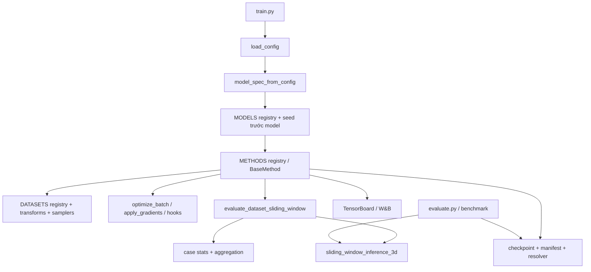

> **Hồ sơ lịch sử:** giữ nguyên phát hiện, số liệu và kết quả kiểm tra tại thời điểm báo cáo; không dùng các mô tả “hiện tại” dưới đây làm trạng thái checkout mới. Xem [chỉ mục tài liệu](../../README.md) để tìm hướng dẫn hiện hành.

# BÁO CÁO RÀ SOÁT MÃ NGUỒN VÀ KẾ HOẠCH REFACTOR BHSD_SSL

**Snapshot audit ban đầu:** 27/10/2026, source `8d750d7`; 71 tests, 70 passed và 1 skipped. Các mục 1–16 bên dưới giữ phân tích/kế hoạch của snapshot này.

**Rà soát triển khai mới nhất:** HEAD `b6d4e90` cộng staged/unstaged changes và file mới trong workspace; **89 tests, 88 passed, 1 skipped**, 6.268 giây với Gloo loopback.

**Kết luận hiện tại:** triển khai mới đạt một phần, **chưa đủ điều kiện nghiệm thu**. Xem [báo cáo kiểm tra triển khai và các lỗi tái hiện](implementation-review-2026-10-27.md) để biết trạng thái hiện hành; không dùng các mô tả “hiện tại” trong snapshot cũ như trạng thái mã nguồn sau refactor.

## Mục lục

1. [Kết luận và hiệu chỉnh báo cáo ban đầu](#1-kết-luận-và-hiệu-chỉnh-báo-cáo-ban-đầu)
2. [Phạm vi, phương pháp và giới hạn kiểm chứng](#2-phạm-vi-phương-pháp-và-giới-hạn-kiểm-chứng)
3. [Kiến trúc và luồng thực thi hiện tại](#3-kiến-trúc-và-luồng-thực-thi-hiện-tại)
4. [Tổ chức repository](#4-tổ-chức-repository)
5. [Danh sách phát hiện và mức ưu tiên](#5-danh-sách-phát-hiện-và-mức-ưu-tiên)
6. [Cấu hình và khả năng tái lập](#6-cấu-hình-và-khả-năng-tái-lập)
7. [Dữ liệu và tính đúng đắn nghiên cứu](#7-dữ-liệu-và-tính-đúng-đắn-nghiên-cứu)
8. [Model, loss và giao diện phương pháp](#8-model-loss-và-giao-diện-phương-pháp)
9. [AMP, DDP và vòng đời huấn luyện](#9-amp-ddp-và-vòng-đời-huấn-luyện)
10. [Metrics, checkpoint và benchmark](#10-metrics-checkpoint-và-benchmark)
11. [Bảo mật, Kaggle và W&B](#11-bảo-mật-kaggle-và-wb)
12. [Kiến trúc mục tiêu và quyết định thiết kế](#12-kiến-trúc-mục-tiêu-và-quyết-định-thiết-kế)
13. [Lộ trình triển khai theo giai đoạn](#13-lộ-trình-triển-khai-theo-giai-đoạn)
14. [Bảng công việc theo module](#14-bảng-công-việc-theo-module)
15. [Kiểm thử và tiêu chí nghiệm thu](#15-kiểm-thử-và-tiêu-chí-nghiệm-thu)
16. [Thứ tự thực hiện và điều kiện sẵn sàng mở rộng](#16-thứ-tự-thực-hiện-và-điều-kiện-sẵn-sàng-mở-rộng)

## 1. Kết luận và hiệu chỉnh báo cáo ban đầu

Báo cáo ban đầu **đúng về hướng ưu tiên**: credential trong Git, cấu hình có thể ghi đè ngoài ý muốn, `BaseMethod` có quá nhiều trách nhiệm, và việc mở rộng còn phụ thuộc vào giả định BHSD. Tuy nhiên, một số bằng chứng bị diễn giải quá mức; vài hạng mục đã có implementation; một số đề xuất có thể phá thuật toán nếu thực hiện nguyên văn.

| Nội dung ban đầu | Kết quả đối chiếu | Hiệu chỉnh cần áp dụng |
|---|---|---|
| Dataset YAML ghi đè Mean Teacher | **Đúng, đã tái hiện** với `--dataset ... --method ...` | Phải phân biệt với `--config configs/methods/mean_teacher.yaml`, được nạp ở lớp cuối và cho kết quả khác. |
| Chỉ cần xóa ràng buộc PICK/LeFeD trong builder | **Không an toàn** | Đây còn là kiểm tra yêu cầu kiến trúc. Chỉ thay bằng capability validation sau khi có adapter/composite phù hợp. |
| Không có `BaseDataset` nên hoàn toàn không thể mở rộng | **Quá mức** | `DATASETS` registry và `torch.utils.data.Dataset` đã có; thiếu contract metadata/sample rõ ràng và còn các giả định BHSD trong caller. |
| Chưa có positive Dice/negative FP | **Sai một phần** | `aggregate_segmentation_stats()` đã tính theo lớp, validation đã log. Thiếu macro tổng hợp, chính sách lựa chọn tùy cấu hình và thông tin support rõ ràng. |
| Ba nơi tự bóc output | **Sai một phần** | `_forward_model()` đã gọi `extract_logits()` dùng chung. Hai extractor còn chưa thống nhất schema. |
| Sliding-window bị nhân bản ở ba module | **Chưa có căn cứ** | Trainer gọi evaluator chung; benchmark gọi cùng kernel inference nhưng tự orchestration. Chỉ hợp nhất phần thực sự giống nhau. |
| Mask broadcasting cần gom lại | **Đã làm** | `compute_masked_ce_loss()` đã gọi `losses.dice.expand_spatial_mask()`. |
| Hai generator trùng 90% | **Không có phép đo hỗ trợ** | Đo `SequenceMatcher` trên dòng được khoảng **0.667**; có trùng cấu trúc nhưng tỷ lệ này cũng không phải phần trăm ngữ nghĩa giống nhau. |
| Mọi model × method đều phải ghép được | **Không thực tế** | Chỉ cam kết tổ hợp có capability phù hợp; PICK cần MIM/aux, LeFeD cần feedback/dual branch. |
| RNG resume đòi can thiệp PyTorch C++ | **Sai** | RNG Python/NumPy/PyTorch có API Python để lưu/khôi phục. Replay chính xác DataLoader nhiều worker/prefetch mới là phần khó hơn. |
| Baseline số học phải giữ nguyên kể cả sửa lỗi | **Cần phân loại** | Refactor thuần giữ parity; bug fix/config/metric policy đổi có chủ đích phải tạo baseline phiên bản mới. |
| Pass CPU/Gloo chứng minh AMP/NCCL và không deadlock | **Không đủ bằng chứng** | Test hiện dùng model nhỏ và `amp=False`; phải bổ sung GPU integration. |
| `kaggle_ctl.py build` là lệnh hiện có | **Sai** | CLI hiện có `account`, `push`, `status`; `build` cần được triển khai như chế độ chỉ đóng gói cục bộ. |

Bổ sung các điểm chưa được báo cáo ban đầu nhận diện đầy đủ: fallback dữ liệu hỏng có thể làm sai partition SSL; AMP nhiều optimizer chưa có cơ chế cập nhật tất cả hoặc bỏ qua tất cả; chỉ clip model thứ nhất; extractor dictionary có thể mất aux; kwargs model không hợp lệ bị bỏ qua; thiếu đặc tả tái lập paper cho các biến thể hiện tại.

## 2. Phạm vi, phương pháp và giới hạn kiểm chứng

### 2.1. Phạm vi

Rà soát các luồng chính trong `train.py`, `evaluate.py`, `core/`, `data/`, `models/`, `methods/`, `losses/`, `evaluation/`, `utils/`, cấu hình YAML, các test và công cụ Kaggle. Đối chiếu tài liệu logic/checkpoint và phân tích run trong `docs/`. Kiểm kê notebook, scripts và đường dẫn credential bằng metadata, không đưa giá trị secret vào báo cáo.

Kiểm tra cú pháp AST **100 file Python**, không phát hiện lỗi cú pháp. Đây là kiểm tra cú pháp toàn bộ file Python trong checkout; **không phải chứng minh đã kiểm thử mọi nhánh hoặc audit bảo mật 100% repository/history**. Số file và dòng chỉ là snapshot, không phải tiêu chí chất lượng.

### 2.2. Kiểm chứng động đã thực hiện

```bash
/home/u001015/.venv/nnunet/bin/python -m unittest discover -s tests -q
```

- Trong sandbox: 71 tests, 1 error và 1 skipped; lỗi khởi tạo Gloo: `Cannot resolve 127.0.0.1 to a (local) address`.
- Chạy lại ngoài sandbox với quyền loopback: **71 tests, OK (skipped=1)**, 6.138 giây.
- Môi trường: Python virtualenv nêu trên, PyTorch `2.13.0+cu126`, `torch.cuda.is_available() == False`.
- Test bị skip là kiểm thử SDK W&B offline thật, được bật qua `BHSD_TEST_WANDB_OFFLINE=1` và yêu cầu SDK có sẵn. Phần test W&B dùng mock vẫn chạy.
- Đã nạp các tổ hợp cấu hình thật bằng `load_config()` và kiểm tra extractor với tensor tổng hợp; kết quả ghi ở mục 6 và 8.

### 2.3. Phân loại bằng chứng

- **Xác nhận:** đọc đúng implementation, hoặc có test/probe tái hiện hành vi. Ghi rõ nếu chỉ xác nhận cấu trúc mã, chưa tái hiện tác động runtime.
- **Rủi ro cần kiểm chứng:** luồng mã cho thấy thiếu bảo đảm, nhưng chưa quan sát sự cố trong môi trường chạy thật.
- **Đề xuất kiến trúc:** lựa chọn cải thiện, không tự động được coi là bug.

Chưa chạy full training, inference toàn bộ checkpoint lịch sử, GPU FP16/NCCL, dịch vụ Kaggle/W&B online, xác thực token, quét toàn bộ Git history hay xác minh phân tách theo bệnh nhân. Không khẳng định token còn hiệu lực; việc lưu credential-looking values trong tracked source đã đủ để yêu cầu xử lý. Không tự thu hồi key, sửa history, xóa notebook hay dừng run trong lần rà soát tài liệu này.

## 3. Kiến trúc và luồng thực thi hiện tại



1. `train.py` khởi tạo distributed mode, nạp cấu hình và dựng model từ spec dùng chung với evaluation.
2. Seed được đặt trước model construction; `BaseMethod` xác định global/local batch, thiết lập device, DDP/DP, dataset, optimizer/scaler và logging.
3. Dataset được tạo qua registry, không chỉ gọi trực tiếp `BHSDDataset`. Tuy nhiên caller còn yêu cầu các thuộc tính BHSD-like như `image_list`, `labeled_indices`, `fold` và metadata.
4. Engine gọi `optimize_batch()`. CPS đăng ký hai optimizer; LeFeD override bằng chuỗi feedback; Mean Teacher cập nhật EMA qua `after_optimizer_step()`.
5. Validation chia case giữa rank, broadcast buffers và gather thống kê. Rank 0 ghi log/checkpoint, sau đó broadcast best score.
6. `evaluate.py` và benchmark tái dựng model qua checkpoint spec/legacy fallback, dùng cùng sliding-window inference. Benchmark vẫn có orchestration riêng và cố định 5 folds.

Những phần này đã được tái sử dụng; refactor tiếp theo cần tận dụng thay vì xây song song một engine không tương thích.

## 4. Tổ chức repository

| Nhóm | Thành phần hiện tại | Nhận xét |
|---|---|---|
| Entrypoints | `train.py`, `evaluate.py`, hai wrapper `BHSD_*_PICK_train.py` | Giữ đường dẫn cũ; wrapper có thể ủy quyền sang module mới. |
| Core | registry, config parser, model builder, batching, distributed, optimizers | Đã tách nhiều chức năng tốt; còn thiếu validation cấu hình/kwargs nhất quán. |
| Data | dataset BHSD, transforms, masking, samplers, constants | Phải sửa tính đúng đắn fallback trước khi trừu tượng hóa. |
| Model/loss/method | VNet, UNet3D, UNETR, nnUNet3D, PICK, LeFeD; 6 method | Không đồng nhất output và yêu cầu forward; không thể giải quyết bằng dataclass đơn thuần. |
| Evaluation/storage | metrics, sliding window, benchmark; checkpoint/resolver/evaluation checkpoint | Đã có metric policy, provenance, strict loading, atomic replacement từng file. |
| Operations | 25 file `.py` trực tiếp trong `tools/`; package `tools/kaggle/` | Con số tính cả `tools/export_wandb_history.py` đang untracked tại lúc rà soát. |
| Notebook | 7 notebook trong workspace | Gồm file tracked và bundle/generated/ignored; không gọi toàn bộ là bản sao không cần thiết. |
| Artifacts | `experiment_data/`, `kaggle_runs/`, log root | `.gitignore` đã ignore các nhóm này; cần phân biệt dữ liệu cục bộ với nội dung Git track. |
| Tests/docs | 7 module `test_*.py`, tài liệu audit và phân tích run | Có nền tảng regression tốt, nhưng không thay GPU smoke test hoặc đánh giá hội tụ. |

`methods/base_method.py` hiện 882 dòng: tách trách nhiệm là hợp lý; ngưỡng “<200 dòng” hoặc “mọi module <300 dòng” không phải mục tiêu bắt buộc. Không di chuyển wrapper gốc rồi tuyên bố CLI cũ được bảo toàn. Không xóa `kaggle_mean_teacher/` hoặc log trước khi kiểm kê tham chiếu và nhu cầu lưu vết.

## 5. Danh sách phát hiện và mức ưu tiên

P0: bảo mật hoặc nguy cơ sai dữ liệu/nghiên cứu; P1: sửa trước khi mở rộng/chạy dài; P2: cải thiện có thể chia nhỏ sau đó. Mức ưu tiên không đồng nghĩa mọi tác động đã được tái hiện trên GPU.

| Mã | Ưu tiên / bằng chứng | Vị trí định danh | Phát hiện và hành động |
|---|---|---|---|
| SEC-01 | P0 / xác nhận tracked files và giá trị không rỗng | Hai `accounts.json`; `tools/test_account2.py`, `tools/identify_token_owner.py` | Credential trong source. Thu hồi/rotate, bỏ track, template an toàn; ignore không xóa history. |
| SEC-02 | P0 / xác nhận cơ chế | `NotebookBuilder._inject_wandb_key_into_bundle` | Chèn W&B key thật vào notebook bundle. Tắt fallback nhúng key; dùng secret runtime. Bundle private/ignored vẫn chứa secret. |
| DATA-02 | P0 / xác nhận luồng mã, chưa chạy tình huống dữ liệu thật | `BHSDDataset.__getitem__` | Khi shape hỏng/zero-slice ở train, gọi đệ quy lấy index kế tiếp. Có thể đổi labeled thành unlabeled hoặc ngược lại; xem mục 7. |
| CFG-01 | P1 / probe tái hiện | `load_config`, dataset YAML binary và multiclass | Dataset ghi đè patch/budget; các cách gọi tương đương về ý định cho resolved config khác nhau. |
| CFG-02 | P1 / probe tái hiện | `train.py:main`, `load_config` | Explicit `--method` có thể bị `--config` thay lại. Cần quy định selectors và config composition; không chỉ đổi thứ tự hai YAML. |
| AMP-01 | P1 / rủi ro từ đọc mã | `BaseMethod.apply_gradients` | Scaler step riêng mỗi optimizer; CPS có thể cập nhật một mạng và skip mạng còn lại. Chưa có gradient-finite consensus tường minh trong nhánh AMP. |
| OPT-01 | P1 / xác nhận phạm vi clip | `BaseMethod.apply_gradients`, `CPSMethod.training_optimizers` | Chỉ clip `self.model.parameters()`, không clip model2. Cần contract clip áp dụng cho các parameter group liên quan. |
| OUT-01 | P1 / probe tái hiện | `extract_multiscale_outputs` | `{'logits': main, 'aux': [aux]}` trả aux rỗng. Schema hỗ trợ không thống nhất với `extract_logits`. |
| MOD-02 | P1 / xác nhận bộ lọc kwargs | `model_spec_from_config` | Bỏ im lặng field không thuộc chữ ký constructor; typo/unsupported option không báo. Validate/allowlist và snapshot tham số thực sự dùng. |
| SCI-01 | P1 / xác nhận implementation; độ khớp paper chưa kiểm chứng | `methods/pick.py`, `bcp.py`, `cps.py`, `lefed.py` | Chưa đủ bằng chứng gọi các implementation là tái lập đầy đủ paper. Cần algorithm specification và ghi tên biến thể. |
| METR-01 | P1 / xác nhận policy và implementation | `evaluation/metrics.py`, validation/checkpoint | Legacy case Dice nhạy với lớp hiếm; positive/negative stats đã có. Bổ sung macro/support và version hóa selection policy. |
| ARCH-01 | P2 / nhận xét kiến trúc | `BaseMethod` | Nhiều trách nhiệm; tách theo contract và test, không theo số dòng. |
| DATA-01 | P2 / xác nhận coupling | dataset, trainer, metrics, benchmark, task CLI | Registry có sẵn nhưng schema dữ liệu/metadata, class names, số fold chưa generic xuyên suốt. |
| COUP-01 | P2 / hạn chế có chủ đích | `core/model_builder.py`, model forward | PICK/LeFeD yêu cầu chuyên biệt; thay hardcoded tên bằng capability contract, giữ chặn tổ hợp không hợp lệ. |
| REPR-01 | P1 cho resume / xác nhận state thiếu | checkpoint, training loop, samplers | Chưa lưu RNG theo rank và sampler cursor; resume epoch bắt đầu lại từ 0. |
| DS-01 | P2 / xác nhận hai policy khác nhau | CPS `_compute_multi_scale_sup_loss`, loss DS chung | CPS cắt/fallback weights; helper chung validate nghiêm ngặt. Thống nhất có version và test parity. |
| DUPL-01 | P2 / xác nhận cấu trúc lặp | Hai generator + notebook builder | Builder hiện chỉ đóng gói và tiêm key; hợp nhất generator không đồng nghĩa viết lại builder đã có. |
| REG-01 | P2 / xác nhận | `Registry.register` | Đăng ký trùng tên ghi đè im lặng; nên cảnh báo/fail hoặc có `replace=True` tường minh. |
| ENV-01 | P1 cho reproducibility / kiểm kê | root, notebook setup | Không có dependency manifest/lock ở root. Cần mô tả môi trường train/test và pin phiên bản thực sự đã kiểm chứng. |

Các head trong `models/heads/` có thể chưa được dùng trong luồng train; ưu tiên thấp, chỉ xóa sau khi kiểm tra cả import ngoài module và public API. Không cần thêm một refactor phase riêng cho dead code nhỏ.

## 6. Cấu hình và khả năng tái lập

### 6.1. Precedence thực tế

Hiện tại: **base → method → dataset → model → config_path → CLI overrides**. `train.py` tiêu thụ các cờ selector đã biết rồi truyền chúng dưới dạng `method_config`, `model_config`, `dataset_config`; chúng không đều được áp lại trong lớp overrides cuối.

Probe trực tiếp bằng `load_config()`:

| Đầu vào | Method cuối | Patch size | Label budget |
|---|---|---|---|
| `method_config='mean_teacher'` | mean_teacher | `[32,192,192]` | 154 |
| Thêm `dataset_config='bhsd_multiclass'` | mean_teacher | `[32,160,160]` | 15 |
| `config_path='configs/methods/mean_teacher.yaml'` + dataset trên | mean_teacher | `[32,192,192]` | 154 |
| `config_path='configs/methods/mean_teacher.yaml'` + `method_config='cps'` | **mean_teacher** | `[32,192,192]` | 154 |

Không gọi `[32,192,192]` là cấu hình “tối ưu” nếu chưa có thực nghiệm chứng minh. Đây là preset hiện hành của Mean Teacher. Explicit `--model nnunet3d` cũng nạp YAML 6-stage, trong khi method preset dùng 7-stage; cần công khai sự khác nhau và kiểm tra weights DS tương ứng.

### 6.2. Contract mục tiêu

- Dataset spec: registry name, task/label mapping, class names, modality, metadata và split/storage configuration.
- Model spec: kiến trúc, kwargs và yêu cầu input shape. Patch size có thể có ràng buộc kiến trúc; validate tính chia hết và shape, không coi đây chỉ là thông số độc lập.
- Method spec: objective, weight, schedule, yêu cầu batch/capability. Có thể khai báo default model/experiment trong giai đoạn tương thích, nhưng cần ghi rõ phạm vi.
- Experiment preset: data + method + model selectors, label budget, patch/batch size, fold, augmentation, optimizer/schedule, seed và inference policy.
- Thứ tự mới phải được đặc tả bằng test: selectors cuối cùng được resolve trước, sau đó compose defaults và áp override tường minh cuối cùng. Nếu `--config` mâu thuẫn `--method/--model`, hoặc hỗ trợ override đầy đủ gồm defaults tương ứng, hoặc fail sớm với lỗi rõ; tránh config lai không hợp lệ.
- Không chỉ đổi thành dataset → method rồi coi xong. Cần migrate cả hai dataset YAML, legacy wrappers, notebook generator và cách `--config` được diễn giải.
- Bổ sung validation key/enum/range; đồng nhất `data` và `experiment` về task/classes; `len(class_names)==num_classes`; batch/budget hợp lệ; unknown overrides phải được phát hiện.
- Ghi resolved value và nguồn ghi đè của từng field quan trọng. Preset lịch sử giữ tên/version; thay đổi default thực nghiệm phải được thông báo và có resolved-config diff.

Parser hiện chỉ merge nội dung `config_path`; một experiment YAML khai báo tên component **chưa tự động nạp YAML của component đó**. Preset mới cần loader hỗ trợ composition hoặc chứa đầy đủ cấu hình resolved; không giả định tính năng đã tồn tại.

### 6.3. Reproducibility và resume

Đã có seed trước model construction, resolved config, git hash/dirty status, split SHA256, metric policy, model spec và optimizer/scaler state. Đây là nền tảng nên giữ.

Cần bổ sung:

1. Lưu Python/NumPy/Torch CPU/CUDA RNG **theo rank**, sampler epoch và batch offset; validate topology/world size khi resume.
2. Phân biệt resume để tiếp tục tối ưu với replay chính xác. Worker RNG, prefetch và augmentation làm replay giữa epoch khó hơn; có thể bắt đầu bằng cam kết replay tại ranh giới epoch với cấu hình cố định.
3. Round-trip RNG dùng API Python; chọn biểu diễn tương thích với `torch.load(weights_only=True)` đang dùng, không hạ an toàn loader một cách vô điều kiện.
4. Pin dependency/môi trường; ghi version CUDA/cuDNN, device và deterministic flags khi có GPU. Split hash không xác nhận nội dung H5 chưa thay đổi: thêm dataset/preprocessing version hoặc manifest checksum phù hợp chi phí.
5. Không khẳng định khôi phục weights/momentum/LR là đủ bảo đảm hội tụ tương đương; cần so sánh thực nghiệm nếu đây là yêu cầu nghiên cứu.

## 7. Dữ liệu và tính đúng đắn nghiên cứu

### 7.1. Fallback dữ liệu hỏng là ưu tiên trước refactor

Trong `data/dataset_bhsd.py:BHSDDataset.__getitem__`, train sample không có shape hợp lệ được thay bằng `self.__getitem__((idx+1) % len(self.image_list))`.

Hệ quả từ luồng mã:

- Sampler vẫn coi vị trí batch theo **index đã yêu cầu**, còn label hiding theo **index thay thế**. Khi index unlabeled hỏng chuyển qua labeled (kể cả wrap về 0), nhãn labeled có thể đi vào crop của vị trí vốn được coi là unlabeled. Chiều ngược lại có thể đưa label toàn 0 vào vị trí supervised.
- Case thay thế có thể lặp, làm sai phân phối dữ liệu; chưa có log/counter cho việc đổi mẫu.
- Nếu tất cả case đều không hợp lệ, đệ quy có thể kết thúc bằng `RecursionError`; file thiếu/HDF5 lỗi không được nhánh shape fallback này xử lý.
- Vì vậy nhận định “không còn label leakage” chỉ đúng với đường lấy mẫu bình thường đã test, chưa bao phủ đường fallback mới ở HEAD.

Ưu tiên preflight dữ liệu và fail/quarantine theo danh sách thống nhất trước khi tạo labeled pool/sampler. Không tự thay đổi label budget hoặc split fingerprint. Nếu cần thay mẫu runtime, phải giữ đúng partition, có giới hạn, ghi provenance và bảo đảm mọi rank kết thúc cùng số bước; đây là thiết kế phức tạp hơn và cần test riêng.

### 7.2. Contract dữ liệu cần có

Dataset mới có thể kế thừa `torch.utils.data.Dataset`; không bắt buộc thêm ABC trước khi có nhu cầu thứ hai. Contract tối thiểu:

- Training sample: `image` đúng dtype/channel/shape, `label` hoặc cơ chế annotation visibility tường minh, `case_id`, trạng thái labeled.
- Validation: volume gốc, class mapping, spacing theo Z/Y/X, normalization/intensity metadata; affine/orientation khi cần xuất ngược NIfTI.
- Dataset/split spec: case IDs ổn định, label mapping, class names, fold/split IDs và fingerprint.
- Phải phân biệt “ground truth background” với “annotation bị ẩn”; không để placeholder 0 được dùng như supervised target.
- Validate image hữu hạn, label nguyên/đúng range **trước cast hoặc gộp nhị phân**, spacing hợp lệ. Hiện binary path gộp `label>0`, còn range check chủ yếu ở multiclass; NaN/label phân số cần được chặn rõ.
- Chặn overlap theo case và kiểm tra quan hệ bệnh nhân/preprocessing variants trước khi báo cáo kết quả. OOF không trùng tên ID chưa đủ chứng minh không rò rỉ bệnh nhân.

NIfTI loader tổng quát và `BaseVolumetricDataset` là tùy chọn sau khi có dataset thứ hai, không phải điều kiện bắt buộc cho sửa lỗi hiện tại.

### 7.3. Baseline nghiên cứu

Theo [audit logic trước](critical-logic-2026-10-27.md), một số run cũ dùng nhãn unlabeled trong foreground crop. Những run đó không thể coi là SSL hoàn toàn ẩn nhãn; sửa evaluation không xóa leakage đã xảy ra khi train. Giữ artifact để truy vết, nhưng phải gắn source/policy và train lại khi so sánh công bằng.

Label budget cần báo cáo số **case/bệnh nhân**, cách chọn pool và danh sách thực tế. Hiện `labeled_idxs=range(labelnum)` phụ thuộc thứ tự split; cần lưu danh sách này, không chỉ giá trị `labelnum`. So sánh supervised/SSL phải cùng pool, seed, preprocessing, augmentation và inference policy hoặc công khai khác biệt.

## 8. Model, loss và giao diện phương pháp

### 8.1. ModelOutput là phương án, không phải bản sửa duy nhất

Hiện có Tensor, nnUNet dict/multiscale, PICK `(features, segmentation, decoder_features)` và LeFeD tuple với hai nhánh, feedback features, deep supervision. PICK còn có `mode='mim'/'aux'`; LeFeD nhận feedback ở lần forward tiếp theo.

Đã tái hiện: `extract_multiscale_outputs({'logits': main, 'aux': [aux]})` nhận main nhưng trả **0 aux**, vì nhánh fallback chỉ thu các giá trị tensor trực tiếp. Trước hết thống nhất schema extractor và thêm test thứ tự key, aux dạng list/tensor, dict rỗng, shape và type không hợp lệ. Không cần đổi tất cả backbone cùng lúc để sửa bug này.

Nếu dùng schema mới, cần biểu diễn rõ:

- Main segmentation logits và aux logits theo thứ tự scale được đặc tả.
- Features phục vụ contrastive hoặc decoder.
- Reconstruction và auxiliary segmentation cho các forward mode PICK.
- Hai nhánh segmentation và feedback features cho LeFeD; contract **đầu vào feedback** không được giải quyết chỉ bằng output schema.

Chuyển bằng adapter hỗ trợ output cũ trước, giữ nguyên state_dict keys. Chọn dict/NamedTuple/dataclass sau khi thử **DataParallel gather**, DDP autograd/unused parameters, serialization và các consumer. Dataclass Python tùy ý không mặc nhiên tương thích mọi wrapper. Không đưa mọi dữ liệu quan trọng vào `extra` không có schema rồi gọi là chuẩn hóa hoàn tất.

### 8.2. Capability validation

PICK cần encoder/decoder phù hợp, reconstruction output và aux segmentation; LeFeD cần dual decoder và feedback. Tên model bị hardcode là hạn chế mở rộng, nhưng kiểm tra hiện tại ngăn cấu hình chắc chắn không dùng được.

Thay dần bằng requirements/capabilities và lỗi rõ ràng. Chỉ cho phép PICK+UNet3D sau khi có composite/adapters và test gradient cho từng nhánh; không hứa mọi model×method. Plain segmentation methods có ma trận compatibility riêng; deep supervision, normalization và input divisibility vẫn cần kiểm chứng.

`model_spec_from_config()` hiện lọc kwargs theo chữ ký constructor. Tách field metadata khỏi constructor args, báo lỗi với field không hỗ trợ và lưu đúng kwargs đã dùng; không bỏ im lặng typo. Giữ legacy mode có chủ đích cho checkpoint cũ.

### 8.3. Method contract phải hỗ trợ tối ưu nhiều bước

Engine nên quản lý thiết bị, logging, lịch, validation và checkpoint; method giữ quyền khai báo:

- Các model/optimizer và state phụ cần checkpoint.
- `optimize_batch()` hoặc kế hoạch substeps, không chỉ loss scalar.
- Hook sau **optimizer step thực sự thành công** để EMA không chạy khi scaler skip.
- PICK pretrain/self-train, chuyển phase bằng weights-only; CPS hai optimizer; LeFeD số `feedback_steps` cấu hình được, mặc định 3.

Ví dụ FixMatch trong báo cáo cũ chỉ mang tính minh họa; muốn chạy thật còn cần weak/strong augmentation và hình học pseudo-label khớp nhau. Không dùng ví dụ đó làm acceptance contract cho mọi phương pháp.

### 8.4. Độ khớp thuật toán và loss

- PICK hiện dùng unlabeled qua reconstruction/context; audit trước lưu ý segmentation self-training chỉ mask vùng labeled. Cần đối chiếu objective mong muốn trước khi gọi là tái lập paper; không tự thêm pseudo-label CE trong refactor.
- BCP hiện sinh pseudo-label bằng chính model và chạy một loop. Nếu mục tiêu là tái lập BCP với teacher/pretraining cụ thể, phải có bảng so sánh từng bước; tên class không xác nhận độ trung thành thuật toán.
- CPS cross-pseudo CE hiện áp trên toàn batch, không chỉ unlabeled. Đây cần được đặc tả/đối chiếu, không tự kết luận sai rồi đổi objective.
- LeFeD và CPS vẫn có class-weight/consistency assumptions riêng. Không suy từ helper FP32 rằng mọi phép softmax/reduction trong mọi method đều đã ép FP32.
- DS weights: helper chung validate độ dài/giá trị, CPS còn cắt hoặc fallback. Thống nhất policy bằng test, ghi phiên bản khi thay kết quả số học.

Các thay đổi objective, normalization, foreground sampling hoặc weighting là thay đổi nghiên cứu, cần baseline riêng, không gộp vào PR tách module.

## 9. AMP, DDP và vòng đời huấn luyện

### 9.1. Những bảo đảm đã có

`apply_gradients()` kiểm tra loss scalar/hữu hạn với DDP consensus trước backward. Nhánh FP32 kiểm tra gradient trên mọi optimizer và all-reduce trước step. CPS có DDP riêng cho model2; LeFeD feedback backward/update tuần tự; EMA hook sau step; validation đồng bộ buffers và best score. `test_distributed_logic.py` thực sự chạy hai process CPU/Gloo cho 5 method SSL với model nhỏ, hai iteration, có kiểm tra NaN và validation rank không có case.

### 9.2. Khoảng trống AMP nhiều optimizer

Nhánh AMP unscale từng optimizer, clip **model1**, rồi gọi `scaler.step()` cho từng optimizer. Sau đó mới dựa vào scale giảm để suy ra có overflow.

- Khi chỉ gradient optimizer2 nonfinite, optimizer1 có thể đã step. Cảnh báo “optimizer step skipped” không chứng minh cả hai cùng skip.
- Nhánh này chưa có check gradient-finite/all-reduce tường minh như FP32. DDP thường đồng bộ gradient, nhưng chưa đủ cơ sở khẳng định mọi nhánh/mọi optimizer luôn thống nhất, nhất là khi mở rộng.
- Chưa có test CUDA AMP cho overflow chỉ ở model2 hoặc một rank; đây là **rủi ro cần tái hiện**, không tuyên bố đã quan sát divergence.

Thiết kế cần: unscale tất cả → kiểm tra finite toàn bộ parameter groups liên quan và consensus giữa rank → clip theo policy rõ ràng → tất cả step hoặc tất cả skip → cập nhật scaler đồng nhất → hook sau step nếu thành công. Không phụ thuộc private API scaler mà chưa đánh giá phiên bản; thêm test overflow injection và optimizer counters.

Chỉ clip model1 là hành vi hiện tại đã xác nhận; mở rộng clip sang model2 làm đổi tối ưu, nên tách bug fix và đặt tên policy/version trong baseline mới. Tránh clip lặp parameter được share giữa optimizer.

### 9.3. Lỗi trên rank và dịch vụ ngoài

W&B thường chỉ hoạt động rank 0; vấn đề còn lại là rank 0 bị lỗi hoặc chờ I/O trong khi rank khác vào collective. `train.py` chỉ cleanup distributed khi trainer thành công; constructor và exception path cần được rà soát vòng đời/finalization. Không thêm `barrier()` vô điều kiện vào `finally` vì một rank có thể đã chết.

Kiểm thử lỗi đọc H5, ghi checkpoint/JSON, validation exception và lỗi W&B với timeout rõ. Dùng cơ chế fail job nhất quán và giữ traceback; không cam kết tự phục hồi mọi hardware/network failure. CPU/Gloo pass chưa xác nhận không OOM, không memory leak hoặc không deadlock trên NCCL/T4.

## 10. Metrics, checkpoint và benchmark

### 10.1. Empty-case Dice và bằng chứng định lượng

`METRIC_POLICY` giữ `empty_prediction_and_target_dice=1.0` và chọn foreground case-mean Dice. Policy này hợp lệ nếu được khai báo; không tự gọi là bug công thức. Nó nhạy với tần suất class vắng mặt và phạt bất kỳ FP nào trên ca âm tính từ 1 xuống 0 cho class đó.

Trong [phân tích run 9tvq8qld](../../analysis/run-9tvq8qld-3500-2026-10-27.md), baseline all-background **được tính giải tích** trên 38 case fold 0: `(32+15+16+18+25)/(38×5)=0.55789`, so với best ghi nhận `0.46258`. Chưa phải kết quả chạy inference baseline, không phải thuộc tính của mọi fold/BHSD. Không suy ra all-background phát hiện bệnh tốt hơn, hoặc chắc chắn checkpoint hiện tại “sai”. Đây là lý do cần nhiều metric và selection policy đã định trước.

### 10.2. Những metric đã có và phần cần bổ sung

`case_segmentation_stats()` và `aggregate_segmentation_stats()` đã cung cấp:

- `dice_case_mean`, `dice_positive_mean`, số ca positive/negative theo lớp.
- `negative_fp_case_rate`, FP voxel/mL trên negative cases khi có spacing.
- Micro precision/recall, TP/FP/FN; HD95/ASD và empty-surface policy nếu bật.

Validation đã ghi vào `validation_latest.json`, TensorBoard/W&B theo lớp; benchmark có `oof_case_metrics`. Vì vậy không cần “xây lại positive Dice từ đầu”.

Đề xuất macro mới: với mỗi class foreground có ít nhất một positive case, tính mean Dice trên các ca `GT_class>0`, sau đó mean đều giữa các class hợp lệ. Ghi `eligible_classes`, positive support và policy class không có ca dương tính = `None`/loại khỏi macro, **không tự gán 0 hoặc 1**. Phân biệt macro theo class này với mean trên mọi cặp case-class dương tính hoặc Dice nhị phân toàn tổn thương.

Giữ legacy `best_model.pth` theo policy cũ để so sánh lịch sử; nếu cần thêm `best_positive_model.pth`, dùng tên và selection metadata riêng. Positive Dice phải đi cùng negative FP để không thưởng mô hình dự đoán tổn thương tràn lan. Chọn policy trước khi chạy, không chọn bằng test set. Không có bằng chứng mọi bài báo dùng cùng legacy policy.

### 10.3. Checkpoint và OOF

Giữ strict context và các fallback được mô tả ở [checkpoint policy](../../guides/checkpoint-evaluation.md). Checkpoint legacy thiếu metadata chỉ có thể coi context chưa xác minh; không thể kiểm tra một field chưa tồn tại. CPS checkpoint chỉ có model1 có thể eval nhưng không resume đầy đủ. EMA/student weights source phải được báo rõ.

`torch.save` và manifest hiện replace atomic **từng file**, không phải transaction chung hai file. Cần test gián đoạn giữa hai bước và quy định recovery, checksum/schema version nếu cần. Cloud `log_artifact()` trả queued/success ở SDK chưa bảo đảm upload đã durable trước khi session bị ngắt.

Benchmark hiện:

- Cố định `range(5)` và `complete == 5`; đổi sang fold IDs cấu hình phải cập nhật mọi chỗ, gồm loader BHSD đang giới hạn 0..4 và CLI.
- `fold_mean_dice` là **trung bình đều giữa fold**, không phải mean đều trên mọi case OOF nếu fold khác kích thước. `oof_case_metrics` đã chứa aggregate theo case; cần trình bày tên/chênh lệch rõ ràng.
- Kiểm tra case OOF không lặp đã có; cần thêm expected cohort coverage và patient-level validation cho báo cáo chính thức.
- `dataset_cls` override path chưa truyền đủ `class_names/num_classes` như registry path; chuẩn hóa contract trước khi hứa dataset mới tự chạy.
- Lưu đầy đủ inference policy: patch, stride, Gaussian/TTA/AMP, spacing và weights source; không so sánh score chỉ theo model name.

## 11. Bảo mật, Kaggle và W&B

### 11.1. Credentials

`git ls-files` xác nhận hai `accounts.json`, hai script có hardcoded token được track; kiểm tra JSON cho thấy mỗi file có 2 account entries chứa key/token không rỗng. Không in giá trị vào báo cáo và không xác thực chúng qua mạng.

Kế hoạch xử lý:

1. Chủ tài khoản thu hồi/rotate credential đã nằm trong source hoặc notebook bundle; key mới chỉ cấp qua runtime secret/local store.
2. Template giữ account ID/slug/username và nguồn secret, không chứa credential thật. Bỏ track file local bằng thay đổi Git riêng; thêm ignore cho cả bản chính và bản sao. Chỉ `.gitignore` không xử lý file đã track.
3. `AccountsManager` đã hỗ trợ env `KAGGLE_API_TOKEN`, `KAGGLE_KEY`, `KAGGLE_USERNAME`, global `~/.kaggle/kaggle.json` và isolated profiles. Tái sử dụng/cải thiện độ ưu tiên và tách theo account; không mô tả các khả năng này là chưa tồn tại.
4. Bỏ cơ chế `_inject_wandb_key_into_bundle()`. Dùng secret runtime; nếu thiếu thì fail/degrade theo cấu hình. “Private notebook” hoặc “git-ignored bundle” không đồng nghĩa không rò rỉ key.
5. `kaggle_ctl account list` hiện in prefix key, và `account add --key` nhận secret qua argv. Chuyển sang trạng thái credential có/không và input qua secret/env/stdin thích hợp; không log key.
6. Quét tracked content, notebook sources/outputs và artifacts chuẩn bị chia sẻ bằng công cụ redacted. Nếu cần rewrite history, lập kế hoạch riêng có phối hợp vì ảnh hưởng clone/branch; rotation không chờ history rewrite.
7. Tiêu chí nghiệm thu thực tế: không còn secret thực trong tracked tree/bundle mới; credential cũ đã thu hồi; history remediation được ghi trạng thái. Không viết “không có secret ở mọi working tree” vì local credential store được phép tồn tại có quyền file phù hợp.

### 11.2. Notebook và vận hành

Hai generator có phần setup tương tự nhưng có khác biệt method/batch/phase; giữ một generator tham số hóa và các preset. `NotebookBuilder` hiện đóng gói source notebook, rewrite metadata/dataset sources và tiêm key; không phải engine generate notebook đầy đủ.

Thêm `build`/dry-run cục bộ trước, có thể validate notebook syntax/metadata mà không gọi mạng, tạo profile credential hoặc submit. CLI `push` có tác dụng bên ngoài, không dùng làm test đóng gói. Chỉ bỏ generator/notebook cũ sau khi cập nhật `configs/kaggle/notebooks.json` và mọi caller, có compatibility wrapper nếu cần.

Thời lượng session/quota phải lấy từ môi trường chạy thực tế; không coi “12h” là invariant kiến trúc. Lịch local save và cloud upload cần căn cứ RPO (số bước chấp nhận mất), băng thông và tín hiệu upload hoàn tất.

### 11.3. W&B

Đã có persisted run identity, explicit `global_step`, resume strict online, redaction config, warning log failure và local-only fallback khi init thất bại trong chế độ không bắt buộc. `wandb_required=True` và resume có thể fail có chủ đích; không đặt acceptance “mọi lỗi mạng đều phải bị nuốt”.

Cần test rõ optional/required behavior ở init/log/artifact/finish, bảo đảm local checkpoint vẫn đúng và job kết thúc có status thích hợp. Redaction theo tên key chưa tương đương secret scanning mọi dạng payload. Bổ sung test SDK offline thật vào profile riêng; test mặc định skip cần được ghi nhận, không gọi tích hợp cloud đã pass.

## 12. Kiến trúc mục tiêu và quyết định thiết kế

Ưu tiên thay đổi nhỏ, có adapter và kiểm chứng. Không cần đổi tên dự án thành MedSSL hay chuyển framework để giải quyết các lỗi này.

```text
configs/
  datasets/             # data/split/label metadata
  models/               # architecture defaults + shape requirements
  methods/              # algorithm defaults + capabilities
  experiments/          # explicit versioned presets; loader composition cần bổ sung
core/
  config_parser.py      # validated composition + provenance
  model_builder.py      # validated kwargs + capability checks
  batching.py           # giữ global/local invariants
training/               # tách dần khi contract ổn định
  gradient_handler.py   # coordinated updates + AMP policy
  validation_runner.py  # evaluation orchestration, selection, outputs
  engine.py             # loop, phase lifecycle, scheduling
methods/                # loss + optimize/substeps + auxiliary state hooks
models/                 # legacy-compatible models + optional output adapters
  outputs.py            # chỉ thêm sau khi chọn format phù hợp DP/DDP
data/                   # dataset implementations + shared contract nếu cần
evaluation/             # inference kernels, metrics, configurable OOF
utils/                  # checkpoint/manifest, tracking, visualization
tools/kaggle/           # local build/validate, explicit push/status
tools/dataset/          # conversion/preflight
tools/analysis/         # reproducible offline analysis
train.py / evaluate.py  # giữ CLI; wrapper root giữ tương thích
```

Quyết định:

- **Registry + parser hiện tại:** giữ; bổ sung validation và quy tắc duplicate registration. Hydra/OmegaConf chỉ cân nhắc nếu nhu cầu composition tăng rõ, không phải dependency bắt buộc.
- **Composition cho trainer:** tách gradient/validation/checkpoint coordination trước; giữ extension hooks cho method nhiều bước. Không tạo deep inheritance chain hoặc engine chỉ nhận scalar loss.
- **Dataset contract trước ABC:** có thể dùng protocol/documented schema; ABC chỉ hữu ích khi thực sự tái sử dụng implementation.
- **Output adapter trước đổi forward:** giảm phạm vi migration; kiểm chứng state_dict/DP/DDP trước.
- **Metric policy có phiên bản:** thêm metric, giữ lịch sử; đổi selection là quyết định thực nghiệm riêng.
- **Giữ artifacts:** chuyển vị trí bằng manifest/index khi cần; không xóa vì tên thư mục trông giống bản sao.
- **Refactor và bug fix tách PR:** bug fix được phép đổi kết quả có giải thích; refactor thuần phải giữ behavior của baseline đã sửa.

## 13. Lộ trình triển khai theo giai đoạn

Không cam kết tổng “12 ngày”: thời gian phụ thuộc dữ liệu, GPU, kiểm chứng checkpoint và trạng thái run. Mỗi phase có đầu ra, gate và khả năng rollback; không yêu cầu triển khai toàn bộ kiến trúc mục tiêu trong một lượt.

### Phase 0 — Bảo mật, preflight dữ liệu và đóng băng bằng chứng

- Xử lý SEC-01/02; liệt kê secret locations bằng kết quả redacted, rotation và history remediation riêng.
- Sửa DATA-02, test corrupt sample tại biên labeled/unlabeled, wrap-around, tất cả invalid và lỗi I/O; giữ số bước DDP nhất quán.
- Ghi baseline config/model spec/metric policy/split và labeled cohort, dependency environment, checkpoint inventory và hash nếu có artifact thật.
- Gắn trạng thái run legacy có leakage; không ghi đè artifacts cũ.

**Gate:** test qua, không có annotation từ partition sai đi vào augmentation/loss; tracked tree và bundle mới không có key thật; các việc cần chủ tài khoản/GPU được ghi pending thay vì đánh dấu xong.

### Phase 1 — Sửa config và những lỗi contract nhỏ có thể tái hiện

- Migration cả binary/multiclass dataset YAML và experiment presets.
- Đặc tả selector precedence, tránh config lai; schema/range/unknown-key validation, diff resolved config giữa cách gọi cũ/mới.
- Sửa OUT-01, kwargs validation và làm rõ DS weights policy; thay đổi numerical behavior tách riêng.

**Gate:** ma trận load config đúng expected values; typo và mâu thuẫn fail trước dựng model; output aux không mất; các preset lịch sử có migration path.

### Phase 2 — Củng cố gradient/AMP/DDP và resume

- Đồng bộ finite/overflow cho nhiều optimizer, clipping policy, successful-update counters và EMA hooks.
- Test CPU/Gloo và CUDA AMP/NCCL riêng; đối chiếu full state qua save-resume (CPS net2/opt2, EMA, phase).
- Thêm RNG/sampler state theo cam kết replay đã chọn; validation lỗi rank/cloud/I/O và cleanup.

**Gate:** overflow chỉ model2/một rank không tạo partial update; hooks chỉ chạy khi thành công; resume đúng state và giới hạn reproducibility được ghi rõ. Nếu chưa có GPU, phase còn pending phần GPU.

### Phase 3 — Tách trainer và chuẩn hóa model capability

- Tách từng thành phần từ `BaseMethod`, giữ API cũ qua adapter và method-specific substeps.
- Triển khai output adapter/schema sau khi test DP/DDP; builder vẫn từ chối tổ hợp thiếu capability.
- Chỉ thêm backbone cho PICK/LeFeD khi đã có implementation và test objective/gradient tương ứng.

**Gate:** parity trong môi trường cố định cho forward/loss/gradient/optimizer state, train/validation/phase/checkpoint. Không lấy số dòng làm gate.

### Phase 4 — Metrics, benchmark và vận hành

- Thêm macro positive/support, policy selection tùy cấu hình, giữ legacy best; report fold-mean và OOF case-mean rõ ràng.
- CLI local `build`, generator chung, bundle không secret; cập nhật preset/caller trước dọn file.
- Thử SDK W&B offline, job GPU ngắn và phục hồi checkpoint; online smoke nếu được cấp môi trường và phạm vi.

**Gate:** build/validate không submit; JSON/manifest nhất quán; metric fixture kiểm tra empty cases/undefined support; không thay selection mặc định âm thầm.

### Phase 5 — Mở rộng dataset có nhu cầu thật và nghiệm thu

- Thêm dataset thứ hai hoặc synthetic implementation có schema khác BHSD; loại assumption lớp/fold/metadata ở toàn chuỗi.
- Fold IDs cấu hình xuyên suốt dataset/trainer/eval/benchmark; giữ wrapper 5-fold cũ khi cần.
- Bổ sung ABC/generic NIfTI loader chỉ khi dữ liệu thứ hai yêu cầu.

**Gate:** dataset thứ hai đi qua train → validation → save/resume → eval/OOF mà không sửa core theo tên dataset; ma trận compatibility và giới hạn GPU được công bố.

## 14. Bảng công việc theo module

| Module | Thay đổi cụ thể | Phase | Kiểm chứng cần có |
|---|---|---|---|
| Credential files + `.gitignore` | Template, untrack, rotation inventory; không tự rewrite history | 0 | Scan tracked tree/bundle redacted |
| `tools/kaggle/accounts_manager.py`, `kaggle_ctl.py` | Tái dùng env/profile, không hiển thị secret/nhận qua argv mặc định | 0/4 | Resolve nhiều account, thiếu key, output không secret |
| `tools/kaggle/notebook_builder.py` | Bỏ injection key; local bundle validation | 0/4 | Build không network, không credential payload |
| `data/dataset_bhsd.py` | Bỏ fallback đệ quy đổi partition; preflight, validation trước cast | 0 | H5 lỗi, shape/NaN/label invalid, boundary SSL |
| `core/config_parser.py`, `train.py` | Selector/default composition, schema và provenance | 1 | Ma trận precedence và xung đột |
| Dataset/method/model YAML, wrappers | Preset version hóa, bảo toàn cách gọi hợp lệ | 1 | Resolved diff và expected invalid configs |
| `utils/model_utils.py`, `losses/deep_supervision.py` | Schema extractor thống nhất | 1 | Tensor/PICK/DS/dict/aux, error cases |
| `core/model_builder.py` | Validate kwargs trước; capabilities sau | 1/3 | Typo/unsupported kwargs; legacy reconstruction |
| `methods/base_method.py` | Coordinated AMP, clip, lifecycle rồi tách module | 2/3 | CPS overflow, EMA skip, DDP failure tests |
| `methods/cps.py`, `lefed.py`, `pick.py`, `mean_teacher.py` | Giữ optimizer/substeps/phase/state hooks; đặc tả objective | 2/3 | State round-trip, gradients, phase transition |
| `utils/checkpoint.py`, samplers | RNG/rank/sampler state, schema và recovery manifest | 2 | Resume/replay theo phạm vi cam kết |
| `evaluation/metrics.py`, trainer logging | Macro/support và metric policy selection riêng | 4 | Fixture all-BG/FP/positive/no-positive |
| `evaluation/benchmark.py`, `evaluate.py` | Configurable folds, cohort/aggregation/inference provenance | 4/5 | Unequal folds, missing folds, duplicate/coverage |
| Hai generator + notebook presets | Hợp nhất có compatibility; tránh thêm dependency template không cần thiết | 4 | Syntax từng code cell, metadata và CLI args |
| `data/`, task/class-name callers | Contract metadata và dataset thứ hai | 5 | Non-BHSD class count/split/spacing |
| Environment manifest / CI docs | Pin môi trường test/train đã xác nhận, CPU/GPU profiles | 0–5 | Recreate environment và chạy đúng profile |

## 15. Kiểm thử và tiêu chí nghiệm thu

### 15.1. Phân tầng kiểm thử

| Cấp | Đã có | Cần bổ sung |
|---|---|---|
| Static/config | AST 100 file, config tests | Schema/unknown kwargs, selector conflicts, dependency manifest |
| Unit/regression | Mask/loss, EMA, CPS resume, LeFeD steps, checkpoint policy, visual/metrics | Corrupt-data partition, dict aux, DS weights consistency, macro support |
| CPU/Gloo | 2-process 5 SSL methods với tiny models, `amp=False` | Rank I/O failure, finite/step consensus nhiều optimizer và timeout |
| GPU integration | **Chưa chạy trong lần rà soát** | FP16 overflow, NCCL, DP gather output schema, backbone thật, memory |
| Tracking/operations | W&B mock tests, crawl snapshot tests | SDK offline opt-in, local build, remote upload/restore khi có môi trường |
| Research validation | Log/snapshot analysis | Train lại baseline sau fix, cùng labeled pool/policy, nhiều seed nếu báo cáo thống kê |

Không đặt timeout 15/30/60 giây hoặc 10 iterations cho mọi model như bảo đảm chung. Tách fast CPU CI, opt-in distributed, GPU/nightly và integration dịch vụ; budget dựa trên đo thực tế. Một CUDA skip không được coi GPU requirement đã đạt.

### 15.2. Golden regression và numerical parity

- Lưu input/seed/config/weights/source/environment và expected outputs **từ baseline đã chấp nhận**, không tự tạo lại golden mỗi lần test.
- Refactor thuần: so sánh main/aux outputs, loss, gradient, parameters và optimizer/scaler state sau một hoặc nhiều update.
- Bitwise chỉ yêu cầu khi cùng môi trường và kernel deterministic. Trường hợp khác dùng `atol/rtol` được chọn theo FP32/FP16 và kích thước tensor; không áp một ngưỡng `1e-7` cho mọi thiết bị.
- Inference: kiểm tra probability/normalization khi API cho phép hoặc qua kernel helper, rồi label map, coverage, padding/TTA. API hiện trả prediction map; không giả định luôn trả probability map.
- Bug fix/config/selection change: fixture expected behavior mới và change note, không ép parity với kết quả đã biết sai.
- CPU test dùng fixture nhỏ, không nhúng checkpoint lớn/secret/dataset bệnh nhân vào repository.

### 15.3. Checklist nghiệm thu thực thi

Các ô dưới đây là **việc cần làm**, không phải kết luận đã hoàn tất sau lần sửa tài liệu này.

- [ ] Credential cũ thu hồi; tracked source/bundle mới không key thật; history remediation có trạng thái.
- [ ] Invalid train case không đổi partition labeled/unlabeled; không đệ quy vô hạn; DDP failure có timeout.
- [ ] Precedence/selector conflict và component loading có test; binary/multiclass/legacy preset đều được kiểm tra.
- [ ] Unknown model kwargs/CLI typo fail rõ, resolved config phản ánh đầy đủ giá trị thực dùng.
- [ ] Extractor giữ main/aux/features đúng contract; capability validation vẫn chặn tổ hợp không hỗ trợ.
- [ ] CPS mọi optimizer cùng step/skip dưới AMP; clipping policy rõ; EMA chỉ cập nhật sau successful step.
- [ ] LeFeD đúng số feedback steps cấu hình; PICK phase transfer/reset optimizer đúng contract.
- [ ] Resume khôi phục state từng model/optimizer/EMA/scaler và kiểm tra context; replay/RNG limitation được công bố.
- [ ] Checkpoint legacy được thử trên inventory artifact có thật; artifact thiếu metadata được gắn unverified.
- [ ] Atomic từng file và recovery checkpoint/manifest được test; upload queued/durable được phân biệt.
- [ ] Legacy Dice, positive macro/support và negative FP được báo riêng; selection policy có phiên bản.
- [ ] Benchmark số fold/cohort/aggregation và inference/weights provenance nhất quán.
- [ ] W&B optional/required/offline/resume failure policy được test; SDK offline profile thực sự chạy khi nghiệm thu tracking.
- [ ] Local build không submit hoặc đọc secret ngoài nhu cầu; notebook preset cũ được migrate trước dọn dẹp.
- [ ] GPU smoke trên model thật gồm AMP/NCCL, validation và save-resume hoàn tất; memory/latency ghi bằng đo thực tế.
- [ ] Dataset thứ hai theo contract đi qua pipeline; class names/spacing/splits không bị gán BHSD âm thầm.

## 16. Thứ tự thực hiện và điều kiện sẵn sàng mở rộng

Thực hiện trước: **credential và notebook injection → fallback dữ liệu hỏng → config/kwargs/output bugs → AMP nhiều optimizer và resume → tách trainer → metrics/operations → dataset thứ hai**. Các chỉnh sửa nghiên cứu về objective/selection phải được duyệt trong đặc tả và gắn baseline riêng.

Chưa cần chuyển toàn bộ sang Lightning/MONAI/Hydra, tạo generic loader cho mọi định dạng, thêm registry transforms khi chưa có nhu cầu, hoặc ép type hints/docstring/số dòng như tiêu chí duy nhất. Type hints và tài liệu nên ưu tiên các contract dễ gây lỗi: config, output, dataset, optimizer và checkpoint.

Repository sẵn sàng mở rộng khi có một tổ hợp method/model mới **hợp capability** và một dataset thứ hai đi qua pipeline được kiểm chứng; cấu hình sai fail sớm; annotations không rò rỉ qua mọi đường lấy mẫu; gradient/checkpoint/metric policies có version; và các yêu cầu GPU/online thực sự được thử hoặc ghi pending rõ. Test hiện tại là bằng chứng tốt cho những đường đã bao phủ, không phải chứng nhận mọi thuật toán đúng paper hoặc mọi thực nghiệm đều tái lập được.
