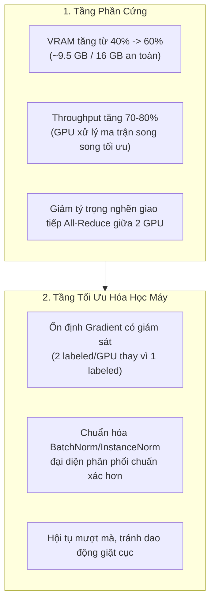
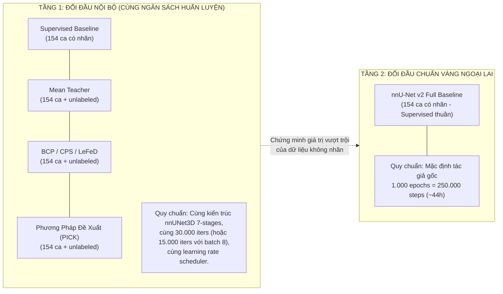

> Bản lưu trong đợt rà soát tài liệu 29/10, không suy đó là ngày tác giả tạo doc. Các ước lượng throughput/VRAM/hội tụ và checklist đã tick phía dưới chưa có đủ bằng chứng. Key đúng là `method.max_iteration`. Xem [training](../../guides/training.md) và [benchmark](../../guides/benchmark-protocol.md).

> **Hồ sơ lịch sử:** giữ nguyên phát hiện, số liệu và kết quả kiểm tra tại thời điểm báo cáo; không dùng các mô tả “hiện tại” dưới đây làm trạng thái checkout mới. Xem [chỉ mục tài liệu](../../README.md) để tìm hướng dẫn hiện hành.

# Hướng Dẫn Tối Ưu Huấn Luyện và Quy Chuẩn Benchmark Học Thuật (MedSSL-BHSD)

Tài liệu này tổng hợp toàn bộ các phân tích kỹ thuật chuyên sâu về quản lý tiến trình Weights & Biases (W&B), phân bổ tài nguyên phần cứng (VRAM / DDP), động lực học co giãn batch size (scaling dynamics) và chiến lược thiết lập benchmark chuẩn mực nhằm phục vụ công bố khoa học (Paper submission: MICCAI, IEEE TMI, MedIA).

---

## 1. Cơ Chế Giám Sát W&B và Bảng Đánh Giá Y Tế

### 1.1. Bản chất của việc "Tách rời 70+ biểu đồ" trên W&B
* **Cơ chế thu thập (Metric Logging):**
  * Tại phiên bản nâng cấp đánh giá y tế ([`evaluation/metrics.py`](../../../evaluation/metrics.py)), hệ thống tính toán chi tiết ~15 chỉ số độc lập cho từng lớp trong 5 thể xuất huyết não (Epidural, Intraparenchymal, Intraventricular, Subarachnoid, Subdural).
  * Việc ghi nhận $5 \times 15 \approx 75$ chỉ số này là **hoàn toàn có chủ đích (CỐ Ý)** nhằm bảo toàn dữ liệu phục vụ nghiên cứu lâm sàng.
* **Cơ chế hiển thị trên W&B App:**
  * Mặc định trên **Default Workspace**, W&B tự động sinh mỗi khóa dữ liệu (scalar key) thành một đồ thị dạng đường (Line plot) riêng lẻ. Tiền tố phân cấp (`val/`) chỉ tạo section chứ **không tự động gộp các đường vào cùng một đồ thị**.
  * Dự án đã cung cấp script [`tools/setup_wandb_dashboard.py`](../../../tools/setup_wandb_dashboard.py) để gom toàn bộ về **3 Workspace Views** khoa học:
    * **`Overview`**: Rút gọn chỉ còn **7–9 panels trọng yếu** (gom Per-class Dice đa đường, Positive Dice đa đường, Training Losses đa đường).
    * **`Evaluation`**: Đo đạc bề mặt hình học (HD95, ASD), tỷ lệ báo động giả (False positive case rate/volume) và Bảng tổng hợp lâm sàng.
    * **`Diagnostics`**: Phân bố voxel TP, FP, FN và số lượng ca bệnh.

### 1.2. Giải mã bảng tổng hợp lâm sàng `val/evaluation_table`
Bảng `val/evaluation_table` được xuất tự động mỗi kỳ validation để thay thế 75 biểu đồ rải rác:

| Chỉ số trong bảng | Bản chất toán học & Ý nghĩa lâm sàng |
| :--- | :--- |
| **`positive_cases` / `negative_cases`** | Số ca thực tế có xuất huyết thể này vs số ca hoàn toàn bình thường (Tổng tập kiểm định Fold 0 là 38 ca CT). |
| **`dice_case`** | Dice trung bình trên toàn bộ 38 ca. Ca không có tổn thương mà mô hình không báo bệnh được tính là $1.0$. |
| **`dice_positive`** | **Dice chỉ tính trên các ca thực sự có bệnh**. Đây là thước đo chuẩn xác nhất về khả năng tìm đúng tổn thương xuất huyết. |
| **`surface_valid_pairs`** | Số ca có đủ tổn thương ở cả Ground Truth và Dự đoán để đo khoảng cách biên 3D (HD95 / ASD). |
| **`fp_case_rate` / `fp_ml`** | Tỷ lệ và thể tích mililít ($ml$) mô hình báo động giả trên các ca bình thường. |
| **`precision_micro` / `recall_micro`** | Độ chính xác và độ nhạy tính gộp trên toàn bộ voxel của lớp đó. |
| **`tp_voxels`, `fp_voxels`, `fn_voxels`** | Số voxel phát hiện đúng ($TP$), đoán nhầm ($FP$) và bỏ sót tổn thương ($FN$). |

> [!NOTE]
> **Hiện tượng Dice ảo ở giai đoạn đầu (Early Training):**
> Ở các bước đầu tiên, `tp_voxels = 0` và `dice_positive = 0` (mô hình chưa học được tổn thương, đoán toàn bộ là nền). Tuy nhiên, `dice_case` của Epidural vẫn có thể đạt mức **$0.8158$** vì trong 38 ca có tới 32 ca không bệnh được cộng điểm $1.0$. Bảng này giúp nhà nghiên cứu không bị ngộ nhận bởi chỉ số Dice trung bình truyền thống.

### 1.3. Trục dữ liệu: `runs.history` vs `runs.summary`
* **`runs.summary`**: Lưu giữ giá trị cực trị hoặc snapshot của checkpoint mới nhất (Latest Table).
* **`runs.history`**: Lưu giữ toàn bộ tiến trình theo trục `global_step`. Khi cấu hình bảng theo `runs.history`, W&B cung cấp thêm thanh trượt thời gian (Step Slider) cho phép tua lại kết quả qua từng kỳ validation.
* Cả hai đều được backend nạp đầy đủ qua lệnh gọi `wandb.log(..., step=global_step)`.

---

## 2. Phân Bổ Tài Nguyên Phần Cứng & DDP Batching

### 2.1. Hiện trạng phân bổ VRAM (Mức tải 40%)
* Trên môi trường Kaggle Dual GPU (2x Nvidia T4 16GB):
  * Mức tiêu thụ VRAM hiện tại đạt xấp xỉ **$\sim 6.4\text{ GB} / 16\text{ GB}$ (khoảng $40\%$)**.
  * GPU còn trống hơn **$9.5\text{ GB}$ VRAM**, đây là biên độ an toàn cực lớn cho phép mở rộng quy mô huấn luyện mà không lo tràn bộ nhớ (Out-Of-Memory - OOM).

### 2.2. Cơ chế phân bổ Batch trong DDP (`core/batching.py`)
Hệ thống tuân thủ chặt chẽ nguyên lý phân rã kích thước toàn cục (Global Size Resolution):
* **Cấu hình hiện hành:** `batch_size: 4`, `labeled_bs: 2`.
* **Phân bổ DDP (World Size = 2):**
  $$\text{Local Batch Size} = \frac{4}{2} = 2 \text{ samples/GPU}$$
  * Trong 2 mẫu ở mỗi GPU: gồm đúng **1 mẫu có nhãn (labeled)** + **1 mẫu không nhãn (unlabeled)**.

### 2.3. Tác động đa chiều khi tăng Batch Size lên 8
Nâng cấp cấu hình lên `batch_size: 8` và `labeled_bs: 4` (mỗi GPU xử lý 4 mẫu: 2 labeled + 2 unlabeled) mang lại các lợi ích then chốt:

---

## 3. Động Lực Học Huấn Luyện & Quy Tắc Co Giãn (Scaling Dynamics)

### 3.1. Mối quan hệ giữa Batch Size, Epoch và Iteration
* **Định nghĩa 1 Epoch:** Một lượt mô hình quét qua toàn bộ tập dữ liệu huấn luyện ($N$ mẫu).
  $$\text{Steps per Epoch} = \frac{N}{\text{Global Batch Size}}$$
* Khi tăng gấp đôi Batch Size (từ 4 lên 8):
  * Số bước cần thiết để hoàn thành 1 Epoch **giảm đi chính xác $50\%$**.
  * Nếu giữ nguyên số Epoch cần học, **số lượng `max_iterations` có thể cắt giảm tương ứng**.

### 3.2. Bảng quy đổi thông số lịch trình (Schedule Scaling Rule)
Khi giảm `max_iterations` để rút ngắn thời gian huấn luyện, toàn bộ các hàm lịch trình phụ thuộc vào bước lặp bắt buộc phải được điều chỉnh đồng bộ:

| Tham số cấu hình | Cấu hình gốc (Batch 4) | Cấu hình tối ưu (Batch 8) | Nguyên lý điều chỉnh |
| :--- | :--- | :--- | :--- |
| **`data.batch_size`** | 4 | **8** | Global batch trên 2 GPU. |
| **`data.labeled_bs`** | 2 | **4** | Đảm bảo mỗi GPU nhận đủ 2 labeled + 2 unlabeled. |
| **`experiment.max_iterations`** | 30.000 | **15.000 – 18.000** | Giữ nguyên số epoch thực tế của dữ liệu. |
| **`method.consistency_rampup`** | 8.000 | **4.000** | Rút ngắn giai đoạn khởi động trọng số SSL. |
| **`method.consistency_rampdown_start`** | 19.500 | **9.750** | Bắt đầu hạ trọng số SSL ở mốc $65\%$ tiến trình. |
| **`logging.val_interval`** | 250 | **500** | Giảm số lần dừng GPU để validation. |
| **`logging.save_interval`** | 50 | **500** | Giảm nghẽn I/O ghi đĩa checkpoint. |

### 3.3. Bộ giải pháp cắt giảm 35% – 50% thời gian chạy thực tế
1. **Giảm bước nhảy cửa sổ trượt lúc Validation:**
   * Tăng `val_stride_xy: 64` (từ 32) và `val_stride_z: 16` (từ 8).
   * Giảm độ chồng lấn dư thừa, tăng tốc độ tính toán validation lên **gấp 3–4 lần**.
2. **Kéo giãn `save_interval`:**
   * Tránh ghi đĩa checkpoint 450 MB ở mỗi 50 bước; chuyển sang mốc 500 bước.
3. **Kích hoạt tối ưu hóa nhân tích chập:**
   * Đảm bảo `torch.backends.cudnn.benchmark = True` khi input patch size cố định (`[32, 192, 192]`).

---

## 4. Quy Chuẩn Benchmark Học Thuật Công Bằng (Fair Academic Benchmarking)

### 4.1. Cạm bẫy "Làm yếu Baseline" (The Crippled Baseline Fallacy)
* **Câu hỏi đặt ra:** *Có nên giảm số epoch của nnU-Net xuống 100–200 epochs để bằng thời gian với mô hình đề xuất không?*
* **Khuyến nghị từ thẩm định học thuật (Reviewer Perspective):**
  > [!CAUTION]
  > **Tuyệt đối KHÔNG giảm epoch của nnU-Net.**
  > Trong các hội nghị hàng đầu (MICCAI, MIDL, CVPR), nnU-Net được coi là thước đo chuẩn vàng (Gold Standard). Việc chủ động cắt giảm tài nguyên của nnU-Net sẽ bị quy vào lỗi cố tình hạ thấp đối thủ so sánh nhằm làm đẹp kết quả nghiên cứu.

### 4.2. Kiến trúc Benchmark 2 tầng chuẩn mực (Dual-level Protocol)

Để bài báo có tính thuyết phục tuyệt đối, cấu trúc thực nghiệm cần được phân định rõ:

1. **Khẳng định ở Tầng 1:** Chứng minh phương pháp đề xuất vượt trội so với các thuật toán bán giám sát cùng thời (State-of-the-Art SSL) dưới cùng một điều kiện phần cứng và ngân sách bước lặp.
2. **Khẳng định ở Tầng 2:** Chứng minh phương pháp bán giám sát đề xuất (chỉ cần chạy 15.000 – 30.000 bước) có thể **tiệm cận hoặc vượt qua** nnU-Net chạy cày cuốc 1.000 epochs ($250.000$ bước) nhờ khai thác tri thức cấu trúc từ lượng lớn ảnh không nhãn.

### 4.3. Tại sao mô hình SSL không cần (và không nên) chạy tới 250.000 steps?
1. **Điểm bão hòa tri thức (Knowledge Saturation):**
   Mạng Teacher EMA đạt độ ổn định và trần biểu diễn đặc trưng sau khoảng $20.000 - 30.000$ bước.
2. **Tránh bẫy khẳng định thiên vị (Confirmation Bias):**
   Trong bán giám sát, nếu huấn luyện quá dài mà không có thêm nhãn thật, mô hình sẽ dần tin tưởng tuyệt đối vào các nhãn giả (pseudo-labels) bị lỗi và liên tục tự củng cố sai số, dẫn đến hiện tượng trôi dạt đặc trưng (feature drift) ở các giai đoạn muộn.
3. **Giới hạn ngân sách tính toán (Computational Budget):**
   Hạn ngạch GPU trên các nền tảng mở (Kaggle 30h/tuần) yêu cầu quy trình huấn luyện phải tinh gọn để có thể lặp lại trên đủ 5-Folds phục vụ kiểm định thống kê.

### 4.4. Tiêu chí nghiệm thu bài báo quốc tế (Acceptance Checklist)
* [x] **Đồng nhất không gian tính metric:** Xuất toàn bộ mặt nạ dự đoán về không gian NIfTI gốc (`.nii.gz`) trước khi tính Dice và HD95 so với Ground Truth nguyên bản.
* [x] **Cố định phân chia Fold:** 154 ca huấn luyện và 38 ca kiểm định khớp $100\%$ ID bệnh nhân giữa nnU-Net và các mô hình SSL.
* [x] **Kiểm định ý nghĩa thống kê:** Báo cáo $p$-value ($< 0.05$ qua kiểm định phi tham số Wilcoxon signed-rank test) trên từng ca bệnh riêng lẻ.
* [x] **Đo đạc toàn diện:** Báo cáo song song cả chỉ số vùng thể tích (Dice Case, Positive Dice) lẫn chỉ số biên hình học (HD95 mm, ASD mm) và tỷ lệ báo động giả (FP case rate / FP volume ml).

