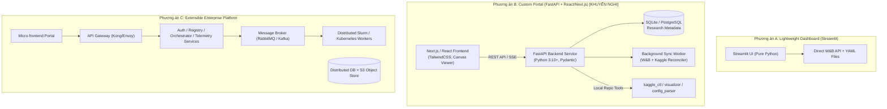
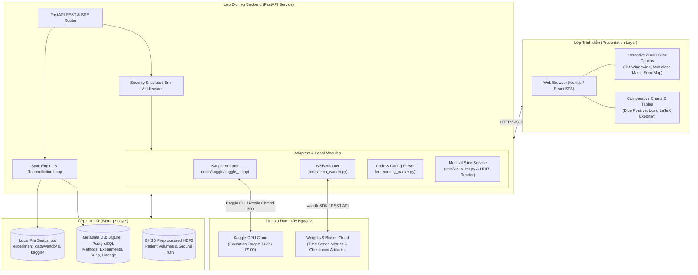

# Thiết kế Kiến trúc Hệ thống (System Architecture)

> Điểm bắt đầu hiện hành: [PoC-first](poc-first.md) quy định stack/phạm vi mặc định. Full stack, hosting và REST API trong tài liệu này là hướng mở rộng; không yêu cầu triển khai trước PoC.

> Cập nhật 31/10/2026: đây là thiết kế ban đầu tập trung BHSD, chưa phải chức năng đã triển khai. Đọc [review mở rộng](platform-review-2026-10-31.md) trước; review điều chỉnh repo boundary, multi-account, worker, schema và phạm vi MVP khi có khác biệt.

Tài liệu này trình bày chi tiết ba phương án kiến trúc cho **Research Management Portal**, phân tích ưu nhược điểm, luồng dữ liệu, chiến lược đồng bộ hóa và cơ chế bảo mật thông tin xác thực.

---

## 1. So sánh Ba Phương án Kiến trúc



### 1.1. Phương án A: Lightweight Dashboard
- **Kiến trúc**: Ứng dụng đơn khối (Monolith) viết hoàn toàn bằng **Streamlit** hoặc **Plotly Dash**. Đọc trực tiếp cấu hình YAML từ thư mục `configs/` và query trực tiếp W&B API qua Python SDK.
- **Ưu điểm**: Dựng cực nhanh (1–2 tuần), mã nguồn 100% Python, không cần cài đặt thêm database riêng.
- **Nhược điểm & Rủi ro**:
  - Không thể duy trì tiến trình nền ổn định để định kỳ kiểm tra trạng thái Kaggle và đồng bộ dữ liệu.
  - Mỗi thao tác trên UI kích hoạt re-run toàn bộ script Python, gây độ trễ lớn và tiêu hao quota W&B API.
  - Rất khó tích hợp trình hiển thị lát cắt CT 3D mượt mà với tính năng điều chỉnh Window HU theo thời gian thực.
- **Phù hợp cho**: Phân tích dữ liệu ad-hoc một lần, không đáp ứng được mục tiêu quản lý tập trung lâu dài.

### 1.2. Phương án B: Custom Research Management Portal [KHUYẾN NGHỊ]
- **Kiến trúc**: Kiến trúc tách rời (Decoupled Client-Server):
  - **Frontend**: Next.js 14/15 (React, TypeScript, TailwindCSS, HTML5 Canvas Medical Viewer).
  - **Backend**: FastAPI (Python 3.10+), chạy cùng môi trường ảo (virtualenv) của repository. Tận dụng trực tiếp các module nghiệp vụ sẵn có (`tools.kaggle.*`, `core.config_parser`, `utils.visualizer`, `evaluation.metrics`).
  - **Database**: SQLite (cho môi trường local/nhóm nhỏ) hoặc PostgreSQL (cho máy chủ phòng lab), sử dụng SQLAlchemy / Alembic để quản lý migration.
  - **Background Worker**: Tiến trình nền nội bộ (FastAPI Background Tasks hoặc APScheduler) định kỳ đồng bộ Kaggle status và W&B snapshots.
- **Ưu điểm**:
  - Tách bạch rõ ràng giữa giao diện hiển thị và logic nghiệp vụ.
  - Giao diện mượt mà, hỗ trợ tốt nhất cho tương tác lật lát cắt CT y tế và vẽ biểu đồ.
  - Backend tái sử dụng nguyên vẹn logic code và bảo mật đa tài khoản đã kiểm chứng trong `tools/kaggle/`.
  - Hỗ trợ đầy đủ chế độ Local-First (hoạt động ngoại tuyến từ các snapshot đã lưu trong `experiment_data/`).
- **Chi phí phát triển & Bảo trì**: Vừa phải, rất phù hợp cho một nhóm nghiên cứu 2–4 người.

### 1.3. Phương án C: Extensible Research Platform
- **Kiến trúc**: Hệ thống phân tán hoàn chỉnh (Microservices), bao gồm API Gateway, Authentication Server, Message Broker (RabbitMQ), Task Execution Workers, Distributed Storage (MinIO / S3), và Orchestration Engine kết nối Slurm/Kubernetes.
- **Ưu điểm**: Khả năng mở rộng vô hạn, hỗ trợ hàng chục dự án và hàng trăm người dùng cùng lúc.
- **Nhược điểm & Rủi ro**: Quá phức tạp (Over-engineering), chi phí hạ tầng và công sức vận hành rất lớn. Làm chậm tiến độ nghiên cứu chính của dự án học máy y tế.
- **Phù hợp cho**: Trung tâm tính toán cấp viện hoặc nền tảng thương mại quy mô lớn.

---

## 2. Kiến trúc Chi tiết Phương án B (Được Chọn)



---

## 3. Luồng Dữ liệu Toàn trình (End-to-End Data Flow)

### 3.1. Luồng Khởi tạo và Thực thi Thí nghiệm (Experiment Dispatch Flow)
1. **Thiết kế**: Người dùng tạo Experiment trên Portal, chọn Method (`mean_teacher`), Model (`nnunet3d`), Dataset (`bhsd_multiclass`), Fold (`0`), Seed (`1337`).
2. **Kiểm tra hợp lệ**: Backend gọi `core.config_parser.load_config()`, kiểm tra schema YAML và tương thích phần cứng.
3. **Đóng gói Bundle**: Backend gọi `tools.kaggle.notebook_builder.NotebookBuilder.build_bundle()`:
   - Tự động sinh file `.ipynb` và `kernel-metadata.json` trong `kaggle_runs/<method>/<username>/`.
   - Gắn Git Commit SHA hiện tại vào metadata thí nghiệm.
4. **Submit sang Kaggle**: Backend gọi `tools.kaggle.kaggle_executor.KaggleExecutor`:
   - Nạp profile tài khoản tương ứng với biến môi trường cô lập (`KAGGLE_CONFIG_DIR`).
   - Thực thi lệnh `kaggle kernels push`.
5. **Ghi nhận Lineage**: Tạo bản ghi `Run` trong Database nội bộ với trạng thái `QUEUED`, liên kết trực tiếp với Kernel Slug.

### 3.2. Luồng Giám sát & Đồng bộ Dữ liệu (Reconciliation Loop)
1. **Polling định kỳ**: Background Worker (chu kỳ 60 giây) quét các Run đang ở trạng thái `QUEUED` hoặc `RUNNING`.
2. **Truy vấn trạng thái Kaggle**: Gọi `KaggleExecutor.get_status()`:
   - Nếu `COMPLETE`: Đổi trạng thái sang `COMPLETED`, kích hoạt lệnh tải log và artifact metadata.
   - Nếu `ERROR`: Đổi trạng thái sang `FAILED`, tự động kéo log lỗi (`kaggle_ctl log`) để trích xuất nguyên nhân (NCCL Timeout, Out of Memory, hoặc Papermill Crash).
3. **Đồng bộ Metrics từ W&B**:
   - Worker gọi `WandbAdapter` (dựa trên `wandb.Api()`):
   - Kéo tóm tắt `run.summary`: `val/mDice`, `val/dice_positive_mean`, per-class metrics.
   - Kéo các mốc validation quan trọng vào bảng `ValidationMetricSnapshot`.
   - Lưu snapshot bất biến vào `experiment_data/wandb/<run_id>/<timestamp>/` theo đúng chuẩn `tools/crawl_storage.py`.

---

## 4. Chiến lược Phân định Nguồn Dữ liệu (Source of Truth Strategy)

Một trong những sai lầm lớn nhất khi thiết kế portal quản lý ML là cố gắng nhân bản toàn bộ cơ sở dữ liệu time-series của W&B vào database riêng. Thiết kế của MedSSL-BHSD áp dụng nguyên tắc phân định nghiêm ngặt:

| Loại Dữ liệu | Nguồn Chuẩn (Single Source of Truth) | Vai trò của Portal Database | Lý do Kỹ thuật |
| :--- | :--- | :--- | :--- |
| **Time-series Loss & LR (mỗi step)** | **Weights & Biases Cloud** | **Không lưu**. Khi người dùng xem biểu đồ chi tiết từng step, Frontend nhúng trực tiếp W&B Panel hoặc gọi API W&B theo yêu cầu. | Tránh phình to database với hàng triệu data points; giảm tải I/O cho máy chủ Portal. |
| **System Telemetry (CPU/GPU/RAM)** | **Weights & Biases Cloud** | **Không lưu chi tiết**. Portal chỉ lưu các chỉ số cực đại (Peak VRAM, Peak RAM, Duration). | Phục vụ cảnh báo tài nguyên mà không cần lưu chuỗi sự kiện chi tiết. |
| **Validation Milestones (mỗi 500 iter)** | **Portal Database & Local Snapshots** | **Lưu trữ toàn bộ**. Lưu giá trị metrics của từng lớp tổn thương tại mỗi lần validation. | Phục vụ tính toán so sánh, vẽ đường cong hội tụ mDice positive và xuất bảng kết quả cho bài báo. |
| **Research Hypotheses & Metadata** | **Portal Database** | **Nguồn chuẩn duy nhất**. Lưu mục tiêu nghiên cứu, giả thuyết, ghi chú, quyết định kỹ thuật. | W&B không có mô hình dữ liệu cho các thực thể này. |
| **Model Checkpoint Lineage** | **Portal Database** | **Nguồn chuẩn duy nhất**. Ánh xạ quan hệ giữa Checkpoint $\leftrightarrow$ Run $\leftrightarrow$ Commit $\leftrightarrow$ W&B Artifact URI. | Đảm bảo tính minh bạch và khả năng tái lập 100%. |

---

## 5. Thiết kế Bảo mật & Ranh giới Cô lập (Security & Boundary Design)

### 5.1. Nguyên tắc Không Lưu Plaintext Token
- Mọi API key (Kaggle Key, W&B API Key) tuyệt đối không lưu trong database hoặc hiển thị trên giao diện người dùng.
- Tận dụng cấu trúc an toàn hiện hành của dự án:
  - Kaggle credentials lưu trong `configs/kaggle/secrets/profile_<id>/kaggle.json` với quyền file hệ thống nghiêm ngặt:
    ```bash
    chmod 700 configs/kaggle/secrets/profile_*
    chmod 600 configs/kaggle/secrets/profile_*/kaggle.json
    ```
  - W&B API Key được đọc từ biến môi trường máy chủ `WANDB_API_KEY` hoặc `~/.netrc` (do lệnh `wandb login` tạo).

### 5.2. Cách ly Môi trường Tiến trình Thực thi (Process Sandbox)
Để ngăn ngừa việc tài khoản Kaggle này ghi đè token hoặc sử dụng nhầm profile của tài khoản khác (vấn đề từng gây lỗi nghiêm trọng trong các đợt chạy trước):
- Mỗi lời gọi lệnh hệ thống tới Kaggle CLI bắt buộc phải thông qua `tools.kaggle.kaggle_executor.KaggleExecutor`.
- Executor tự động tạo bản sao môi trường `os.environ.copy()`, xóa toàn bộ các biến `KAGGLE_*` toàn cục, và gán:
  $$\text{KAGGLE\_CONFIG\_DIR} = \text{profile\_dir}$$

---

## 6. Xử lý Lỗi, Tính Bất biến và Cơ chế Tự phục hồi

### 6.1. Xử lý Trạng thái Không nhất quán (Idempotent Reconciliation)
- Khi tiến trình đồng bộ bị ngắt quãng (do mất mạng hoặc crash ứng dụng), worker có thể chạy lại bất cứ lúc nào mà không tạo ra bản ghi trùng lặp (Idempotent).
- Mỗi snapshot dữ liệu đều mang `manifest.json` chứa UUID và timestamp UTC bất biến (kế thừa từ `tools/crawl_storage.py`).

### 6.2. Phát hiện và Xử lý Lỗi Kaggle Thường gặp
Portal tích hợp bộ phân tích log tự động (Log Parser Rule Engine):
- **NCCL Timeout Pattern**: Phát hiện chuỗi `watchdog detected that a process did not terminate within ... ms`. Hệ thống sẽ gắn nhãn run là `FAILED (NCCL_TIMEOUT)`, thông báo cho người dùng và không tự động retry ngẫu nhiên để tránh lãng phí GPU.
- **Kaggle 9-Hour Limit Pattern**: Phát hiện log dừng ở trạng thái console bình thường nhưng runtime chạm ngưỡng 32.400 giây (9 giờ). Hệ thống gắn nhãn `TERMINATED (TIME_LIMIT)` và kích hoạt kịch bản tạo cấu hình Resume.
- **Memory Pressure Warning**: Nếu sự kiện RAM hệ thống vượt $90\%$, hệ thống ghi nhận cảnh báo rủi ro sập tiến trình.

