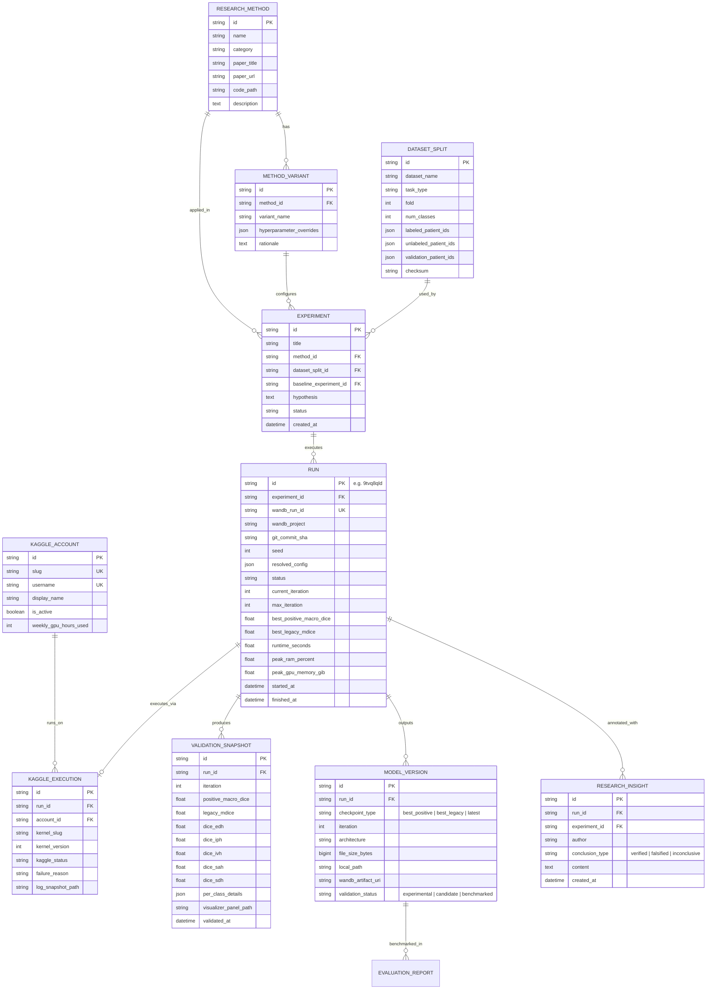

# Mô hình Dữ liệu và Thiết kế Cơ sở Dữ liệu (Data Model)

> Cập nhật 31/10/2026: đây là thiết kế ban đầu tập trung BHSD, chưa phải chức năng đã triển khai. Đọc [review mở rộng](platform-review-2026-10-31.md) trước; review điều chỉnh repo boundary, multi-account, worker, schema và phạm vi MVP khi có khác biệt.

Tài liệu này xác định mô hình thực thể (Entity-Relationship Model), lược đồ cơ sở dữ liệu quan hệ (Relational Schema), định nghĩa JSON Schema cho cấu hình thực nghiệm và chiến lược lưu trữ dữ liệu cho **Research Management Portal**.

---

## 1. Sơ đồ Quan hệ Thực thể (Entity-Relationship Diagram)

Mô hình dữ liệu được thiết kế nhằm phân biệt rõ ràng 5 cấp bậc phân cấp nghiên cứu:
$$\text{ResearchMethod} \longrightarrow \text{MethodVariant} \longrightarrow \text{Experiment} \longrightarrow \text{Run} \longrightarrow \text{ModelVersion} \ \& \ \text{Artifact}$$



---

## 2. Chi tiết Các Bảng Dữ liệu Chính

### 2.1. Bảng `research_methods`
Lưu trữ định nghĩa lý thuyết và căn cứ khoa học của các phương pháp học nửa giám sát (SSL):
- `id`: Mã định danh (ví dụ: `mean_teacher`, `pick`, `cps`, `bcp`, `lefed`, `supervised`).
- `name`: Tên đầy đủ (ví dụ: *"Mean Teacher with EMA Consistency"*).
- `category`: Phân loại thuật toán (`consistency_regularization`, `pseudo_labeling`, `co_training`, `supervised_baseline`).
- `paper_title`: Tên bài báo gốc (ví dụ: *"Weight-averaged consistency targets improve semi-supervised deep learning results"*).
- `paper_url`: Liên kết bài báo (arXiv/DOI link).
- `code_path`: Đường dẫn lớp triển khai trong repository (ví dụ: `methods/mean_teacher.py`).

### 2.2. Bảng `dataset_splits`
Quản lý việc phân chia dữ liệu và hỗ trợ kiểm toán chống rò rỉ dữ liệu (Data Leakage Prevention):
- `id`: Định danh phân chia (ví dụ: `bhsd_multiclass_fold0_10pct`).
- `dataset_name`: `bhsd_multiclass` hoặc `bhsd_binary`.
- `fold`: Chỉ số fold (`0` .. `4`).
- `labeled_patient_ids`: Mảng JSON chứa ID các bệnh nhân thuộc tập có nhãn (ví dụ: 15 hoặc 154 ca).
- `unlabeled_patient_ids`: Mảng JSON chứa ID các bệnh nhân thuộc tập không nhãn.
- `validation_patient_ids`: Mảng JSON chứa ID các bệnh nhân thuộc tập validation (ví dụ: 38 ca).
- `checksum`: Mã hash SHA-256 của danh sách phân chia file HDF5.

### 2.3. Bảng `runs`
Đại diện cho một phiên huấn luyện cụ thể, liên kết mật thiết với W&B và Git:
- `id`: Mã run ID (thường lấy trùng với `wandb_run_id`, ví dụ: `9tvq8qld`, `s9i9nsui`).
- `experiment_id`: Khóa ngoại tham chiếu đến bảng `experiments`.
- `git_commit_sha`: Mã commit Git 40 ký tự tại thời điểm chạy thí nghiệm.
- `resolved_config`: Toàn bộ cấu hình YAML sau khi gộp base + experiment + overrides (dạng JSON).
- `status`: Trạng thái thực thi (`PLANNED`, `QUEUED`, `RUNNING`, `COMPLETED`, `FAILED`, `CANCELLED`).
- `current_iteration`: Số bước huấn luyện hiện tại (ví dụ: 16.250).
- `max_iteration`: Ngân sách bước huấn luyện tối đa (ví dụ: 30.000).
- `best_positive_macro_dice`: Giá trị positive macro Dice cao nhất đạt được (ví dụ: 0.34167).
- `best_legacy_mdice`: Giá trị legacy mDice cao nhất đạt được (ví dụ: 0.46258).
- `failure_reason`: Phân loại lỗi tự động nếu thất bại (`NCCL_TIMEOUT`, `OOM_KILL`, `TIME_LIMIT`, `USER_ABORT`).

### 2.4. Bảng `validation_snapshots`
Lưu trữ các mốc đánh giá định kỳ (mỗi 500 bước), tách bạch rõ ràng các metric theo chuẩn `docs/guides/metrics-and-wandb.md`:
- `run_id`: Khóa ngoại tham chiếu `runs.id`.
- `iteration`: Mốc đánh giá (ví dụ: 2500, 5000, 14500, 16000).
- `positive_macro_dice`: Trung bình đều Dice chỉ trên các ca có tổn thương (Foreground positive cases only).
- `legacy_mdice`: Trung bình Dice trên toàn bộ ca validation (tính cả ca âm tính = 1.0).
- `dice_edh`, `dice_iph`, `dice_ivh`, `dice_sah`, `dice_sdh`: Dice positive từng lớp riêng biệt.
- `per_class_details`: Lưu chi tiết JSON chứa:
  ```json
  {
    "EDH": {"positive_cases": 6, "negative_cases": 32, "precision_micro": null, "recall_micro": 0.0, "negative_fp_cases": 0},
    "IPH": {"positive_cases": 23, "negative_cases": 15, "precision_micro": 0.5787, "recall_micro": 0.7636, "negative_fp_ml": 2.651}
  }
  ```

### 2.5. Bảng `model_versions`
Quản lý checkpoint mô hình và tính liên tục trong nghiên cứu:
- `id`: Định danh checkpoint (ví dụ: `chk_9tvq8qld_14500_best_positive`).
- `run_id`: Khóa ngoại tham chiếu `runs.id`.
- `checkpoint_type`: Loại checkpoint:
  - `best_positive`: Checkpoint đạt positive macro Dice cao nhất (dùng để benchmark chính thức).
  - `best_legacy`: Checkpoint đạt legacy mDice cao nhất (lưu để đối chiếu lịch sử).
  - `latest`: Checkpoint tại bước lưu gần nhất (dùng để resume khi hết giờ).
- `local_path`: Đường dẫn file `.pth` trên máy cục bộ (nếu đã tải về).
- `wandb_artifact_uri`: Đường dẫn URI trên W&B Cloud Artifacts (ví dụ: `wandb-artifact://.../checkpoint_best:v14`).
- `validation_status`: Trạng thái kiểm chứng (`experimental`, `candidate_for_paper`, `deprecated`).

---

## 3. Định nghĩa JSON Schema cho Cấu hình Thí nghiệm (Experiment Config Schema)

Để đảm bảo các cấu hình nạp vào Portal hoàn toàn tương thích với `core/config_parser.py`, Portal sử dụng JSON Schema để tiền kiểm định (Pre-validation) trước khi gửi lệnh submit:

```json
{
  "$schema": "http://json-schema.org/draft-07/schema#",
  "title": "MedSSL_BHSD_ExperimentConfig",
  "type": "object",
  "required": ["experiment", "data", "model", "method"],
  "properties": {
    "experiment": {
      "type": "object",
      "required": ["name", "task", "num_classes", "fold", "seed"],
      "properties": {
        "name": { "type": "string" },
        "task": { "type": "string", "enum": ["multiclass", "binary"] },
        "num_classes": { "type": "integer", "enum": [2, 6] },
        "fold": { "type": "integer", "minimum": 0, "maximum": 4 },
        "seed": { "type": "integer", "default": 1337 },
        "resume": { "type": "boolean", "default": false },
        "resume_policy": { "type": "string", "enum": ["latest", "epoch_boundary"] }
      }
    },
    "data": {
      "type": "object",
      "required": ["patch_size", "batch_size", "labeled_bs"],
      "properties": {
        "patch_size": {
          "type": "array",
          "items": { "type": "integer" },
          "minItems": 3,
          "maxItems": 3
        },
        "batch_size": { "type": "integer", "minimum": 1 },
        "labeled_bs": { "type": "integer", "minimum": 1 },
        "labelnum": { "type": "integer" }
      }
    },
    "model": {
      "type": "object",
      "required": ["name", "in_channels"],
      "properties": {
        "name": { "type": "string", "enum": ["nnunet3d", "vnet", "unet3d", "unetr"] },
        "in_channels": { "type": "integer", "default": 1 },
        "base_filters": { "type": "integer" },
        "deep_supervision": { "type": "boolean" }
      }
    },
    "method": {
      "type": "object",
      "required": ["name", "base_lr", "max_iteration"],
      "properties": {
        "name": { "type": "string", "enum": ["mean_teacher", "pick", "cps", "bcp", "lefed", "supervised"] },
        "base_lr": { "type": "number", "minimum": 0.00001 },
        "max_iteration": { "type": "integer", "minimum": 100 },
        "consistency": { "type": "number", "minimum": 0.0 },
        "ema_decay": { "type": "number", "minimum": 0.9, "maximum": 0.9999 }
      }
    }
  }
}
```

---

## 4. Chiến lược Lưu trữ Dữ liệu Phân tầng (Tiered Storage Strategy)

Hệ thống kết hợp ba tầng lưu trữ chuyên biệt:

```text
[Tầng 1: Metadata DB (SQLite / PostgreSQL)]
    └── Lưu cấu trúc thực thể, quan hệ, chỉ số tổng hợp, lineage và ghi chú nghiên cứu.
        Dung lượng: Rất nhẹ (~10 MB - 50 MB cho 500 thí nghiệm).

[Tầng 2: File System Snapshot Storage (experiment_data/)]
    ├── wandb/<run_id>/<timestamp_UTC>/
    │   ├── manifest.json
    │   ├── summary.json
    │   ├── events.json (telemetry CPU/RAM/VRAM thô)
    │   └── output.log
    └── kaggle/<owner>/<kernel_slug>/<timestamp_UTC>/
        ├── manifest.json
        ├── status.json
        └── output.log.json
    └── Dung lượng: ~500 MB - 2 GB (dạng văn bản nén).

[Tầng 3: Cloud & Medical Volume Storage]
    ├── W&B Cloud Artifacts: Lưu trữ checkpoints nặng (.pth ~550 MB mỗi checkpoint).
    └── Preprocessed HDF5: Lưu trữ local trên SSD của workstation phục vụ cắt lát CT.
```

