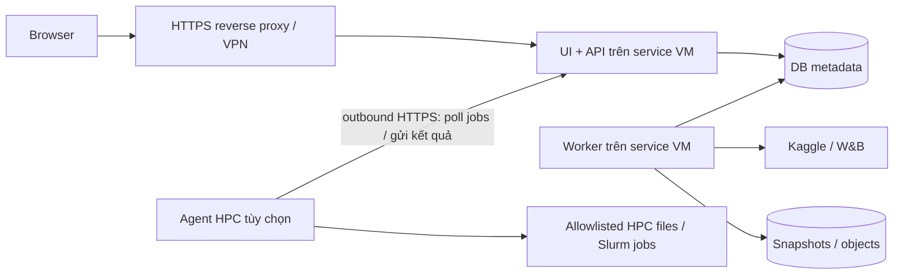

# Chuyển sang repo riêng và triển khai khi làm việc trên HPC

> Điểm bắt đầu hiện hành: [PoC-first](poc-first.md) quy định stack/phạm vi mặc định. Full stack, hosting và REST API trong tài liệu này là hướng mở rộng; không yêu cầu triển khai trước PoC.

Ngày 31/10/2026. Đề xuất topology, không phải deployment đã chạy. Chưa biết policy HPC, Open OnDemand, service VM, network egress, filesystem hay quyền daemon của hệ thống người dùng; không giả định login node cho phép host dịch vụ thường trực.

> Bổ sung theo ưu tiên miễn phí của người dùng: [managed/free options](free-managed-options.md) đề xuất hosted DB + UI + scheduled tasks thay service VM. VM là một deployment profile; không phải yêu cầu bắt buộc của platform.

## 1. Repo đặt ở đâu khác với service chạy ở đâu

Có thể clone/phát triển repo platform trên HPC, nhưng deploy UI/API/worker ở service VM hoặc máy chủ lab khác. Browser truy cập địa chỉ của service, không truy cập thư mục repo. Muốn mở trang bất kỳ lúc nào cần đồng thời: process đang chạy, route mạng đến process, storage bền vững và cơ chế restart. Domain/reverse proxy/tunnel chỉ giải quyết đường truy cập, không giữ job sống khi hết allocation.

Ưu tiên cho hệ thống quản lý Kaggle/W&B: **một VM/service node được phép chạy thường trực**, có outbound HTTPS đến providers. UI/API/worker/DB không cần GPU để quản lý Kaggle/W&B. HPC tiếp tục giữ dataset, training/evaluation và checkout BHSD. Chỉ thêm agent phía HPC khi cần đọc dữ liệu local hoặc chạy lệnh tại HPC.

## 2. Chuyển những gì sang repo mới?

| Nguồn BHSD | Xử lý ở repo mới | Lý do |
|---|---|---|
| `docs/research-portal/` | Copy toàn bộ làm seed vào `docs/design/`; chỉnh relative links, ghi source repo/revision rồi phát triển ở repo mới | Bộ tài liệu có thứ tự ưu tiên và lịch sử điều chỉnh; không chỉ copy architecture cũ |
| `tools/kaggle/*.py` | Giữ ở BHSD, dùng qua adapter checkout theo revision trong bước đầu | Chứa logic/path/config và notebook đặc thù BHSD; chưa phải package platform tổng quát |
| `tools/crawl_run.py`, `crawl_kaggle.py`, `crawl_storage.py`, `fetch_wandb.py`, `export_wandb_history.py` | Tham khảo/extract logic có kiểm soát vào adapters; không copy cả thư mục tools làm backend | Cần multi-connection, typed results, isolation và incremental sync |
| `configs/kaggle/notebooks.json`, `scripts/` templates | Giữ cùng revision BHSD; adapter đọc template catalog | Bundle phải gắn đúng source training |
| `configs/kaggle/accounts.json.example` | Có thể dùng để thiết kế migration/import schema; không lấy làm secret store mới | Metadata/credential phải tách |
| `core/`, `training/`, `methods/`, `models/`, `evaluation/`, `utils/`, `configs/` còn lại | Giữ ở BHSD | Code nghiên cứu không chuyển ownership sang portal |
| `experiment_data/` | Chọn snapshot fixture đã sanitize hoặc mount/sync runtime read-only | Không commit cả lịch sử thực nghiệm vào repo platform |
| Dataset H5, checkpoints, `kaggle_runs/`, logs thật | Không copy vào Git mới; đăng ký storage reference hoặc chuyển runtime có chọn lọc | Dung lượng, provenance, secrets và lifecycle |
| Account JSON thật, secret profiles, `.netrc`, `.env`, token | Không copy vào Git/tài liệu/fixtures; cấp lại runtime secret references | Repo mới phải không có credentials |
| Tests hiện có | Giữ ở BHSD; viết contract tests cho adapter tại platform bằng fixture phù hợp | Test CLI/training không tự kiểm chứng web/concurrency |

Nên **copy tài liệu trước**, giữ bản ở BHSD làm lịch sử và để link tới nguồn mới sau khi có remote URL. Không di chuyển/xóa code làm CLI BHSD hỏng. Repo mới không cần sao chép requirements training hay cài Torch/CUDA chỉ để hiển thị dữ liệu.

Thứ tự đọc mang sang: README → kaggle-operations-spec → provider-capabilities → platform-review → migration-and-hosting → bộ thiết kế ban đầu. Các link tới guides/code BHSD phải đổi sang URL repo ghim revision hoặc ghi rõ path nguồn. Không để relative links trỏ vào thư mục không tồn tại ở repo mới.

## 3. Backend nên chứa gì?

| Thành phần | Nhiệm vụ | Nơi chạy |
|---|---|---|
| Web frontend | Form account/submit, monitor, charts, artifacts UI | Static assets trên cùng host/reverse proxy; hoặc frontend server nếu framework cần |
| API | Auth/permissions, validation, CRUD metadata, đọc cache, tạo operations | Service host |
| Worker | Provider API calls, polling, build/submit, downloads, retries/reconcile | Service host; có checkout BHSD nếu build bundle tại đây |
| Metadata DB | Accounts metadata + credential refs, notebook/run mapping, operations, cursors, notes/audit | Persistent storage service host hoặc managed DB |
| Artifact/snapshot storage | JSON snapshots, logs, media cache, bundle digests và các file cần giữ | Persistent directory/object storage; lifecycle riêng |
| Secret store | Kaggle/W&B credentials và agent credentials | Runtime private storage ngoài checkout/Git |
| HPC agent (tùy chọn) | Đọc allowlisted local data, build/eval/submit Slurm theo job spec | Vị trí HPC được policy cho phép; không mặc định login node |

API không chạy training trong request. Worker cho Kaggle/W&B có thể chạy ngoài HPC hoàn toàn. Nếu build cần code BHSD, service host có checkout read-only theo commit và workspace writable riêng từng job; không cần mount toàn bộ home HPC. Evaluation GPU được giao cho compute job sau này.

## 4. Những lựa chọn host thực tế

| Phương án | Cách truy cập | Có cần khởi chạy lại? | Phù hợp |
|---|---|---|---|
| **Service VM/node của lab/HPC — ưu tiên** | HTTPS qua reverse proxy của đơn vị, VPN nếu nội bộ | Supervisor tự restart; không phụ thuộc terminal SSH | Platform dùng hằng ngày, nhiều account |
| VM bên ngoài HPC | HTTPS + application auth hoặc private VPN | VM chạy liên tục, service tự restart | Không có service node; provider worker không phụ thuộc HPC |
| Open OnDemand interactive app | Browser đi qua gateway/reverse proxy có sẵn | Thường phải launch app/job và giới hạn bởi allocation | Dùng trong phiên, viewer/data exploration gần HPC |
| Compute job + SSH tunnel | Localhost trên laptop qua tunnel | Job và tunnel phải còn sống; hết walltime cần chạy lại | Dev/MVP trước khi có hosting |

Open OnDemand có cơ chế reverse proxy tới ứng dụng trên compute node: [reverse proxy](https://osc.github.io/ood-documentation/latest/how-tos/app-development/interactive/setup/enable-reverse-proxy.html), [connection view](https://osc.github.io/ood-documentation/latest/how-tos/app-development/interactive/view.html). Có OOD không đồng nghĩa mọi user tự deploy dịch vụ vĩnh viễn được; cần kiểm tra app framework và policy của trung tâm.

Nếu host được quản trị và cho phép VPN overlay, [Tailscale Serve](https://tailscale.com/docs/reference/tailscale-cli/serve) là ví dụ cung cấp HTTPS riêng trong tailnet. Browser device cần quyền/network phù hợp; URL riêng không phải public hosting. Không tự cài overlay network/tunnel daemon trên HPC khi chưa rõ policy. Một HTTPS endpoint qua proxy của đơn vị thường phù hợp hơn việc mỗi user tự duy trì tunnel.

Không đề xuất `nohup`, `tmux` hoặc user systemd làm giải pháp vượt walltime/policy login node. Chúng không tạo quyền chạy thường trực. Docker/Compose cũng chỉ dùng trên host hỗ trợ/cho phép; HPC có thể yêu cầu Apptainer hoặc job script.

## 5. Layout storage đề xuất

Ví dụ cho service VM; các path minh họa cần map sang storage thực của đơn vị:

```text
/opt/research-platform/           # release code hoặc image manifests
/srv/research-platform/
  db/                            # SQLite local disk hoặc PostgreSQL data volume
  snapshots/                     # immutable exported observations
  objects/                       # downloaded artifacts/media cần giữ
  work/                          # workspace riêng theo operation; có thể dọn
  backups/                       # bản backup local; còn cần bản ngoài host
/etc/research-platform/
  config.*                       # runtime settings không secret
  secrets/                       # private secret material, không commit
/var/log/research-platform/       # logs có rotation hoặc journal
```

Trên HPC: source ở home/project phù hợp policy; durable metadata/snapshots/notes ở project/service storage có cam kết retention/backup. Scratch dùng cache/workspace có thể tái tạo, **không làm nơi duy nhất giữ DB, secret hoặc notes**. Không tự chọn home để tải checkpoint lớn; kiểm tra quota.

SQLite nên đặt local filesystem của một service instance, tránh dùng WAL/shared file DB trên NFS/Lustre chưa xác minh locking. Nếu API/worker chạy trên nhiều node, dùng PostgreSQL service qua network và connection pool, không cùng mở SQLite trên shared mount. Filesystem shared chỉ để artifacts theo quy tắc publish/atomicity được kiểm chứng. DB và snapshots có cùng backup provenance; file backup local không đủ nếu host/storage hỏng.

Source code, database và model checkpoints là ba vòng đời khác nhau: Git cho code; DB migrations+backup cho metadata; file/object store cho artifacts. Secrets backup/restore phải tách quyền khỏi dataset/artifact browser.

## 6. Topology đề xuất khi repo vẫn ở HPC



Repo platform có thể phát triển trên HPC và push Git; service VM deploy revision đã chọn. Worker không cần SSH vào HPC để lấy metrics Kaggle/W&B. Nếu muốn import snapshot cũ, có thể export/sync có chọn lọc trước khi cần agent.

Agent là phase sau: poll task dạng typed/allowlisted, scope project, credential riêng, không cho API gửi shell command tùy ý. Durable queue nằm tại service host; agent offline thì task pending và UI hiển thị offline. Agent chỉ chạy khi HPC cho phép: có thể là service được duyệt hoặc job có thời hạn. Khi job hết hạn, web vẫn xem cache và quản lý Kaggle/W&B bình thường; thao tác cần HPC chờ agent/job mới.

Viewer dữ liệu lớn nên gửi slices/cache có quyền thay vì chuyển cả dataset về VM mặc định; nếu HPC không reachable, UI phải chỉ rõ local viewer unavailable. Không công bố dataset y tế hoặc mở filesystem browser toàn home qua web.

## 7. Chốt điều kiện trước khi chọn deployment profile

Cần hỏi admin/tài liệu HPC bốn điểm: có service VM/node không; có Open OnDemand/custom apps không; nơi nào được chạy daemon/web và cơ chế truy cập; storage nào durable/local và có backup. Ngoài ra kiểm tra outbound tới Kaggle/W&B, container runtime và việc cấp domain/TLS/auth.

Nếu chưa có câu trả lời: tiếp tục build bằng local/dev profile và giữ deployment config độc lập. Mục tiêu production ưu tiên service VM + HTTPS/auth + worker/DB thường trực; không hứa truy cập 24/7 trên compute allocation có thời hạn. Chưa có đủ thông tin để chỉ định host/port/path production cụ thể của HPC này.

## 8. Deliverables cho repo mới

- `docs/design/` seed như mục 2, ghi precedence và source revision.
- `apps/web`, `services/api`, `services/worker`, `adapters`, `migrations`, `tests/fixtures`.
- Runtime config tách path source/runtime/secrets; `.env.example` chỉ placeholder.
- `deploy/dev` và một production profile sau khi biết loại host; start/stop/health/backup/restore docs, không tự chạy daemon qua SSH.
- MVP nghiệm thu: đóng laptop/SSH không làm service host dừng; worker restart không push trùng; backup restore được account metadata/notes/jobs; mất HPC agent không mất dashboard provider/cache.

## 9. Open OnDemand: luồng hoạt động và giới hạn

Open OnDemand (OOD) là gateway web do trung tâm HPC triển khai, không phải Python dependency mà repo platform tự cài là có quyền truy cập cluster từ Internet.

Với **Batch Connect / Interactive App**: browser đăng nhập OOD → chọn app và resources/walltime → OOD gửi job cho scheduler → job được cấp compute node và khởi chạy web server → OOD cung cấp link qua reverse proxy tới host/port của session. Có thể phải chờ queue. Đóng tab thường không tự hủy job; session/job vẫn kết thúc theo scheduler/walltime hoặc thao tác cancel. Kết nối lại qua session đang còn sống không cần tự dựng SSH tunnel. Địa chỉ session không phải cam kết URL application thường trực.

OOD còn có **Passenger web apps**, không đồng nhất với Batch Connect compute jobs. Đây là cơ chế app chạy qua hạ tầng web của OOD theo runtime và policy trung tâm. Không mặc định coi FastAPI ASGI deploy được nguyên trạng vào Passenger WSGI, hoặc coi Passenger quản lý worker polling/job queue bền vững. Nếu chọn cơ chế này phải kiểm tra runtime/ASGI gateway, lifecycle, auth và cách host worker với admin.

Đề xuất cho platform: OOD interactive app phù hợp dev hoặc viewer gần dataset HPC. Backend/worker quản lý Kaggle/W&B cần quan sát kể cả khi không mở browser nên ưu tiên service host thường trực. Có thể kết hợp platform trên VM và viewer/evaluation theo phiên OOD, nếu có cơ chế định danh và truy cập dữ liệu rõ ràng.

Nguồn: [OOD connection view](https://osc.github.io/ood-documentation/latest/how-tos/app-development/interactive/view.html), [reverse proxy](https://osc.github.io/ood-documentation/latest/how-tos/app-development/interactive/setup/enable-reverse-proxy.html), [OOD application frameworks](https://github.com/OSC/ondemand). Việc trung tâm đã cài OOD không chứng minh đã bật custom apps/reverse proxy cho user này.
