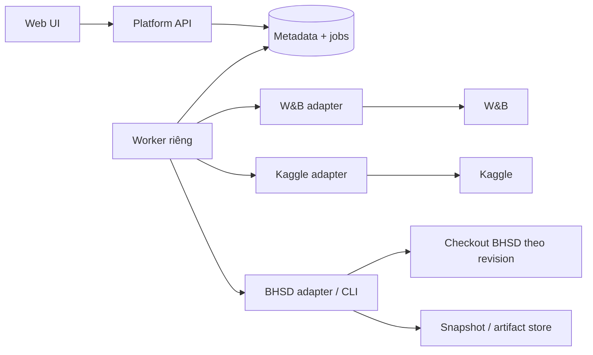

# Đánh giá mở rộng Research Portal — 31/10/2026

## 1. Kết luận và phạm vi bằng chứng

Nên xây **platform ở repo riêng**, dạng một ứng dụng có module rõ ràng, phục vụ nhiều project; BHSD là project và adapter đầu tiên. Repo BHSD giữ training/evaluation/config, exporter và contract tích hợp. Platform cung cấp giao diện, quản lý kết nối, tra cứu runs/models/artifacts, đồng bộ và ghi chú. Giữ W&B cho experiment tracking; không cần thay toàn bộ W&B bằng hệ thống tự xây.

Nếu chỉ cần dashboard cá nhân cho BHSD trong thời gian ngắn, một ứng dụng Streamlit riêng dependency trong `apps/portal/` ở repo này cũng hợp lý. Nhưng nhu cầu quản lý nhiều dịch vụ/tài khoản và dùng cho các model khác đã vượt phạm vi đó. Repo riêng có thêm chi phí version contract và release hai phía; lợi ích là không buộc platform phụ thuộc vòng đời training/CUDA và một dataset.

Đã đọc bảy tài liệu portal, docs index, hướng dẫn visualization, config parser, snapshot storage và mã tích hợp Kaggle/W&B liên quan. Chưa chạy API có credential, chưa xác minh quota tài khoản, chưa thử online multi-account hay triển khai server. Không đọc hoặc công bố nội dung secret. Nhận xét dưới đây là phân tích source và tài liệu chính thức; không phải chứng nhận an toàn của các công cụ hiện tại.

## 2. Bộ thiết kế hiện tại phù hợp đến đâu?

Đúng hướng ở: tách research metadata khỏi telemetry, tận dụng W&B, ưu tiên snapshot/offline, nhận diện positive Dice khác case mean, có checkpoint lineage và adapter thực thi. Phân tích nghiệp vụ BHSD khá tốt, nhưng chưa đủ làm đặc tả platform tổng quát.

| Vấn đề | Bằng chứng trong checkout | Cần điều chỉnh |
|---|---|---|
| Chưa chốt repo và dependency boundary | Roadmap còn `portal/` hoặc submodule; architecture/ADR-01 dùng chung virtualenv training | Repo riêng; môi trường platform độc lập; adapter subprocess hoặc import package đã version hóa |
| W&B còn single identity/project | `tools/fetch_wandb.py` hardcode entity/project, dùng `wandb.Api()` mặc định | Connection theo provider/principal/endpoint; project bindings riêng; credential theo từng client/job |
| Công cụ Kaggle chưa phải backend đa người dùng | `accounts_manager.py` có fallback credential toàn cục; builder dùng đường dẫn repo cố định; CLI thay `os.environ` | Adapter strict profile, workspace riêng từng job, không fallback identity khi vận hành qua web |
| Thiếu domain tổng quát | Data model tập trung method BHSD/Kaggle, một run gắn tối đa một execution | Workspace/project/connection; một logical run có nhiều execution attempts và nhiều external references |
| Schema config được mô tả quá mạnh | JSON Schema minh họa yêu cầu các field vốn có thể có từ merge/default; parser đồng bộ `data.num_classes`, có layered config | Gọi parser thực của revision được chọn; lưu resolved config; không coi schema minh họa là tương thích 100% |
| Snapshot bị đồng nhất với idempotency | `new_snapshot()` tạo thư mục UUID mỗi lần, ghi manifest và cập nhật `latest` trước khi caller ghi đủ nội dung | Snapshot append-only không đồng nghĩa upsert idempotent; cần commit marker/checksum và unique key import |
| Worker chưa có durability | Architecture dùng BackgroundTasks/APScheduler nội bộ | Job lưu DB, process worker riêng, lease và recovery; không chạy scheduler mỗi API replica |
| Phân loại lỗi quá chắc chắn | Suy time limit từ runtime/log; W&B stalled có thể do mất kết nối | Lưu raw state + evidence + độ chắc chắn; không tự kết luận timeout/failed từ telemetry stale |
| Viewer mặc định HU chưa phù hợp dữ liệu | Hướng dẫn visualization xác nhận H5 normalized, HU cần provenance | Percentile mặc định; chỉ bật HU khi units/normalization đã xác minh; Z theo volume thực |
| Lịch và inventory dễ lỗi thời | Roadmap ghi số run cố định, ngày triển khai cố định | Nghiệm thu theo fixture/imported dataset thực tế, không lấy số run lịch sử làm contract |

Không nên giữ các khẳng định “tái sử dụng nguyên vẹn”, “bảo mật đã kiểm chứng”, hoặc “tái lập 100%”. Có thể tái sử dụng logic, nhưng phải kiểm tra concurrency, identity, side effects và config compatibility trước khi bọc API.

## 3. Chọn vị trí và công nghệ

| Cách làm | Hợp khi | Đánh đổi |
|---|---|---|
| Dashboard trong repo BHSD | Một người, một project, đọc snapshot | Đơn giản nhưng dễ lệ thuộc schema và dependencies training |
| **Platform repo riêng — đề xuất** | Nhiều project, Kaggle/W&B profiles, phát triển lâu dài | Phải có contract version hóa, fixture và adapter compatibility |
| Microservices nhiều repo | Có đội vận hành và tải phân tán thực tế | Chưa có bằng chứng cần chi phí này |

Platform repo có thể dùng cấu trúc:

```text
research-platform/
  apps/web/                 # React + TypeScript
  services/api/             # FastAPI: API, authorization, metadata
  services/worker/          # sync jobs, reconcile, execution jobs
  packages/contracts/      # schemas, fixtures, compatibility versions
  adapters/{wandb,kaggle,bhsd}/
  migrations/
  deploy/                   # compose, backup/restore, runtime mounts
  docs/                     # nguồn thiết kế chính sau khi tạo repo
```

FastAPI + React/TypeScript là lựa chọn hợp lý. Chỉ thêm Next.js nếu cần khả năng routing/rendering của nó; dashboard nội bộ không tự có nhu cầu SSR. Chọn phiên bản còn được hỗ trợ lúc khởi tạo, khóa dependencies; không cố định Next 14/15 từ thiết kế cũ. SQLite phù hợp một máy và ít writer; PostgreSQL khi nhiều worker/writer hoặc host dùng chung. Không mặc định cần Redis/Celery ngay: worker riêng đọc job table có thể đủ giai đoạn đầu nếu có locking/recovery đúng.

Không cần submodule mặc định. Cho platform cấu hình đường dẫn checkout BHSD và revision được hỗ trợ, gọi CLI có allowlist; dài hạn có thể đóng gói adapter. Không sao chép training code sang platform. Giữ docs này làm bản phân tích nguồn, khi có repo platform thì chuyển đặc tả chính sang đó và để link tại đây.



## 4. Mô hình dữ liệu cần bổ sung

Core không hardcode EDH/SDH, số fold, Kaggle session length hoặc tên architecture. BHSD cung cấp metric profile, config validator và viewer adapter.

- `Workspace`, `Project`, `ProjectMembership`: phạm vi dữ liệu, repo URI và vai trò viewer/operator/admin khi có nhiều người dùng.
- `ProviderConnection`: provider, endpoint, principal, label, `credential_ref`, health, last check, capabilities. Không chứa key trả về UI.
- `ProjectConnectionBinding`: project ↔ connection ↔ remote entity/project hoặc owner. Kaggle account và W&B identity là hai lựa chọn độc lập.
- `Experiment`, `LogicalRun`: giả thuyết, resolved config/hash, seed, dataset/split fingerprint, code revision, dirty diff hoặc bundle digest.
- `ExecutionAttempt`: logical run, attempt index, execution target, connection, notebook slug/version, submitted bundle hash, started/ended; một logical run có nhiều attempts.
- `ExternalRunReference`: provider + endpoint + entity + project + remote run ID; không chỉ dùng W&B short ID. Gán với attempt và đánh dấu liên kết được xác minh hay suy đoán.
- `ModelVersion`, `ArtifactReference`: immutable digest/version, parent checkpoint, source attempt và iteration. Alias `best/latest` chỉ là pointer có thể thay đổi.
- `Evaluation`: checkpoint digest + dataset/split/protocol hash + evaluated component (teacher/student) + evaluator revision; không chỉ metric cao nhất trên run.
- `MetricDefinition`, `MetricObservation`: tên, direction, unit, aggregation, support/empty-case policy, protocol version, iteration và source. Missing/unsupported phải khác số 0.
- `SyncCursor`, `SyncJob`, `Operation`, `AuditEvent`: nguồn, watermark, retry, actor, request hash, status, timestamps, sanitized outcome.
- `ResearchNote` và liên kết paper/report: nội dung, tags, entity references và lịch sử chỉnh sửa tối thiểu.

Khóa import observation cần gồm external reference, evaluation/protocol, step và metric (cùng class/scope khi có). Import cùng snapshot hai lần không tạo metric/run trùng, dù hai file snapshot có UUID khác nhau. Không bắt buộc cùng logical run luôn giữ một W&B run: hỗ trợ cả resume same-run và new-run với quan hệ parent.

## 5. Quản lý tài khoản thực sự là gì?

Bản đầu quản lý **kết nối được cấp quyền**: thêm profile, xác minh principal, chọn project/entity, xem tình trạng kết nối, thay/revoke credential reference, chọn account cho job và xem lịch sử sử dụng. Tạo tài khoản dịch vụ, đổi mật khẩu/2FA, billing và quản trị membership trên provider không thuộc MVP; dẫn người dùng về trang provider.

W&B client nhận credential tường minh theo connection (`api_key` nếu SDK đã chọn hỗ trợ), không đổi `WANDB_API_KEY` toàn cục trong API server. Test identity và project permissions trước khi bind. Với Kaggle dùng env/process riêng từng job, credential source tường minh, không thừa hưởng token hoặc fallback account của người chạy server. Xác thực phải phân biệt legacy key, access token và OAuth; kiểm tra lại theo phiên bản CLI pin thực tế.

DB chỉ lưu secret reference. Một máy có thể dùng file secret ngoài repo, directory 700/file 600 và backup có kiểm soát; server chia sẻ có thể dùng secret manager. File chmod 600 vẫn chứa plaintext và không phải encryption-at-rest. Không đưa API key vào URL, browser storage, log, notebook source hoặc command preview. API trả profile metadata và trạng thái, không trả secret. Không dựa vào env toàn cục hoặc `.netrc` chung để chọn identity.

Khi chỉ dùng cá nhân: bind localhost. Khi có người dùng khác: authentication, quyền theo project, kiểm tra quyền tại API/download, TLS và bảo vệ cookie/CSRF nếu dùng cookie session là điều kiện vận hành. Dataset/artifact chỉ được đọc từ root allowlist; chặn path traversal và giới hạn kích thước tải. Giao diện viewer chỉ phục vụ nghiên cứu.

## 6. Đồng bộ và thực thi đáng tin cậy

**Read path:** UI đọc DB/cache/snapshot; worker gọi provider theo connection và cập nhật DB. Trả `observed_at`, `synced_at`, trạng thái stale/error và source cho UI. Poll active runs thường hơn terminal runs; backoff+jitter khi lỗi/429, phân trang và checkpoint cursor. Không dùng UI request để quét lại toàn bộ W&B history.

Giữ telemetry thô tại W&B; cho phép cache có TTL, giới hạn dung lượng và downsample. Bảng paper/so sánh phải dựa trên evaluation snapshot cố định với provenance, không dựa vào biểu đồ sampled. Không mặc định nhúng được private W&B panel: dùng link mở trang provider, hoặc server lấy dữ liệu mà connection được quyền đọc.

**Snapshot:** ghi staging, xác minh file/checksum, đánh dấu complete, rồi publish/cập nhật latest; importer bỏ incomplete snapshot. Snapshot cũ chưa có marker cần adapter legacy kiểm tra các file bắt buộc theo loại export và ghi trạng thái chất lượng. Không coi latest là bằng chứng bất biến. Có retention và backup metadata+notes; không tự xóa checkpoint đang được evaluation/report tham chiếu.

**Write path (giai đoạn sau):** preview config/account/bundle digest → tạo operation bền vững trước dispatch → worker claim bằng lease → submit → lưu remote version → reconcile. API submit trả operation ID; client retry dùng idempotency key và request hash. Hai request khác nhau cùng đẩy một notebook cần lock theo connection+slug. Nếu push timeout sau khi provider có thể đã nhận, trạng thái `unknown/reconciling`; kiểm tra remote version và bundle evidence trước khi retry, không hứa exactly-once khi provider không hỗ trợ.

Tách `execution_state`, `tracking_state`, `sync_health`. W&B heartbeat cũ không chứng minh Kaggle chết; Kaggle complete không chứng minh đạt max iteration hay benchmark hợp lệ. UI hiển thị bằng chứng và cho gán nguyên nhân có nguồn. Quota và session duration phải cấu hình/ghi nguồn+thời điểm; nếu API không cung cấp thì hiện ước tính hoặc unknown, không ghi cứng 9h/30h thành sự thật mọi account. Đa tài khoản là quản lý quyền truy cập hợp lệ, không thiết kế tự xoay account để vượt hạn mức.

## 7. Phạm vi màn hình và thứ tự triển khai

MVP gồm: Project selector; Dashboard theo project; bảng Runs có filter; Run detail (config, curves, lineage, artifact links); Compare; Models; Connections; Sync health; notes. Giai đoạn sau mới thêm experiment matrix, submit/resume và medical viewer. Tách trạng thái “chưa sync”, “thiếu quyền”, “không có dữ liệu” và “giá trị bằng 0”.

| Mốc | Kết quả sử dụng được | Điều kiện nghiệm thu |
|---|---|---|
| M0: contract | Fixture snapshot BHSD + schema version + thiết kế multi-connection | Import offline không cần Torch/GPU/credential; resolved config khớp parser thực |
| M1: read-only offline | Runs/detail/compare/model metadata/notes | Import lặp không nhân đôi; phân biệt missing/0; hiển thị metric definitions, protocol và source |
| M2: read-only online | Multi-account Kaggle/W&B, health và sync worker | Hai connection không lẫn identity; mất mạng/403/429 có trạng thái rõ; restart không mất job; chạy offline tiếp được |
| M3: controlled execution | Build/preview/submit, logs, resume recipe | Duplicate request không tạo push thứ hai; timeout ambiguous được reconcile; audit đầy đủ; khóa workspace/job |
| M4: BHSD analytics | Viewer + evaluation registry + paper export | HU chỉ khi đủ provenance; ảnh/mask khớp grid; nhóm so sánh cùng split/protocol/budget; export ghim checkpoint và nguồn |

Không gán ngày hoàn thành trước khi biết người triển khai và thời gian có thể dành. Định nghĩa xong M0 rồi làm một lát cắt M1 hoàn chỉnh, tránh xây đồng thời toàn bộ 11 nhóm chức năng. Các kiểm thử cần tập trung vào import idempotency, identity isolation, crash recovery, config compatibility, scientific comparison và ambiguous submit.

## 8. Những việc cụ thể trong repo BHSD

1. Trước mắt giữ bộ phân tích này và thêm fixture/contract export ở bước triển khai M0; chưa tạo `portal/` hay thêm web dependencies vào requirements training.
2. Chuyển hardcoded entity/project của W&B exporter thành input tường minh khi làm adapter; trả kết quả cấu trúc có schema version thay vì parse stdout tự do.
3. Tách account metadata khỏi credential lookup; chế độ platform bắt buộc strict profile, không fallback. Cô lập output/workspace từng job thay vì dùng một bundle path dùng chung.
4. Chuẩn hóa export manifest: source revision, resolved config hash, dataset/split/protocol fingerprints nếu có, artifact version/digest và snapshot completeness. Thiếu dữ liệu phải ghi unknown, không suy ra giá trị.
5. Kiểm tra snapshot publish/retention và credential redaction trước khi bật online write. Không cần đổi training algorithm để xây dashboard.

Đây là backlog đề xuất, chưa phải những thay đổi code đã thực hiện trong lần đánh giá này.

## 9. Đính chính khảo sát và nguồn chính thức

- Streamlit vẫn là lựa chọn hợp lệ cho dashboard nhỏ: [caching](https://docs.streamlit.io/develop/concepts/architecture/caching) và [fragments](https://docs.streamlit.io/develop/concepts/architecture/fragments) giảm gọi lại và rerun. Việc thiết kế cũ coi mỗi tương tác luôn chạy lại tất cả hoặc không thể tách worker là quá tuyệt đối. Chọn React theo nhu cầu quản lý/tương tác dài hạn, không phải vì Streamlit bất khả thi.
- [FastAPI BackgroundTasks](https://fastapi.tiangolo.com/tutorial/background-tasks/) không phải thiết kế hàng đợi bền vững; tài liệu chỉ ra hướng công cụ ngoài process cho tác vụ lớn. Yêu cầu job table/lease/recovery ở đây là quyết định thiết kế của platform.
- [W&B Public API source](https://github.com/wandb/wandb/blob/main/wandb/apis/public/api.py) là nguồn kiểm tra credential/client contract theo SDK pin. [W&B service accounts](https://docs.wandb.ai/support/models/articles/is-it-possible-to-add-the-same-service-a) gắn với team; không giả định một service account đại diện mọi team.
- [Kaggle authentication reference](https://github.com/Kaggle/kaggle-cli/blob/main/skills/references/auth.md) mô tả OAuth/access token/legacy key. [Kaggle API docs](https://www.kaggle.com/docs/api) là nguồn kiểm tra capabilities. Không coi API private/log endpoint trong executor hiện có là contract ổn định.

Các nhận xét cũ về giá/license/quota, viewer library maintenance và hạn chế tuyệt đối của nền tảng khác chưa được xác minh hết trong lần này. Không dùng chúng làm căn cứ duy nhất để mua dịch vụ hoặc chọn dependency.
