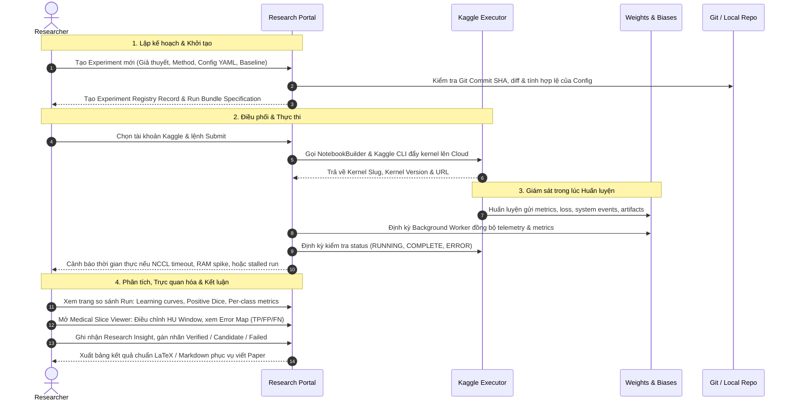

# Yêu cầu Hệ thống Research Management Portal (MedSSL-BHSD)

Tài liệu này xác định toàn bộ yêu cầu chức năng, phi chức năng và luồng công việc (user workflows) cho **Research Management Portal** phục vụ dự án nghiên cứu **Semi-Supervised Learning (SSL) cho phân đoạn ảnh cắt lớp vi tính (CT) sọ não trên bộ dữ liệu BHSD (Brain Hemorrhage Segmentation Dataset)**.

Cơ sở phân tích được đối chiếu trực tiếp từ hiện trạng mã nguồn, cấu trúc dữ liệu, các công cụ điều khiển và báo cáo thực nghiệm trong repository `MedSSL-BHSD` tính đến ngày 29/10/2026.

---

## 1. Bối cảnh nghiên cứu và Hiện trạng Workflow

### 1.1. Mục tiêu khoa học của dự án
Dự án tập trung giải quyết bài toán phân đoạn tổn thương xuất huyết nội sọ (Intracranial Hemorrhage - ICH) 3D trên ảnh CT sọ não trong điều kiện dữ liệu gán nhãn khan hiếm bằng các phương pháp Semi-Supervised Learning (SSL).
- **Bộ dữ liệu**: BHSD gồm 2 bài toán:
  - **Multiclass**: 6 lớp (0: Background, 1: Epidural - EDH, 2: Intraparenchymal - IPH, 3: Intraventricular - IVH, 4: Subarachnoid - SAH, 5: Subdural - SDH).
  - **Binary**: 2 lớp (0: Background, 1: Xuất huyết nói chung).
- **Các phương pháp SSL đang triển khai**: PICK, Mean Teacher (MT), Supervised Baseline, Cross Pseudo Supervision (CPS), Bidirectional Copy-Paste (BCP), LeFeD.
- **Backbone 3D**: `nnunet3d` (7-stage deep supervision), `vnet`, `unet3d`, `unetr`.

### 1.2. Hiện trạng thực thi và các điểm nghẽn thực tế (Pain Points)

Dựa trên kết quả kiểm toán mã nguồn và các báo cáo điều tra thực nghiệm gần đây (`docs/analysis/run-s9i9nsui-termination-2026-10-26.md`, `docs/analysis/run-9tvq8qld-16250-2026-10-28.md`):

1. **Phân tán môi trường thực thi và giới hạn hạ tầng:**
   - Huấn luyện mô hình 3D yêu cầu GPU lớn (2x Tesla T4 hoặc P100 trên Kaggle).
   - Mỗi tài khoản Kaggle bị giới hạn trần 9 giờ / session và hạn mức hàng tuần (khoảng 30 giờ GPU/tuần).
   - Nhóm nghiên cứu phải dùng **nhiều tài khoản Kaggle** (`bokhnhl`, `thnhnguynvncng`), quản lý thủ công qua `tools/kaggle/accounts_manager.py` và `configs/kaggle/accounts.json`.
   - Khi hết 9 giờ hoặc gặp sự cố, thí nghiệm bị dừng đột ngột; việc resume đòi hỏi tra cứu thủ công checkpoint mới nhất trên W&B Artifacts hoặc Kaggle output để nối tiếp.

2. **Lệch pha thông tin (Information Asymmetry) giữa các nền tảng:**
   - **Kaggle** chỉ lưu console output thô và file zip output. Khi gặp lỗi NCCL Timeout hoặc Papermill Execution Crash, log W&B thường bị ngắt sớm hoặc không hiển thị nguyên nhân trực tiếp từ launcher.
   - **Weights & Biases (W&B)** lưu trữ loss curves, metric history và system events, nhưng không lưu trữ giả thuyết nghiên cứu, lý do chạy thí nghiệm, quan hệ với các run trước, hay mã nguồn notebook thực tế đang submit.
   - **Local Repository** chứa code và cấu hình YAML, nhưng không theo dõi tự động được code commit nào đang chạy ở phiên bản kernel nào trên Kaggle.

3. **Cạm bẫy diễn giải chỉ số (Metric Ambiguity & Misleading Checkpoints):**
   - Chỉ số `val/mDice` truyền thống (legacy) tính trung bình toàn bộ ca (kể cả ca âm tính không có tổn thương, gán mặc định Dice = 1.0 khi prediction và GT cùng rỗng).
   - Thực tế kiểm toán run `9tvq8qld` chỉ ra: Tại iteration 2.750, legacy mDice đạt đỉnh 0.46258 do mô hình đoán toàn background, trong khi `positive macro Dice` thực tế chỉ đạt 0.10432! Ngược lại, tại iteration 14.500 khi mô hình học tốt các lớp tổn thương khó (positive macro đạt đỉnh 0.34167), legacy mDice lại thấp hơn (0.36147).
   - Nếu không có giao diện hiển thị tách bạch `dice_case_mean`, `dice_positive_mean`, `negative_fp_case_rate`, `precision_micro`, `recall_micro`, nhà nghiên cứu sẽ đưa ra kết luận sai lệch về hiệu quả thuật toán.

4. **Trực quan hóa lát cắt y tế còn hạn chế:**
   - Trực quan hóa hiện tại (`utils/visualizer.py`) sinh ra ảnh tĩnh 4 panel (`CT | GT | Prediction | Error Map`) tải lên W&B hoặc xuất ra file HTML cục bộ.
   - Nhà nghiên cứu không thể tương tác điều chỉnh Window Center/Width (HU windowing), không thể lật từng lát cắt axial (Z-axis), không thể zoom-in vào vùng tổn thương nhỏ, và không thể bật/tắt từng lớp nhãn tổn thương riêng biệt.

5. **Thiếu hệ thống quản lý tri thức khoa học (Research Knowledge Registry):**
   - Việc so sánh giữa các phương pháp SSL (ví dụ: Mean Teacher vs PICK vs Supervised) hiện phải làm thủ công bằng script dòng lệnh (`tools/compare_runs.py`, `tools/fetch_wandb.py`).
   - Thiếu một nơi lưu trữ cấu trúc: Giả thuyết là gì? Kết quả kiểm chứng thế nào? Run nào làm baseline? Lý do chọn hyperparameters?

---

## 2. Đối tượng sử dụng và Kịch bản Vận hành (User Workflows)

### 2.1. Đối tượng sử dụng chính
- **Principal Researcher / Phụ trách Nghiên cứu**: Thiết kế giả thuyết, so sánh các phương pháp SSL, phân tích lỗi định tính/định lượng, trích xuất bảng số liệu báo cáo/paper.
- **Experiment Operator / Kỹ sư Thực nghiệm**: Đóng gói notebook, phân bổ jobs vào các tài khoản Kaggle, giám sát tài nguyên/lỗi, quản lý checkpoint resume và đồng bộ dữ liệu về máy chủ nghiên cứu.

### 2.2. Kịch bản vận hành trọng tâm (Core Workflows)

---

## 3. Danh mục Chi tiết 11 Nhóm Chức năng

### 3.1. Centralized Research Dashboard (Bảng Điều khiển Nghiên cứu Trung tâm)
1. **Tổng quan nghiên cứu (Research Pulse)**:
   - Thẻ thống kê số lượng: Active Methods, Total Experiments, Executed Runs, Best Model Candidates, Total GPU Hours.
   - Thống kê trạng thái run: `Planned`, `Queued`, `Running`, `Completed`, `Failed`, `Terminated (Kaggle timeout)`, `Resumed`.
2. **Bảng thí nghiệm đang chạy (Live Running Monitor)**:
   - Danh sách các jobs đang chạy trên các tài khoản Kaggle: Kernel Slug, Account Username, Iteration hiện tại / Max Iteration, GPU Memory, Thời gian đã chạy (Elapsed / 9h limit).
3. **Best Performers Leaderboard**:
   - Bảng xếp hạng mô hình tốt nhất theo bài toán (Multiclass vs Binary), lọc theo metric:
     - `val/best_mDice_positive` (Ưu tiên số 1 - Foreground positive macro mean).
     - `val/best_mDice_legacy` (Chỉ số truyền thống gồm cả background).
     - Per-class Dice (EDH, IPH, IVH, SAH, SDH).
     - `negative_fp_case_rate` (Tỷ lệ cảnh báo giả trên ca âm tính).
4. **Radar so sánh phương pháp (SSL Comparative Radar)**:
   - So sánh trực tiếp giữa các phương pháp: Supervised Baseline vs Mean Teacher vs PICK vs CPS theo từng lát cắt dữ liệu (% labeled data: 10%, 20%, 100%).
5. **Trung tâm cảnh báo (Health & Alert Feed)**:
   - Tự động nhận diện và đẩy cảnh báo:
     - Cảnh báo Kaggle kernel sắp chạm ngưỡng 9h (ví dụ: > 8h15m).
     - Cảnh báo NCCL Timeout hoặc Process Stall (không có telemetry mới trong > 20 phút).
     - Cảnh báo RAM hệ thống vượt ngưỡng nguy hiểm (> 90%).
     - Cảnh báo Zero-Detection cho các lớp hiếm (như hiện tượng EDH Dice = 0 kéo dài).

### 3.2. Account & Integration Management (Quản lý Tài khoản & Tích hợp)
1. **Kaggle Multi-Account Registry**:
   - Quản lý danh sách tài khoản (`configs/kaggle/accounts.json`): Account ID, Slug, Username, Tên hiển thị, Hạn mức sử dụng hàng tuần ước tính.
   - Kiểm tra kết nối API (`kaggle_ctl account test`) theo từng profile độc lập.
   - Bảo mật thông tin xác thực: Mỗi tài khoản lưu trữ file `kaggle.json` trong thư mục profile riêng biệt với quyền `chmod 600`. Tuyệt đối không hardcode credentials trong source code hay hiển thị token trên UI.
2. **Weights & Biases (W&B) Integration**:
   - Quản lý thông tin kết nối: Entity, Project, Default Mode (`online`/`offline`).
   - Trạng thái kết nối W&B API, kiểm tra API key hợp lệ từ biến môi trường `WANDB_API_KEY`.
   - Giám sát đồng bộ: Thời điểm đồng bộ gần nhất, số lượng runs đã crawl về local snapshot.
3. **GitHub / Git Codebase Integration**:
   - Hiển thị Branch hiện tại, Commit SHA gần nhất, trạng thái working directory (clean/dirty).
   - Phát hiện độ lệch code (Code Drift Detection): So sánh mã nguồn thực tế đóng gói trong Kaggle notebook với Commit SHA tại thời điểm submit.
4. **Khả năng mở rộng môi trường tính toán (Future Execution Targets)**:
   - Hỗ trợ thêm các target: Local GPU Server, HPC Cluster (Slurm) thông qua kiến trúc Adapter trừu tượng.

### 3.3. Research Method & Experiment Registry (Quản lý Phương pháp & Thí nghiệm)
1. **Phân cấp dữ liệu nghiên cứu rõ ràng**:
   - `Research Method`: Tên phương pháp (Mean Teacher, PICK, CPS...), Nhóm thuật toán (Consistency Regularization, Pseudo-Labeling, Co-Training), Paper tham khảo (DOI/arXiv link), Mô tả lý thuyết cốt lõi.
   - `Experiment`: Đơn vị kiểm chứng giả thuyết (ví dụ: *"Đánh giá ảnh hưởng của Confidence Threshold đối với Mean Teacher trên BHSD 10% labeled data"*). Bao gồm: Giả thuyết, Baseline đối chứng, Dataset & Fold, Cấu hình chung.
   - `Run`: Một phiên thực thi cụ thể với seed, commit SHA, hyperparameter cố định, liên kết trực tiếp với Kaggle Session và W&B Run ID.
   - `Model Version`: Checkpoint được tạo ra sau run (Best, Latest, Phase Checkpoint), kèm metrics đánh giá độc lập.
   - `Artifact`: Các tệp dữ liệu phái sinh: Log thô, Visualizations, Masks, Báo cáo đánh giá JSON.
2. **Quản lý biến thể phương pháp (Method Variants)**:
   - Theo dõi sự biến đổi tham số và chiến lược: Thay đổi loss function (CE + Dice vs Focal + Dice), thay đổi tỷ lệ labeled/unlabeled, điều chỉnh rampup/rampdown của consistency weight.

### 3.4. Kaggle Notebook Management (Quản lý Notebook Kaggle Tập trung)
1. **Kho mẫu Notebook (Notebook Templates & Specifications)**:
   - Đồng bộ từ `configs/kaggle/notebooks.json` và thư mục `scripts/`:
     - `mean_teacher`: Dual-GPU DDP Mean Teacher template.
     - `pick`: PICK 2-phase framework template.
     - `supervised`: Baseline single/dual GPU template.
2. **Trình tạo Bundle tự động (Automated Bundle Builder)**:
   - Tích hợp trực tiếp với `tools/kaggle/notebook_builder.py`: Tự động inject W&B credentials an toàn, liên kết dataset Kaggle tương ứng (`bhsd-pick-preprocessed`, v.v.), sinh `kernel-metadata.json` chuẩn hóa cho từng tài khoản.
3. **Giám sát vòng đời Kernel**:
   - Quản lý trạng thái thực thi: `QUEUED`, `RUNNING`, `COMPLETE`, `ERROR`, `CANCEL_ACKNOWLEDGED`.
   - Kéo file log nhanh (`kaggle_ctl log`) mà không cần tải toàn bộ checkpoint nặng hàng gigabytes.
4. **Phục hồi & Tiếp tục (Checkpoint Resume Recipe Generator)**:
   - Khi run bị dừng do hết 9h: Portal tự động xác định checkpoint mới nhất trên W&B hoặc Kaggle output, sinh cấu hình resume (`resume: true`, `resume_path: ...`, `resume_policy: latest`), tạo bundle mới để đẩy lên tài khoản tiếp theo.

### 3.5. W&B Integration & Experiment Tracking (Tích hợp W&B Sâu)
1. **Chiến lược hai nguồn dữ liệu (Two-Source Data Policy)**:
   - **W&B là Single Source of Truth cho Time-series Telemetry**: Portal KHÔNG duplicate từng bước train loss (hàng chục ngàn data points). Thay vào đó, Portal query trực tiếp qua W&B API hoặc nhúng W&B Workspace Panels/Charts khi cần xem chi tiết từng step.
   - **Portal là Single Source of Truth cho Research Metadata & Validation Milestones**: Portal lưu trữ cấu hình, checkpoint lineage, báo cáo đánh giá, ghi chú nghiên cứu và các mốc validation chính thức (`val/mDice`, per-class metrics tại các iteration quan trọng).
2. **Đồng bộ hóa Idempotent**:
   - Kế thừa cơ chế snapshot bất biến từ `tools/crawl_storage.py`: Lưu trữ snapshot theo định dạng `experiment_data/wandb/<run_id>/<timestamp>/` với `manifest.json`.
   - Đồng bộ có chọn lọc: Quét các run mới hoặc run đang active, tránh quét lại các run đã `finished` từ lâu.

### 3.6. Model Registry & Medical Segmentation Analytics (Quản lý & Phân tích Mô hình)
1. **Kho lưu trữ Mô hình (Model Lineage Registry)**:
   - Quản lý metadata checkpoint: Tên model, Architecture (`nnunet3d`, `vnet`...), Backbone configuration (stages, filters, deep supervision), Kích thước checkpoint (bytes), Vị trí lưu trữ (Local path, W&B Cloud Artifact URI).
   - Phân loại trạng thái mô hình: `Experimental`, `Candidate`, `Validated Benchmark`, `Archived / Deprecated`.
2. **Bảng phân tích chuyên sâu cho Phân đoạn Xuất huyết Não (BHSD Metrics Suite)**:
   - Tách biệt rõ ràng theo chuẩn dự án (`docs/guides/metrics-and-wandb.md`):
     - `dice_case_mean` vs `dice_positive_mean`.
     - `precision_micro` vs `recall_micro` theo voxel.
     - Phân tích âm tính giả/dương tính giả: `negative_fp_case_rate`, `negative_fp_voxels_mean`, `negative_fp_ml_mean`.
     - Bề mặt khoảng cách (Surface distance): `hd95_mm_mean`, `asd_mm_mean` (kèm xác thực spacing mm).
3. **Trình hiển thị Lát cắt Y tế Tương tác (Interactive Medical Slice Viewer)**:
   - Dựa trên quy ước hiển thị an toàn của `utils/visualizer.py`:
     - **Windowing HU linh hoạt**: Cho phép điều chỉnh Window Center ($L$) và Window Width ($W$) (Mặc định não/xuất huyết: $C=40, W=80$; Mặc định xương: $C=400, W=1000$; Mặc định Subdural: $C=75, W=150$).
     - **Lật lát cắt Axial (Z-axis slider)**: Xem toàn bộ thể tích 3D của bệnh nhân lát qua từng slice.
     - **Lớp phủ Đa nhãn (Multiclass Segmentation Overlay)**: Bật/tắt riêng biệt từng lớp: EDH (Đỏ), IPH (Xanh lục), IVH (Vàng), SAH (Tím), SDH (Cam).
     - **Bản đồ Lỗi Chẩn đoán (Diagnostic Error Map Overlay)**:
       - True Positive (Xanh lục nhạt)
       - False Negative (Đỏ đậm - bỏ sót tổn thương)
       - False Positive (Vàng cam - chẩn đoán nhầm)
       - Wrong Class (Tím hồng - phân loại nhầm giữa các loại xuất huyết).
4. **Phân tích Pseudo-Label trong SSL**:
   - Đối với các phương pháp như PICK hoặc Mean Teacher: Hiển thị độ tin cậy (Confidence Heatmap) của Teacher model trên dữ liệu không gán nhãn (Unlabeled pool), tỷ lệ voxel vượt ngưỡng tin cậy qua các epoch.

### 3.7. Dataset & Split Management (Quản lý Dữ liệu & Phân chia Tập dữ liệu)
1. **Catalog Bộ dữ liệu**:
   - Quản lý phiên bản dữ liệu HDF5: Đường dẫn, Checksum, Số lượng bệnh nhân, Thể tích, Kích thước patch training (`[32, 192, 192]`).
   - Cấu hình tiền xử lý (Preprocessing metadata): Spacing gốc vs Target Spacing (`[5.0, 0.5, 0.5]`), Chuẩn hóa (`zscore_hu` vs `percentile`), Clip range (`[11.0, 88.0]`).
2. **Kiểm tra Chống Rò rỉ Dữ liệu (Data Leakage & Split Integrity Guard)**:
   - Cơ chế kiểm toán: Đảm bảo toàn bộ lát cắt của cùng một bệnh nhân (Patient-level ID) chỉ nằm trong 1 tập duy nhất (Train Labeled, Train Unlabeled, hoặc Validation).
   - Kiểm tra phân bố 5-fold cross validation: Xác minh tỷ lệ các loại xuất huyết hiếm (đặc biệt là EDH) được phân bổ cân bằng giữa các fold.

### 3.8. Experiment Planning & Orchestration (Kế hoạch & Điều phối Thực nghiệm)
1. **Ma trận Thực nghiệm (Experiment Matrix Planner)**:
   - Thiết kế thí nghiệm lưới: Tự động sinh danh sách runs cho ma trận:
     $\text{Methods} \times \text{Folds (0..4)} \times \text{Labeled Ratios (10\%, 20\%, 100\%)} \times \text{Seeds}$.
2. **Hàng đợi Thực nghiệm (Local Job Queue)**:
   - Danh sách công việc chờ thực thi.
   - Hướng dẫn chuyển đổi môi trường: Cung cấp CLI script sẵn sàng chạy cho môi trường Local GPU, Kaggle batch submit (`scripts/submit_mean_teacher_kaggle.sh`), hoặc Slurm batch script.

### 3.9. Research Insights, Reporting & Paper Generation (Báo cáo & Viết Paper)
1. **Nhật ký Quyết định Nghiên cứu (Research Decision Log)**:
   - Ghi nhận lý do thay đổi kiến trúc, lý do điều chỉnh hyperparameter (ví dụ: *"Tăng consistency rampup lên 40 epoch vì student bị collapse sớm"*).
2. **Trình tạo Bảng Kết quả Khoa học (Paper Table Generator)**:
   - Tự động tổng hợp kết quả Benchmark theo định dạng bảng chuẩn của các hội nghị y tế/AI (MICCAI, IEEE TMI, MIDL).
   - Hỗ trợ xuất 1-click ra: **LaTeX table** (`\begin{tabular}...`), **Markdown table**, và **CSV**.
   - Tự động tính toán Mean ± Standard Deviation qua 5 folds.

### 3.10. System Health, Resource & Cost Monitoring (Giám sát Vận hành & Tài nguyên)
1. **Kaggle Session Telemetry Tracker**:
   - Theo dõi thời gian thực: GPU Memory Allocation (GiB), RAM Usage (%), CPU Utilization.
   - Phát hiện rò rỉ bộ nhớ (Memory Leak Detection): Đánh giá xu hướng RAM/VRAM qua các validation checkpoint.
2. **Quota & Rate Limit Dashboard**:
   - Đếm tổng số giờ GPU đã sử dụng trên từng tài khoản Kaggle trong tuần.

### 3.11. Search, Metadata & Knowledge Management (Tra cứu & Quản lý Tri thức)
1. **Faceted Search & Filter**:
   - Tìm kiếm đa chiều: Tìm theo tên phương pháp, commit SHA, W&B run ID, Kaggle kernel slug, tags, khoảng Dice score, hoặc trạng thái.
2. **Thư viện Tài liệu Tham khảo (Reference Papers & Notes)**:
   - Lưu trữ danh mục các bài báo SSL kinh điển và SOTA (Mean Teacher - Tarvainen 2017, PICK, CPS - Chen 2021, BCP - Bai 2023, nnU-Net - Isensee 2021).
   - Liên kết trực tiếp từng file mã nguồn trong `methods/` với bài báo tương ứng.

---

## 4. Yêu cầu Phi chức năng (Non-Functional Requirements)

1. **Bảo mật & Cách ly Thông tin Xác thực (Strict Credential Isolation)**:
   - Tuyệt đối không lưu trữ API keys, token, mật khẩu trong database dạng plaintext.
   - Tuân thủ cơ chế của dự án: Lưu credentials trong thư mục phân quyền nghiêm ngặt (`chmod 600`), ưu tiên sử dụng Environment Variables (`WANDB_API_KEY`, `KAGGLE_USERNAME`, `KAGGLE_KEY`).
2. **Bảo vệ Dữ liệu Y tế (Medical Data Privacy)**:
   - Portal được thiết kế chạy nội bộ (Local / On-premise). Tuyệt đối không tự động upload ảnh CT hoặc thông tin bệnh nhân lên các dịch vụ đám mây công cộng ngoài những artifacts đã được người dùng cấu hình rõ ràng.
3. **Tính Bất biến & Khả năng Tái lập (Immutability & Reproducibility)**:
   - Mọi kết quả đánh giá, snapshot metrics và metadata phải được gắn với Git Commit SHA và Configuration Hash tương ứng. Dữ liệu đã ghi không bị ghi đè ngầm (No silent overwrites).
4. **Hiệu năng & Độ trễ (Performance & Responsiveness)**:
   - Thời gian tải trang tổng quan Dashboard < 1.5 giây.
   - Trình hiển thị lát cắt CT 3D phải mượt mà: Độ trễ chuyển lát cắt < 50ms khi duyệt volume đã cache.
5. **Khả năng Chạy Ngoại tuyến (Local-First Architecture)**:
   - Toàn bộ Portal phải hoạt động bình thường ngay cả khi không có kết nối Internet (sử dụng dữ liệu snapshot đã crawl trong `experiment_data/`). Khi có mạng, tính năng đồng bộ sẽ tự động kết nối W&B và Kaggle API.

