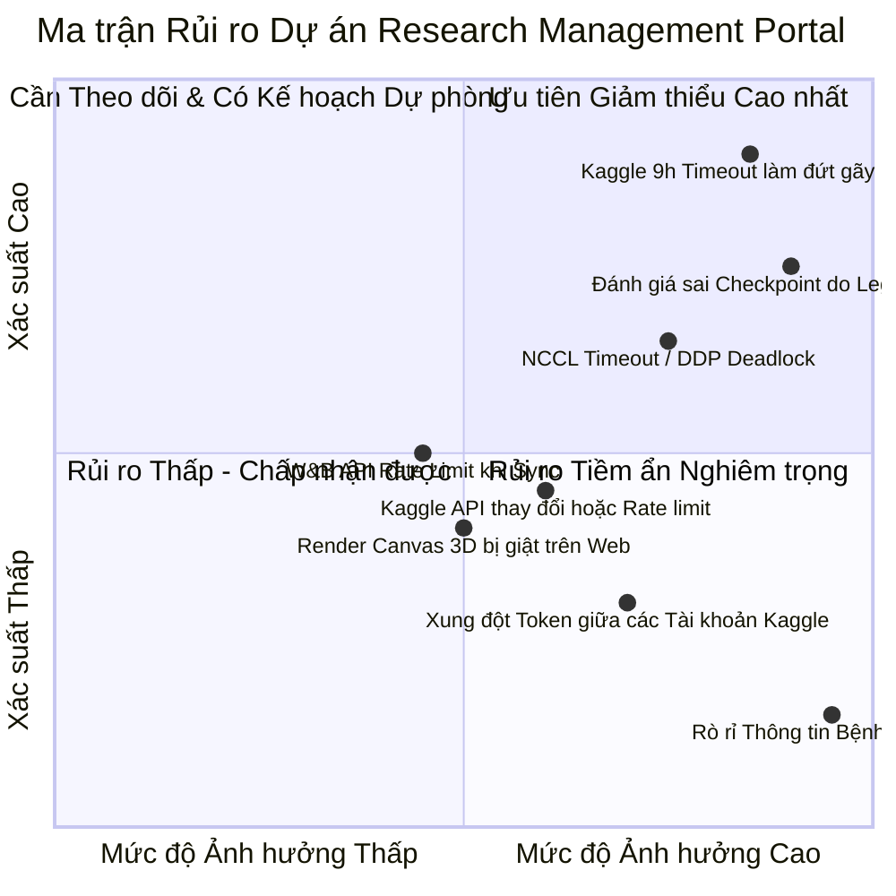

# Phân tích Rủi ro và Các Quyết định Kỹ thuật (Risks, Trade-offs & Decisions)

> Cập nhật 31/10/2026: đây là thiết kế ban đầu tập trung BHSD, chưa phải chức năng đã triển khai. Đọc [review mở rộng](platform-review-2026-10-31.md) trước; review điều chỉnh repo boundary, multi-account, worker, schema và phạm vi MVP khi có khác biệt.

Tài liệu này ghi nhận toàn bộ các rủi ro kỹ thuật, phân tích trade-off, các giả định cốt lõi và 10 Quyết định Thiết kế Kiến trúc (Architecture Decision Records - ADR) then chốt định hình nên **Research Management Portal**.

---

## 1. Ma trận Rủi ro Kỹ thuật và Biện pháp Giảm thiểu (Risk Matrix)

| Rủi ro Kỹ thuật | Xác suất | Mức độ | Biện pháp Giảm thiểu trong Thiết kế (Mitigation Strategy) |
| :--- | :---: | :---: | :--- |
| **1. Kaggle 9h Session Timeout làm đứt gãy thực nghiệm** | **Rất cao** | **Nghiêm trọng** | Portal tích hợp **Auto-Resume Recipe Engine**: Khi run chạm mốc 8h30m, hệ thống chuẩn bị sẵn cấu hình resume; tự động tra cứu checkpoint mới nhất trên W&B Artifacts và sinh bundle cho tài khoản tiếp theo. |
| **2. Tối ưu nhầm Checkpoint do chỉ số mDice truyền thống** | **Cao** | **Rất cao** | Portal mặc định hiển thị và xếp hạng theo **`dice_positive_mean`** (Foreground positive macro). Tách riêng `dice_case_mean` và cảnh báo rõ ràng khi có sự chênh lệch lớn giữa hai chỉ số. |
| **3. Lỗi NCCL Timeout trên Kaggle Dual-GPU** | **Cao** | **Nghiêm trọng** | Tích hợp bộ phân tích log tự động nhận diện chuỗi `NCCL ALLREDUCE timeout` hoặc `SIGABRT` từ Kaggle log thô. Portal gắn nhãn run là `FAILED (NCCL_TIMEOUT)` và khuyến nghị cấu hình lại batch size / DDP settings thay vì retry mù quáng. |
| **4. Rò rỉ Dữ liệu Y tế (HIPAA / Quyền riêng tư)** | **Thấp** | **Cực kỳ nguy hại** | Thiết kế **Local-First**: Mọi tệp HDF5 và ảnh CT chỉ đọc và xử lý trên máy trạm cục bộ. Tuyệt đối không có API endpoint nào upload ảnh bệnh nhân thô lên các dịch vụ public cloud. |
| **5. Xung đột Token giữa các Tài khoản Kaggle** | **Trung bình** | **Nghiêm trọng** | Kế thừa cơ chế từ `tools/kaggle/accounts_manager.py`: Mỗi lệnh push được thực thi trong sub-process với biến môi trường `KAGGLE_CONFIG_DIR` trỏ vào profile riêng có quyền `chmod 600`. Xóa hoàn toàn biến môi trường Kaggle toàn cục. |
| **6. Quá tải W&B API (Rate Limits)** | **Trung bình** | **Trung bình** | Áp dụng chiến lược đồng bộ thông minh (Differential Sync): Chỉ quét tóm tắt các run đang `RUNNING`. Các run đã `COMPLETED` chỉ đồng bộ đúng 1 lần và lưu snapshot bất biến vào `experiment_data/wandb/`. |
| **7. Độ trễ hiển thị lát cắt CT trên Trình duyệt** | **Trung bình** | **Trung bình** | Thay vì gửi toàn bộ 3D volume nặng hàng trăm MB về browser, backend FastAPI chỉ render lát cắt 2D theo yêu cầu (On-demand slice streaming) hoặc nén mảng lát cắt float32 dạng binary nhẹ. |

---

## 2. Các Giả định Cốt lõi (Key Assumptions)

1. **Giả định về Hạ tầng Tính toán**: Nhóm nghiên cứu tiếp tục sử dụng Kaggle GPU miễn phí làm môi trường huấn luyện chính trong tương lai gần, kết hợp máy trạm local (có CPU/GPU tầm trung) để chạy Portal và trực quan hóa kết quả.
2. **Giả định về Dữ liệu**: Bộ dữ liệu BHSD đã được tiền xử lý thành các file HDF5 chuẩn hóa (`.h5`) theo giao thức mô tả trong `docs/architecture/dataset-preprocessing.md`.
3. **Giả định về Tài khoản**: Các tài khoản Kaggle của nhóm nghiên cứu đều có quyền truy cập API hợp lệ và đã thiết lập xác thực qua file `kaggle.json`.
4. **Giả định về W&B**: Dự án sử dụng gói học thuật miễn phí của Weights & Biases (Academic Tier) đủ quota để lưu trữ loss curves và checkpoint artifacts.

---

## 3. Mười Quyết định Thiết kế Kiến trúc Then chốt (Architecture Decision Records)

### ADR-01: Lựa chọn Tech Stack - FastAPI Backend + Next.js Frontend
- **Ngữ cảnh**: Cần một hệ thống vừa tương thích sâu với codebase Python hiện có (`torch`, `h5py`, `tools.kaggle.*`), vừa có giao diện web hiện đại, hỗ trợ tương tác mượt mà trên ảnh y tế.
- **Quyết định**: Chọn **FastAPI (Python 3.10+)** làm Backend API Service và **Next.js 14/15 (React, TypeScript)** làm Frontend.
- **Lý do & Trade-off**:
  - So với Streamlit: Mất thêm thời gian dựng giao diện ban đầu, nhưng khắc phục triệt để vấn đề giật lag khi chuyển lát cắt CT, hỗ trợ background worker thực sự và dễ bảo trì khi nghiệp vụ phức tạp.
  - Backend FastAPI chia sẻ chung virtualenv với repository, không phát sinh chi phí chuyển đổi dữ liệu.

### ADR-02: Phân định Nguồn Dữ liệu - W&B là Time-Series Engine, Portal là Research Metadata Hub
- **Ngữ cảnh**: Có nên sao chép toàn bộ loss từng step và telemetry của W&B vào cơ sở dữ liệu nội bộ không?
- **Quyết định**: **KHÔNG sao chép time-series**. W&B giữ vai trò nguồn chuẩn cho telemetry từng bước. Portal Database chỉ lưu trữ: Thông tin nghiên cứu, cấu hình, checkpoint lineage, và các mốc validation định kỳ (mỗi 500 bước).
- **Lý do & Trade-off**: Giữ database của Portal cực nhẹ (~50 MB thay vì hàng chục GB), tránh lãng phí I/O và không tạo ra hai hệ thống tracking trùng lặp.

### ADR-03: Triển khai Local-First / On-Premise
- **Ngữ cảnh**: Triển khai Portal lên Cloud SaaS công cộng hay chạy trên máy chủ/workstation nội bộ?
- **Quyết định**: Thiết kế Portal theo kiến trúc **Local-First**: Chạy nội bộ trên workstation phòng lab hoặc máy cá nhân của nhà nghiên cứu.
- **Lý do & Trade-off**: Đảm bảo $100\%$ an toàn dữ liệu y tế, không phát sinh chi phí thuê server cloud hàng tháng, và có thể truy cập ngay lập tức vào các tệp dữ liệu HDF5 cục bộ với tốc độ đọc cực nhanh từ ổ cứng SSD.

### ADR-04: Hệ Quản trị Cơ sở Dữ liệu - SQLite cho Nhóm Nhỏ, Hỗ trợ Nâng cấp PostgreSQL
- **Ngữ cảnh**: Lựa chọn cơ sở dữ liệu nào để vừa dễ cài đặt vừa mở rộng được?
- **Quyết định**: Sử dụng **SQLite** làm cơ sở dữ liệu mặc định thông qua **SQLAlchemy ORM**. Thiết kế toàn bộ schema tuân thủ chuẩn ANSI SQL để có thể chuyển sang **PostgreSQL** chỉ bằng việc thay đổi chuỗi kết nối `DATABASE_URL`.
- **Lý do & Trade-off**: SQLite không yêu cầu cài đặt server service riêng, không chiếm dụng RAM, cực kỳ lý tưởng cho một nhà nghiên cứu đơn lẻ hoặc nhóm nhỏ 2–4 người.

### ADR-05: Trực quan hóa Lát cắt CT - 2D Canvas Tương tác kết hợp HU Windowing trên Backend
- **Ngữ cảnh**: Cần hiển thị lát cắt CT não và các mặt nạ tổn thương trên Web. Nên dùng 3D WebGL hoàn chỉnh (như NiiVue/Cornerstone) hay 2D Canvas?
- **Quyết định**: Giai đoạn MVP sử dụng **2D Canvas** với API cắt lát từ FastAPI Backend, tích hợp trực tiếp logic Windowing HU từ `utils/visualizer.py`.
- **Lý do & Trade-off**: Tránh được sự phức tạp của việc chuyển đổi định dạng HDF5 sang DICOM/NIfTI 3D trên browser; đảm bảo độ chính xác màu sắc và tính nhất quán với kết quả đánh giá của dự án. NiiVue sẽ được xem xét bổ sung ở Giai đoạn sau nếu thực sự cần dựng hình 3D xoay khối.

### ADR-06: Điều khiển Kaggle - Sử dụng Kaggle CLI chính thức qua Môi trường Cô lập
- **Ngữ cảnh**: Làm thế nào để Portal đẩy và kiểm tra notebook trên Kaggle an toàn?
- **Quyết định**: Tái sử dụng module `tools/kaggle/kaggle_executor.py` bọc quanh Kaggle CLI chính thức, tuyệt đối không dùng web scraping hoặc API nội bộ không tài liệu.
- **Lý do & Trade-off**: Kaggle CLI chính thức là phương thức được Google/Kaggle hỗ trợ lâu dài. Cơ chế cách ly profile qua `KAGGLE_CONFIG_DIR` đảm bảo an toàn tuyệt đối giữa các tài khoản.

### ADR-07: Mô hình Dữ liệu Nghiên cứu Phân cấp 5 Cấp
- **Ngữ cảnh**: Cần cấu trúc dữ liệu thế nào để theo dõi và so sánh khoa học các phương pháp SSL?
- **Quyết định**: Áp dụng mô hình phân cấp:
  $$\text{ResearchMethod} \longrightarrow \text{MethodVariant} \longrightarrow \text{Experiment} \longrightarrow \text{Run} \longrightarrow \text{ModelVersion} \ \& \ \text{Artifact}$$
- **Lý do & Trade-off**: Giúp phân biệt rõ ràng giữa "ý tưởng thuật toán" (Method) với "thí nghiệm kiểm chứng" (Experiment) và "phiên thực thi cụ thể" (Run), hỗ trợ truy vết lịch sử thực nghiệm không bị lẫn lộn.

### ADR-08: Bảo mật Thông tin Xác thực - Chmod 600 và Environment Variables
- **Ngữ cảnh**: Lưu trữ Kaggle Key và W&B Key ở đâu?
- **Quyết định**: Tuyệt đối không lưu API keys trong database. Kaggle credentials nằm trong thư mục profile `chmod 600`. W&B API Key nạp qua biến môi trường hệ thống.
- **Lý do & Trade-off**: Ngăn ngừa hoàn toàn nguy cơ vô tình commit token lên Git hoặc bị lộ qua các API endpoint của Portal.

### ADR-09: Điều phối Thực nghiệm - Bán tự động (Human-in-the-Loop)
- **Ngữ cảnh**: Portal có nên tự động lên lịch đẩy hàng loạt 20 notebook lên Kaggle cùng lúc không?
- **Quyết định**: Áp dụng cơ chế **Bán tự động (Semi-automated)**: Portal chuẩn bị sẵn cấu hình, kiểm tra hợp lệ, hiển thị cảnh báo tài nguyên; người dùng bấm nút xác nhận cuối cùng để submit.
- **Lý do & Trade-off**: Tránh việc vòng lặp tự động tiêu sạch hạn mức GPU 30 giờ/tuần của các tài khoản khi gặp lỗi lặp vô hạn (Infinite failure loop).

### ADR-10: Tiêu chí Đánh giá Mô hình - Tôn trọng Positive Case Macro Dice
- **Ngữ cảnh**: Tiêu chí nào làm thước đo chính để chọn checkpoint tốt nhất?
- **Quyết định**: Chọn **`dice_positive_mean`** (Foreground positive macro mean) làm tiêu chí số 1 để đánh giá và xếp hạng. Checkpoint `best_model.pth` phải dựa trên chỉ số này thay vì legacy mDice.
- **Lý do & Trade-off**: Trực tiếp giải quyết cạm bẫy khoa học đã được kiểm toán trong run `9tvq8qld`, phản ánh chính xác năng lực phát hiện tổn thương xuất huyết não của thuật toán.

---

## 4. Những Câu hỏi Cần Thảo luận và Xác nhận Thêm (Open Questions)

1. **Môi trường Triển khai Thực tế**: Nhóm nghiên cứu dự định chạy Portal trên một máy trạm cố định trong phòng lab (để mọi người trong mạng LAN cùng truy cập) hay mỗi thành viên tự chạy local trên laptop cá nhân?
2. **Nhu cầu Dựng hình Khối 3D (3D Volume Rendering)**: Việc duyệt từng lát cắt 2D theo trục Axial có đủ đáp ứng nhu cầu đánh giá tổn thương của nhóm, hay nhóm bắt buộc cần tính năng xoay khối 3D (3D Mesh/Volume rendering) trong các giai đoạn sau?
3. **Mở rộng sang HPC / Slurm**: Trong tương lai gần, nhóm có dự định xin tài nguyên trên cụm máy chủ HPC trường học / quốc gia hay vẫn tập trung khai thác hạ tầng Kaggle GPU?

