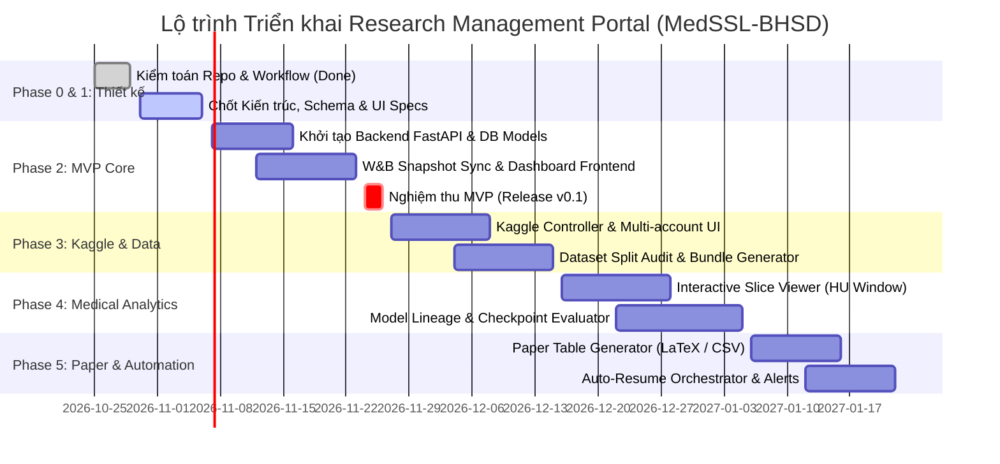

# Lộ trình Triển khai Hệ thống (Implementation Roadmap)

> Điểm bắt đầu hiện hành: [PoC-first](poc-first.md) quy định stack/phạm vi mặc định. Full stack, hosting và REST API trong tài liệu này là hướng mở rộng; không yêu cầu triển khai trước PoC.

> Cập nhật 31/10/2026: đây là thiết kế ban đầu tập trung BHSD, chưa phải chức năng đã triển khai. Đọc [review mở rộng](platform-review-2026-10-31.md) trước; review điều chỉnh repo boundary, multi-account, worker, schema và phạm vi MVP khi có khác biệt.

Tài liệu này xác định lộ trình phát triển theo giai đoạn (Phased Roadmap) cho **Research Management Portal**, phân bổ công việc thực tế, tiêu chí nghiệm thu rõ ràng và chiến lược bàn giao giá trị sớm (Fast Time-to-Value) cho nhóm nghiên cứu.

---

## 1. Tổng quan Lộ trình theo Giai đoạn



---

## 2. Chi tiết Từng Giai đoạn Phát triển

### Giai đoạn 0: Kiểm toán Mã nguồn và Quy trình (Phase 0 - Repository & Workflow Audit)
- **Trạng thái**: **ĐÃ HOÀN THÀNH** (Đối chiếu ngày 29/10/2026).
- **Phạm vi**:
  - Khảo sát mã nguồn trong `core/`, `methods/`, `training/`, `utils/`, `tools/`.
  - Kiểm toán các báo cáo điều tra lỗi thực nghiệm (`docs/analysis/run-s9i9nsui-termination-2026-10-26.md`, `docs/analysis/run-9tvq8qld-16250-2026-10-28.md`).
  - Xác minh cấu trúc lưu trữ snapshot trong `experiment_data/` và công cụ Kaggle controller `tools/kaggle/`.
- **Deliverables**: Bộ tài liệu phân tích hiện trạng và kiến trúc trong `docs/research-portal/`.

---

### Giai đoạn 1: Chuẩn hóa Yêu cầu và Kiến trúc Kỹ thuật (Phase 1 - Requirements & Architecture Freeze)
- **Thời lượng dự kiến**: 1 tuần.
- **Phạm vi**:
  - Chốt lựa chọn công nghệ: Backend **FastAPI (Python 3.10+)** + Frontend **Next.js 14/15 (TypeScript)** + Database **SQLite** (sử dụng SQLAlchemy ORM).
  - Định nghĩa chính xác cấu trúc API REST và Pydantic Schemas.
  - Thiết kế cấu trúc thư mục portal trong repository (dự kiến: `portal/backend/` và `portal/frontend/` hoặc repo độc lập liên kết qua submodule).
- **Deliverables**:
  - Bộ OpenAPI Specification (Swagger) hoàn chỉnh cho backend.
  - Database migration script ban đầu (Alembic).
- **Tiêu chí nghiệm thu (Acceptance Criteria)**:
  - Tất cả thành viên nhóm thống nhất về ranh giới dữ liệu giữa W&B và Portal Database.
  - JSON Schema kiểm định cấu hình YAML tương thích $100\%$ với `core/config_parser.py`.

---

### Giai đoạn 2: Phiên bản Tối thiểu (Phase 2 - MVP Core: Dashboard & Experiment Registry)
- **Thời lượng dự kiến**: 2.5 tuần.
- **Mục tiêu cốt lõi**: Tạo ra sản phẩm có giá trị sử dụng ngay, thay thế việc chạy script dòng lệnh `tools/compare_runs.py` và `tools/list_runs_summary.py`.
- **Phạm vi công việc**:
  1. Xây dựng dịch vụ FastAPI backend:
     - Endpoints đọc và quản lý: `ResearchMethod`, `Experiment`, `Run`.
     - Bộ chuyển đổi `WandbAdapter`: Tự động nạp dữ liệu từ các snapshot có sẵn trong `experiment_data/wandb/` và gọi `wandb.Api()` để đồng bộ run mới.
  2. Xây dựng giao diện Frontend cơ bản:
     - Trang **Centralized Dashboard**: Thẻ KPI, danh sách runs đã thực hiện, trạng thái hoàn thành.
     - Trang **Run Detail**: Biểu đồ so sánh `val/dice_positive_mean` vs `val/best_mDice_legacy`.
     - Bảng xếp hạng mô hình: Xếp hạng theo positive macro Dice.
- **Dependencies**: Môi trường Python nội bộ có `requirements-tools.txt` (`wandb`, `pandas`).
- **Deliverables**: Bản phát hành **v0.1-mvp** chạy được trên máy trạm nội bộ qua lệnh:
  ```bash
  cd portal && docker-compose up -d  # hoặc ./run_portal.sh
  ```
- **Tiêu chí nghiệm thu**:
  - Hiển thị chính xác toàn bộ 8 runs đã lưu trong `experiment_data/wandb/` (`9tvq8qld`, `s9i9nsui`...).
  - Hiển thị đúng sự khác biệt giữa peak mDice legacy (2.750) và peak positive macro (14.500) trên run `9tvq8qld`.

---

### Giai đoạn 3: Tích hợp Kaggle và Dữ liệu (Phase 3 - Kaggle Multi-Account & Dataset Management)
- **Thời lượng dự kiến**: 2.5 tuần.
- **Mục tiêu cốt lõi**: Đưa toàn bộ việc quản lý tài khoản và submit Kaggle từ CLI (`tools/kaggle/kaggle_ctl.py`) lên giao diện Web trực quan.
- **Phạm vi công việc**:
  1. Tích hợp module `tools/kaggle/accounts_manager.py` vào FastAPI Backend:
     - Giao diện quản lý danh sách tài khoản Kaggle, trạng thái token `chmod 600`.
     - Nút kiểm tra kết nối API 1-click cho từng profile.
  2. Tích hợp `notebook_builder.py` và `kaggle_executor.py`:
     - Trình tạo bundle và đẩy kernel trực tiếp từ giao diện Portal.
     - Bộ giám sát trạng thái Kernel (`QUEUED`, `RUNNING`, `COMPLETE`, `ERROR`).
     - Tự động kéo log nhanh (`kaggle_ctl log`) và hiển thị trên Web Console.
  3. Module kiểm toán tập dữ liệu:
     - Kiểm tra tính toàn vẹn của split 5-fold, đảm bảo không có rò rỉ bệnh nhân giữa các tập.
- **Deliverables**: Bản phát hành **v0.2** với khả năng điều phối Kaggle đa tài khoản.
- **Tiêu chí nghiệm thu**:
  - Người dùng có thể submit notebook lên một tài khoản Kaggle bất kỳ thông qua giao diện Web mà không cần mở terminal.
  - Log lỗi Kaggle (kể cả lỗi NCCL timeout hay Papermill crash) được hiển thị trực tiếp trên giao diện trong vòng 2 phút kể từ khi phiên kết thúc.

---

### Giai đoạn 4: Phân tích Nâng cao và Trực quan hóa Lát cắt Y tế (Phase 4 - Medical Analytics & Slice Viewer)
- **Thời lượng dự kiến**: 3 tuần.
- **Mục tiêu cốt lõi**: Xây dựng công cụ chẩn đoán hình ảnh chuyên sâu, giải quyết điểm nghẽn lớn nhất trong việc đánh giá mô hình phân đoạn tổn thương não.
- **Phạm vi công việc**:
  1. Xây dựng dịch vụ **Medical Slice API** trên FastAPI:
     - Đọc dữ liệu HDF5 từ tập validation/test (`data/dataset_bhsd.py`).
     - Áp dụng logic chuẩn hóa an toàn từ `utils/visualizer.py` (hỗ trợ `percentile` và `zscore_hu` với Window Center 40, Width 80).
     - Trả về slice mảng 2D cho lát cắt chỉ định.
  2. Xây dựng **Interactive Medical Slice Canvas** trên Frontend:
     - Slider trục Axial Z (lật lát cắt mượt mà).
     - Điều chỉnh Window/Level trực tiếp.
     - Lớp phủ phân đoạn 5 lớp đa màu sắc (EDH, IPH, IVH, SAH, SDH).
     - Lớp phủ Diagnostic Error Map (TP, FP, FN, Wrong Class).
  3. Quản lý Lineage Checkpoint:
     - Liên kết trực tiếp giữa lát cắt hiển thị với checkpoint `.pth` cụ thể.
- **Deliverables**: Bản phát hành **v0.3** với bộ công cụ phân tích y tế chuyên sâu.
- **Tiêu chí nghiệm thu**:
  - Duyệt lát cắt CT 3D với độ trễ < 50ms giữa các lát cắt.
  - Cho phép người nghiên cứu quan sát rõ ràng ca bệnh nhân bị bỏ sót tổn thương EDH (False Negative màu đỏ) tại mốc 16.000 của run `9tvq8qld`.

---

### Giai đoạn 5: Tự động hóa, Viết Paper và Báo cáo (Phase 5 - Paper Reporting & Automation)
- **Thời lượng dự kiến**: 2 tuần.
- **Mục tiêu cốt lõi**: Tối ưu hóa tối đa thời gian viết bài báo khoa học và tự động hóa khôi phục thực nghiệm.
- **Phạm vi công việc**:
  1. Trình tạo Bảng Kết quả Bài báo (**Scientific Paper Table Generator**):
     - Tổng hợp kết quả 5-fold cross validation của tất cả các phương pháp.
     - Tính tự động Mean $\pm$ Standard Deviation.
     - Xuất 1-click ra mã LaTeX (`\begin{tabular}...`) theo mẫu chuẩn IEEE/MICCAI.
  2. Kịch bản Tự động Khôi phục (**Auto-Resume Recipe Engine**):
     - Nhận diện các phiên Kaggle bị ngắt do chạm trần 9 giờ.
     - Tự động tìm checkpoint mới nhất trên W&B Cloud Artifacts, tạo bundle resume với `resume: true`, và đề xuất tài khoản Kaggle tiếp theo để chạy tiếp.
  3. Cảnh báo qua Webhook:
     - Gửi thông báo hoàn thành run hoặc lỗi nghiêm trọng qua Discord/Telegram bot (tùy chọn).
- **Deliverables**: Bản phát hành hoàn thiện **v1.0** phục vụ toàn diện chu trình nghiên cứu.
- **Tiêu chí nghiệm thu**:
  - Xuất bảng LaTeX chuẩn xác trong 1 giây, biên dịch thành công trên Overleaf mà không cần sửa lại định dạng.

---

## 3. Các Hạng mục Có thể Triển khai Song song (Parallel Tracks)

Để rút ngắn thời gian phát triển cho nhóm 2–3 người:
- **Track 1 (Backend Core & W&B/Kaggle Adapters)**: 1 kỹ sư phụ trách xây dựng FastAPI service, database models và tích hợp các module Python sẵn có (`tools/kaggle/`, `tools/fetch_wandb.py`).
- **Track 2 (Frontend Dashboard & Medical Viewer)**: 1 kỹ sư phụ trách dựng giao diện Next.js, thiết kế canvas lát cắt CT và xây dựng các biểu đồ Recharts.
- Hai track giao tiếp thông qua hợp đồng OpenAPI Specification được chốt ngay từ Giai đoạn 1.

---

## 4. Bảng Ước lượng Độ phức tạp và Nguồn lực

| Giai đoạn | Thời gian | Độ phức tạp | Nguồn lực đề xuất | Rủi ro chính |
| :--- | :---: | :---: | :--- | :--- |
| **Phase 1: Architecture Freeze** | 1 tuần | Thấp | 1 Senior Researcher | Bất đồng ý kiến về tech stack |
| **Phase 2: MVP Core** | 2.5 tuần | Trung bình | 1 Backend + 1 Frontend | W&B API rate limit khi sync nhiều runs |
| **Phase 3: Kaggle Integration** | 2.5 tuần | Trung bình | 1 Backend | Thay đổi không báo trước trong Kaggle CLI |
| **Phase 4: Medical Slice Viewer** | 3 tuần | Khá cao | 1 Frontend chuyên WebGL/Canvas + 1 Data Eng | Tối ưu hóa hiệu năng render mảng CT 3D |
| **Phase 5: Paper & Automation** | 2 tuần | Thấp - Trung bình | 1 Fullstack | Định dạng bảng LaTeX không khớp hội nghị |
| **TỔNG CỘNG** | **11 tuần (~2.5 tháng)** | — | **Nhóm 2 người** | — |

