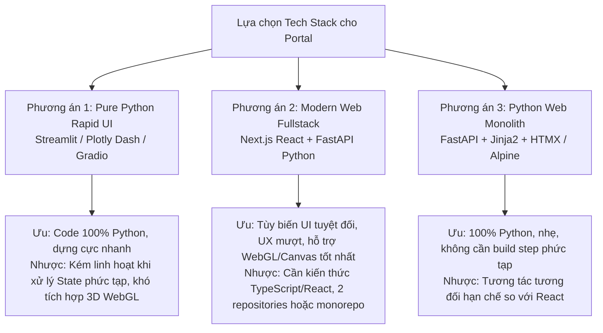
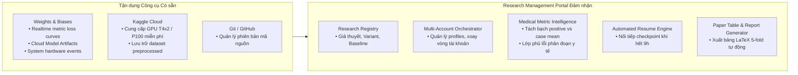

# Khảo sát và Phân tích Các Giải pháp Hiện có (Solution Landscape)

Tài liệu này đánh giá toàn diện các công cụ, thư viện, nền tảng mã nguồn mở và thương mại có liên quan đến việc quản lý nghiên cứu học máy y tế, theo dõi thí nghiệm, trực quan hóa ảnh 3D và điều phối thực thi.

Mục tiêu là xác định rõ:
1. Những chức năng nào nên **tận dụng tối đa từ các công cụ sẵn có**.
2. Những chức năng nào là **khoảng trống thực sự (Critical Gaps)** mà nhóm nghiên cứu cần xây dựng trong **Research Management Portal**.

---

## 1. Phân tích Các Nền tảng Experiment Tracking & Model Registry

| Tiêu chí | Weights & Biases (W&B) | MLflow | ClearML | Aim |
| :--- | :--- | :--- | :--- | :--- |
| **Bản quyền & Mô hình** | SaaS (Free academic tier) / Self-hosted Enterprise | Hoàn toàn Open-source (Apache 2.0) | Open-source Core / Cloud SaaS | Hoàn toàn Open-source (Apache 2.0) |
| **Hiện trạng trong Repo** | **Đã tích hợp sâu** (`wandb_manager.py`, snapshot crawler, dashboards) | Chưa tích hợp | Chưa tích hợp | Chưa tích hợp |
| **Theo dõi Metrics & Loss Curves** | Cực mạnh, real-time, giao diện tùy biến linh hoạt | Tốt, giao diện cơ bản | Rất mạnh, hỗ trợ nhiều loại log | Tốt, giao diện tập trung so sánh |
| **Artifact & Checkpoint Tracking** | Rất tốt (W&B Artifacts với versioning, lineage) | Tốt (MLflow Models, Artifacts) | Rất tốt (Model storage, versioning) | Cơ bản (chỉ metadata) |
| **Kaggle Notebook Integration** | Tự nhiên, hoạt động tốt qua `WANDB_API_KEY` | Cần cấu hình server public (ngrok / remote server) | Cần cấu hình server public | Cần cấu hình server public |
| **Hỗ trợ Quản lý Giả thuyết & Tri thức** | Hạn chế (chỉ có W&B Reports dạng ghi chú) | Không có | Hạn chế | Không có |
| **Trực quan hóa CT 3D chuyên sâu** | Ảnh tĩnh 2D / Gallery cơ bản (không có HU window tương tác) | Ảnh tĩnh cơ bản | Ảnh tĩnh cơ bản | Ảnh tĩnh cơ bản |
| **Quản lý Đa tài khoản Kaggle** | Không hỗ trợ | Không hỗ trợ | Không hỗ trợ | Không hỗ trợ |

### Đánh giá chuyên sâu:
- **Weights & Biases (W&B)**: Là dịch vụ xuất sắc nhất cho việc ghi nhận chuỗi thời gian (time-series loss, learning rate, GPU memory events). Dự án `MedSSL-BHSD` đã xây dựng sẵn module `utils/wandb_manager.py` với tính năng auto-resume cho preemptible instances và `tools/setup_wandb_dashboard.py` tạo workspace views chuẩn hóa. **Khuyến nghị: Giữ W&B làm Time-Series Metric & Cloud Artifact Engine cốt lõi; không tự viết lại phần này.**
- **MLflow / ClearML / Aim**: Đều yêu cầu duy trì một máy chủ backend công khai (Public IP/Domain) để các Kaggle container có thể gửi dữ liệu về trong suốt 9 giờ chạy. Việc cấu hình và bảo trì máy chủ này tạo thêm gánh nặng hạ tầng lớn cho một nhóm nghiên cứu nhỏ mà không mang lại giá trị vượt trội so với W&B SaaS miễn phí cho học thuật.

---

## 2. Phân tích Công nghệ Xây dựng Portal UI & Backend

Khi quyết định xây dựng Portal, có ba trường phái công nghệ chính:

### So sánh chi tiết các Framework:

| Tiêu chí | Streamlit | Plotly Dash | Next.js (React) + FastAPI | FastAPI + Jinja2/HTMX |
| :--- | :--- | :--- | :--- | :--- |
| **Ngôn ngữ phát triển** | Pure Python | Pure Python | TypeScript (FE) + Python (BE) | Pure Python + HTML/JS nhẹ |
| **Tốc độ làm MVP ban đầu** | **Cực nhanh (1 - 2 tuần)** | Nhanh (2 - 3 tuần) | Trung bình (3 - 4 tuần) | Nhanh (2 tuần) |
| **Khả năng tùy biến giao diện** | Thấp (Bị gò bó theo component layout của Streamlit) | Trung bình (Tùy biến CSS khá tốt) | **Tối đa (Không giới hạn, thiết kế theo Figma)** | Cao |
| **Tích hợp logic dự án sẵn có** | Trực tiếp (`import core.*`, `import tools.*`) | Trực tiếp | Trực tiếp qua REST API FastAPI | Trực tiếp |
| **Xử lý tác vụ nền (Async Background Sync)** | Kém (Mỗi tương tác reload script từ đầu) | Khá (Dựa trên Celery/Flask) | **Xuất sắc (FastAPI BackgroundTasks / Celery)** | **Xuất sắc (FastAPI BackgroundTasks)** |
| **Hiển thị ảnh y tế tương tác (Windowing, Slices)** | Chậm (Phải re-render ảnh trên server rồi gửi lại browser) | Trung bình | **Rất nhanh (Canvas/WebGL xử lý trực tiếp trên browser)** | Khá (Canvas với API endpoint) |
| **Khả năng mở rộng dài hạn** | Khó bảo trì khi ứng dụng lớn | Trung bình | **Rất cao (Kiến trúc phân tầng chuẩn doanh nghiệp)** | Khá |

### Đánh giá chuyên sâu:
- **Streamlit**: Phù hợp cho công cụ phân tích dữ liệu nhanh nội bộ (Ad-hoc data exploration), nhưng khi ứng dụng mở rộng sang quản lý tài khoản Kaggle, hàng đợi bất đồng bộ, và trình hiển thị lát cắt y tế mượt mà, vòng đời execution của Streamlit (rerun toàn bộ script mỗi khi thay đổi state) gây ra độ trễ lớn và trải nghiệm giật lag.
- **FastAPI Backend + Next.js Frontend (hoặc FastAPI + HTMX)**: Là kiến trúc cân bằng lý tưởng nhất.
  - Backend **FastAPI** khai thác toàn bộ thư viện Python của repo (`torch`, `h5py`, `wandb`, `tools.kaggle.*`), xử lý background sync qua task runner.
  - Frontend cung cấp trải nghiệm chuyên nghiệp, hiển thị lát cắt CT 3D mượt mà trên browser.

---

## 3. Khảo sát Các Thư viện Trực quan hóa Ảnh Y tế (Medical Image Visualizers)

Bài toán của dự án là hiển thị ảnh cắt lớp vi tính sọ não 3D (kích thước gốc hoặc patch $32 \times 192 \times 192$), nhãn ground-truth và dự đoán đa lớp.

| Thư viện | Cơ chế hoạt động | Định dạng hỗ trợ | HU Windowing tương tác | Trực quan hóa Error Map | Nhận định tính khả thi |
| :--- | :--- | :--- | :---: | :---: | :--- |
| **NiiVue** | WebGL 2.0 (Client-side) | NIfTI (`.nii.gz`), DICOM | Có sẵn (Rất mượt) | Hỗ trợ nhiều lớp layer overlay | **Rất tiềm năng** cho 3D volume chuyên sâu |
| **Cornerstone.js / OHIF Viewer** | HTML5 Canvas / WebGL | DICOM WADO, NIfTI | Chuẩn công nghiệp y tế | Phức tạp khi cấu hình custom colormap | Quá nặng nề cho nhu cầu nghiên cứu AI |
| **Papaya / Itk-vtk-viewer** | WebGL / Canvas | NIfTI, DICOM, VTK | Có | Hạn chế | Thư viện cũ, ít bảo trì |
| **Custom Canvas 2D + Python Slice API** | HTML5 Canvas 2D / SVG | Slice PNG/Float32 Array từ H5 | Linh hoạt qua Shader hoặc API | **Hoàn toàn chủ động** theo `utils/visualizer.py` | **Khuyến nghị cho MVP** (Đơn giản, tin cậy tuyệt đối) |

### Đánh giá chuyên sâu:
- Hiện tại, repository lưu trữ dữ liệu dưới định dạng **HDF5** (`.h5`), chứa các mảng tensor đã chuẩn hóa, cùng metadata `norm_params`, `clip_range`, `target_spacing` (đối chiếu `docs/guides/validation-visualization.md`).
- Các viewer chuẩn DICOM như OHIF/Cornerstone đòi hỏi phải chuyển đổi dữ liệu ngược về DICOM hoặc NIfTI với header hình học đầy đủ, gây tốn kém thời gian và dung lượng đĩa.
- **Phương án tối ưu**:
  - Giai đoạn MVP: Xây dựng **Custom Interactive Slice Viewer** bằng HTML5 Canvas trên Frontend, kết hợp API cắt lát từ FastAPI Backend. Backend tái sử dụng logic chuẩn hóa an toàn từ `utils/visualizer.py` (chế độ `percentile` hoặc `zscore_hu`).
  - Giai đoạn nâng cao: Tích hợp **NiiVue** khi nghiên cứu cần dựng hình 3D thể tích (Volume Rendering) hoặc Multi-Planar Reconstruction (MPR: Axial, Coronal, Sagittal).

---

## 4. Phân tích Khả năng Tự động hóa và Giới hạn Kỹ thuật của Kaggle

Để tránh thiết kế những tính năng không khả thi trên thực tế, cần phân tích chi tiết giới hạn API và CLI của Kaggle:

| Thao tác | Hỗ trợ qua API/CLI | Cơ chế thực hiện trong Repo | Giới hạn thực tế & Rủi ro |
| :--- | :---: | :--- | :--- |
| **Liệt kê Notebooks** | Có | `kaggle kernels list` | Chỉ trả về metadata cơ bản, không có tiến độ chi tiết |
| **Đẩy Code (Push Kernel)** | Có | `tools/kaggle/kaggle_ctl.py push` | Tạo phiên bản mới và tự động kích hoạt thực thi ngầm trên máy chủ Kaggle |
| **Kiểm tra Trạng thái** | Có | `kaggle kernels status <slug>` | Chỉ trả về: `QUEUED`, `RUNNING`, `COMPLETE`, `ERROR`, `CANCEL_ACKNOWLEDGED` |
| **Kéo Log đầu ra** | Có | `tools/kaggle/kaggle_ctl.py log` | Kaggle gộp stdout và stderr thành một file text. Khi crash nghiêm trọng, log có thể bị cắt bớt phần đuôi |
| **Tải Checkpoints / Output** | Có | `kaggle kernels output <slug>` | Tải toàn bộ file trong `/kaggle/working`. Tốc độ phụ thuộc băng thông mạng và dung lượng checkpoint |
| **Dừng Kernel (Stop / Cancel)** | **Không chính thức** | Kaggle web UI hoặc CLI undocumented | Kaggle CLI chính thức không có lệnh `cancel` ổn định trên mọi phiên bản CLI |
| **Đọc GPU Telemetry Realtime** | **Không qua Kaggle API** | Gián tiếp qua W&B System Events | Kaggle API không cung cấp metric VRAM/GPU temp. Phải dựa vào W&B background agent chạy bên trong notebook |
| **Tự động Resume khi chạm 9h** | Bán tự động | Cần Portal orchestration | Kaggle không hỗ trợ scheduler tự động xâu chuỗi. Portal phải phát hiện trạng thái hoàn thành/dừng và kích hoạt lệnh push mới |

### Kết luận quan trọng về Kaggle:
Portal **KHÔNG THỂ** điều khiển trực tiếp container Kaggle như một máy ảo SSH. Mọi tương tác phải diễn ra theo chu trình:
$$\text{Build Bundle} \longrightarrow \text{Push via Kaggle CLI} \longrightarrow \text{Poll Status \& Sync W&B} \longrightarrow \text{Fetch Output Log / Checkpoint}$$

---

## 5. Bảng Phân định Trách nhiệm (Responsibility Matrix)

Bảng này làm rõ ranh giới: Cái gì tận dụng từ công cụ có sẵn, cái gì Portal bắt buộc phải đảm nhận.

| Nhu cầu nghiệp vụ | Công cụ sẵn có đáp ứng | Khoảng trống cần Portal giải quyết |
| :--- | :--- | :--- |
| **Loss curves, learning rate, GPU memory** | W&B Workspace | Không cần làm lại. Portal chỉ hiển thị tóm tắt và cung cấp link trực tiếp đến W&B. |
| **Lưu trữ model checkpoint cloud** | W&B Artifacts | Portal theo dõi lineage: Model nào thuộc về Run nào, sinh ra từ Commit nào, ứng với Fold nào. |
| **Chạy tính toán GPU song song** | Kaggle GPU Cloud | Portal quản lý việc phân bổ tài khoản (`profile_1`, `profile_2`), kiểm tra token hợp lệ và đóng gói bundle. |
| **Đánh giá tổn thương hiếm & ca âm tính** | Không có công cụ nào có sẵn | **Portal xây dựng riêng**: Bảng tra cứu `dice_positive_mean`, `negative_fp_case_rate` theo chuẩn `MedSSL-BHSD`. |
| **Khảo sát trực quan lát cắt CT tổn thương** | W&B chỉ có ảnh tĩnh | **Portal xây dựng riêng**: Interactive Slice Viewer với HU Windowing (Não/Xương/Subdural) và Colormaps. |
| **So sánh nhiều phương pháp SSL** | W&B cho phép overlay run | **Portal xây dựng riêng**: Bảng so sánh khoa học cố định theo fold, tính Mean ± Std và xuất bảng LaTeX cho bài báo. |

