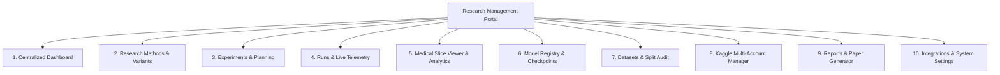

# Thiết kế Trải nghiệm Người dùng và Giao diện (UI/UX Design)

> Cập nhật 31/10/2026: đây là thiết kế ban đầu tập trung BHSD, chưa phải chức năng đã triển khai. Đọc [review mở rộng](platform-review-2026-10-31.md) trước; review điều chỉnh repo boundary, multi-account, worker, schema và phạm vi MVP khi có khác biệt.

Tài liệu này xác định kiến trúc thông tin (Sitemap), thiết kế chi tiết từng trang màn hình, quy ước trạng thái giao diện và đặc tả kỹ thuật cho **Interactive Medical Slice Viewer** trong **Research Management Portal**.

---

## 1. Cấu trúc Điều hướng và Sơ đồ Trang (Sitemap)

Giao diện Portal được thiết kế theo phong cách hiện đại, tối giản và tập trung vào dữ liệu nghiên cứu khoa học (Clean Scientific Dashboard):



### Thanh điều hướng chính (Top Navigation & Sidebar):
- **Header**: Hiển thị Project (`MedSSL-BHSD`), Branch/Git Commit (`main: 8d750d7...`), Trạng thái kết nối W&B (Chấm xanh: Connected), và Tổng số jobs Kaggle đang chạy (Badge).
- **Sidebar cố định bên trái**: Các biểu tượng và tiêu đề cho 10 màn hình chức năng.

---

## 2. Đặc tả Chi tiết Các Màn hình Chức năng

### 2.1. Centralized Dashboard (Trang Tổng quan)
- **Mục đích**: Cung cấp bức tranh toàn cảnh về tiến độ nghiên cứu, hiệu năng các phương pháp và sức khỏe hệ thống.
- **Thành phần chính**:
  - *Metric KPI Cards*:
    - Best Positive Macro Dice hiện tại (Kèm tên method & run ID).
    - Tổng số GPU Hours đã tiêu thụ trong tuần trên toàn bộ tài khoản Kaggle.
    - Số lượng Runs thành công / Tổng số runs đã thực thi.
  - *Active Running Jobs*: Bảng mini các job đang chạy trên Kaggle (Account, Kernel slug, Iteration hiện tại, Elapsed time / 9h limit, Nút kéo log nhanh).
  - *Comparative Radar Chart*: So sánh 5 phương pháp (Supervised, MT, PICK, CPS, BCP) trên 5 lớp xuất huyết.
  - *System Alert Feed*: Cảnh báo kernel chạm ngưỡng 8h30m, cảnh báo RAM vượt $90\%$, hoặc cảnh báo run không có tiến triển telemetry.
- **Trạng thái**:
  - *Empty State*: Nếu chưa có run nào, hiển thị nút bấm nổi bật: *"Khởi tạo Thí nghiệm Đầu tiên"*.
  - *Stale Data Warning*: Hiển thị banner vàng nếu lần đồng bộ W&B gần nhất cách đây hơn 30 phút.

### 2.2. Research Methods & Hypotheses (Quản lý Phương pháp)
- **Mục đích**: Quản lý danh mục các phương pháp SSL, bài báo tham khảo và các giả thuyết đang kiểm chứng.
- **Thành phần chính**:
  - *Method Cards*: Mỗi card đại diện cho một phương pháp (Mean Teacher, PICK, CPS...):
    - Tên phương pháp, Phân loại, Link bài báo gốc, Tác giả, Năm xuất bản.
    - Badge trạng thái: `Active Investigation`, `Baseline Established`, `Deprecated`.
    - Thống kê: Số lượng runs đã thực hiện, Best Positive Dice đạt được.
  - *Hypothesis Board*: Bảng Kanban phân loại các câu hỏi nghiên cứu:
    - `Cần kiểm chứng` $\rightarrow$ `Đang chạy thí nghiệm` $\rightarrow$ `Đã xác nhận (Verified)` $\rightarrow$ `Bị bác bỏ (Falsified)`.
- **Thao tác chính**: Thêm phương pháp mới, thêm biến thể (Variant), liên kết bài báo.

### 2.3. Experiments & Planning (Kế hoạch & Ma trận Thực nghiệm)
- **Mục đích**: Thiết kế ma trận thực nghiệm và quản lý hàng đợi trước khi đưa lên Kaggle.
- **Thành phần chính**:
  - *Experiment Matrix Builder*: Cho phép chọn tổ hợp:
    - Methods: [x] Supervised, [x] Mean Teacher, [x] PICK
    - Folds: [x] Fold 0, [x] Fold 1, [ ] Fold 2...
    - Labeled Ratios: [x] 10% (15 ca), [x] 20% (30 ca), [x] 100% (154 ca)
    - Seeds: `1337`, `42`, `2026`
    - Tự động sinh danh sách hàng đợi $N$ runs tương ứng.
  - *Validation Guard*: Tự động kiểm tra xung đột cấu hình hoặc thí nghiệm trùng lặp.

### 2.4. Runs & Live Telemetry (Quản lý Phiên Huấn luyện)
- **Mục đích**: Theo dõi chi tiết từng lần chạy, phân tích đường cong hội tụ và chẩn đoán lỗi.
- **Thành phần chính**:
  - *Bộ lọc đa năng*: Lọc theo Method, Fold, Trạng thái (`RUNNING`, `COMPLETED`, `FAILED`), Tài khoản Kaggle, Tags.
  - *Run Detail View*:
    - **Tab 1: Learning Trajectory**: Biểu đồ tương tác so sánh `val/dice_positive_mean` vs `val/best_mDice_legacy` qua các iteration; Biểu đồ Supervised Loss vs Consistency Loss.
    - **Tab 2: Per-Class Convergence**: 5 đường cong riêng biệt cho EDH, IPH, IVH, SAH, SDH.
    - **Tab 3: Hardware & Telemetry**: Biểu đồ RAM hệ thống, GPU Allocated Memory, và timeline các sự kiện.
    - **Tab 4: Raw Logs**: Trình đọc log thông minh, tự động tô màu (Syntax Highlighting) cho các cảnh báo, checkpoint lưu, và thông báo lỗi.
    - **Tab 5: Config Diff**: So sánh cấu hình run này với baseline hoặc run trước bằng giao diện side-by-side diff.
- **Thao tác nguy hiểm**: Nút *"Cancel Run trên Kaggle"* hoặc *"Xóa Run"* yêu cầu modal xác nhận gõ lại tên Run ID.

### 2.5. Medical Slice Viewer & Analytics (Trực quan hóa Lát cắt CT Y tế)
- **Mục đích**: Đánh giá định tính chất lượng phân đoạn mô hình trên từng ca bệnh nhân và từng lát cắt giải phẫu.
- *(Xem đặc tả chi tiết ở Mục 3 dưới đây)*.

### 2.6. Model Registry & Checkpoints
- **Mục đích**: Quản lý phiên bản checkpoint, phục vụ đánh giá benchmark và tái sử dụng cho các giai đoạn tiếp theo.
- **Thành phần chính**:
  - Danh sách Checkpoint: Model name, Architecture (`nnunet3d`), Checkpoint type (`best_positive` vs `latest`), Iteration, Dung lượng file, Vị trí lưu trữ.
  - Nút tải trực tiếp từ W&B Artifacts về máy chủ nội bộ.
  - Nút đánh giá độc lập: Kích hoạt `evaluate.py` với cấu hình sliding-window và surface metrics trên tập test.

### 2.7. Kaggle Multi-Account Manager
- **Mục đích**: Giám sát và điều khiển các tài khoản Kaggle mà nhóm nghiên cứu đang sử dụng.
- **Thành phần chính**:
  - Danh sách Profile: Tên hiển thị, Username, Trạng thái file `kaggle.json` (`Configured / Chmod 600`), Số giờ GPU đã sử dụng trong tuần.
  - Nút bấm *"Kiểm tra Kết nối (Test Connection)"*: Chạy lệnh kiểm tra API tức thời mà không đẩy code.
  - Danh sách Bundle đã đóng gói cục bộ trong `kaggle_runs/`.

### 2.8. Reports & Paper Table Generator (Trình tạo Báo cáo Viết Paper)
- **Mục đích**: Tự động tổng hợp số liệu thực nghiệm thành bảng biểu chuẩn khoa học, loại bỏ hoàn toàn việc copy-paste thủ công dễ nhầm lẫn.
- **Thành phần chính**:
  - Chọn bài toán: Multiclass 5-class hay Binary.
  - Chọn các phương pháp cần so sánh: Supervised, Mean Teacher, PICK, CPS, nnU-Net.
  - Tùy chọn hiển thị: Mean ± Std qua các fold; Tách bạch `Dice Positive Mean`, `Precision`, `Recall`, `HD95 (mm)`.
  - Bộ xuất 1-click (1-Click Export):
    - **Nút "Copy LaTeX"**: Sinh mã `\begin{table}...\end{table}` có định dạng `booktabs` sẵn sàng dán vào Overleaf.
    - **Nút "Export Markdown"**: Xuất bảng markdown lưu vào `docs/results/`.
    - **Nút "Export CSV"**: Xuất tệp dữ liệu thô phục vụ vẽ đồ thị trên Prism hoặc Python Seaborn.

---

## 3. Đặc tả Kỹ thuật: Interactive Medical Slice Viewer

Đây là thành phần giao diện quan trọng nhất phục vụ việc đánh giá chất lượng lâm sàng của mô hình phân đoạn tổn thương CT sọ não.

```mermaid
graph LR
    subgraph Controls["Bảng Điều khiển (Sidebar Controls)"]
        C1[Chọn Bệnh nhân / Case ID]
        C2[Slider Trục Axial Z: Lát cắt 0 .. 31]
        C3[HU Window Presets:<br/>• Não / Máu: C=40, W=80<br/>• Xương sọ: C=400, W=1000<br/>• Dưới màng cứng: C=75, W=150<br/>• Percentile Range: 1% - 99%]
        C4[Lớp hiển thị Overlay:<br/>• [x] Ảnh CT gốc<br/>• [x] Ground Truth<br/>• [x] Prediction Model<br/>• [x] Diagnostic Error Map]
        C5[Lọc Lớp Tổn thương:<br/>• [x] EDH  • [x] IPH  • [x] IVH<br/>• [x] SAH  • [x] SDH]
    end

    subgraph Viewport["Khung Trình chiếu (Canvas Viewport)"]
        V1["Panel 1: CT Gốc (HU Windowed)"]
        V2["Panel 2: Ground Truth Overlay"]
        V3["Panel 3: Prediction Overlay"]
        V4["Panel 4: Error Map (TP / FP / FN / Wrong)"]
    end

    Controls --> Viewport
```

### 3.1. Quy ước Màu sắc và Bảng màu Phân đoạn
Tuân thủ nghiêm ngặt quy ước của dự án đã được định nghĩa trong `utils/visualizer.py`:

| Lớp Tổn thương (Class) | Màu sắc (RGB) | Tên hiển thị | Ý nghĩa Lâm sàng |
| :--- | :---: | :--- | :--- |
| **0: Background** | Trong suốt | Nền mô não bình thường | Không hiển thị overlay |
| **1: EDH (Epidural)** | `rgb(230, 25, 75)` - Đỏ | Xuất huyết Ngoài màng cứng | Lớp tổn thương hiếm, hình thấu kính hai mặt lồi |
| **2: IPH (Intraparenchymal)** | `rgb(60, 180, 75)` - Xanh lục | Xuất huyết Nhu mô não | Khối máu tụ trong nhu mô |
| **3: IVH (Intraventricular)** | `rgb(255, 225, 25)` - Vàng | Xuất huyết Não thất | Máu tràn vào hệ thống não thất |
| **4: SAH (Subarachnoid)** | `rgb(145, 30, 180)` - Tím | Xuất huyết Dưới nhện | Máu len lỏi vào các rãnh cuộn não |
| **5: SDH (Subdural)** | `rgb(245, 130, 48)` - Cam | Xuất huyết Dưới màng cứng | Khối máu hình liềm dọc vòm sọ |

### 3.2. Bảng màu Bản đồ Lỗi Chẩn đoán (Diagnostic Error Map)
Màn hình Error Map cho phép người nghiên cứu nhìn thấy ngay mô hình đang sai ở đâu mà không cần đối chiếu bằng mắt:
- **True Positive (TP)**: `rgb(40, 200, 80)` (Xanh lục nhạt) - Mô hình nhận diện chính xác tổn thương.
- **False Negative (FN)**: `rgb(230, 40, 40)` (Đỏ đậm) - Mô hình **bỏ sót tổn thương** (Cực kỳ nguy hiểm trong y tế).
- **False Positive (FP)**: `rgb(255, 210, 30)` (Vàng cam) - Mô hình chẩn đoán nhầm mô lành thành tổn thương.
- **Wrong Class**: `rgb(220, 40, 220)` (Hồng tím) - Mô hình phát hiện có xuất huyết nhưng gán sai loại xuất huyết (ví dụ: nhầm SDH thành EDH).

### 3.3. Tương tác Người dùng trên Slice Viewer
- **Cuộn chuột (Mouse Wheel)**: Tăng/giảm nhanh chỉ số lát cắt Z để duyệt nhanh thể tích sọ não như phần mềm PACS chuyên dụng của bác sĩ chẩn đoán hình ảnh.
- **Kéo chuột phải (Right Click + Drag)**: Điều chỉnh động Window Center và Window Width.
- **Phóng to / Thu nhỏ (Pinch to Zoom / Ctrl + Wheel)**: Phóng to vào vùng xuất huyết nhỏ để kiểm tra độ mịn của đường biên phân đoạn.
- **Thanh trượt Opacity (0% - 100%)**: Điều chỉnh độ trong suốt của mặt nạ phân đoạn đè lên ảnh CT mô não.

---

## 4. Xử lý Trạng thái Giao diện và Phản hồi Người dùng (State UX)

| Trạng thái | Hành vi Giao diện | Thông điệp / Phản hồi |
| :--- | :--- | :--- |
| **Loading** | Skeleton Shimmer trên các thẻ metric và bảng biểu | Hiển thị loader nhẹ, không làm giật layout |
| **Empty** | Hình minh họa trực quan kèm nút hành động rõ ràng | *"Chưa có dữ liệu cho fold này. Hãy nạp file cấu hình hoặc kích hoạt đồng bộ."* |
| **Error (Mất mạng)** | Banner cảnh báo đầu trang | *"Không thể kết nối đến W&B / Kaggle API. Hệ thống đang chuyển sang chế độ dữ liệu ngoại tuyến (Offline Snapshot)."* |
| **Action Confirmation** | Modal xác nhận với cảnh báo đỏ | *"Thao tác này sẽ gửi lệnh Push Kernel lên Kaggle với tài khoản [username], tiêu tốn khoảng 9 giờ hạn mức GPU. Bạn có chắc chắn muốn thực hiện?"* |
| **Success Feedback** | Toast notification ở góc dưới bên phải | *"Đã sao chép bảng LaTeX vào clipboard thành công!"* hoặc *"Đã submit notebook lên Kaggle thành công."* |

